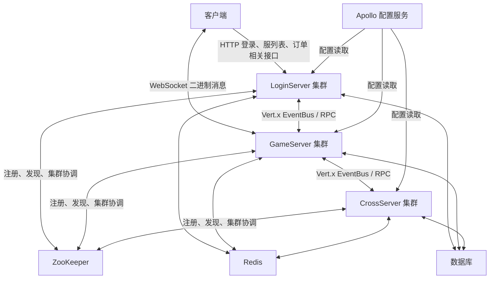
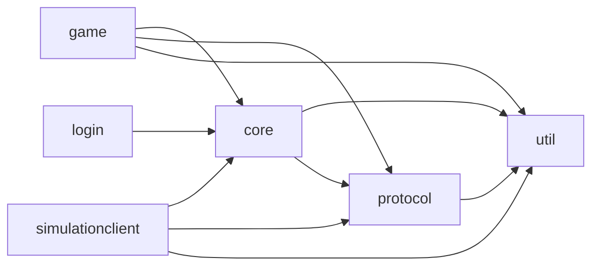
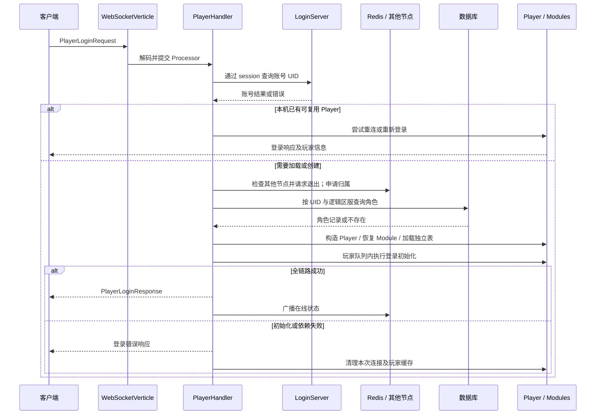
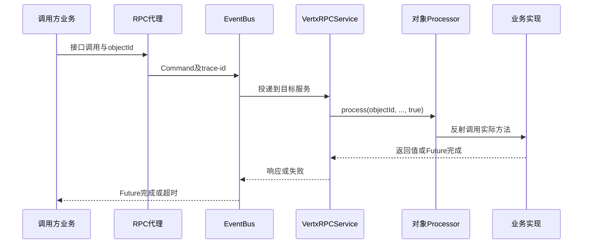
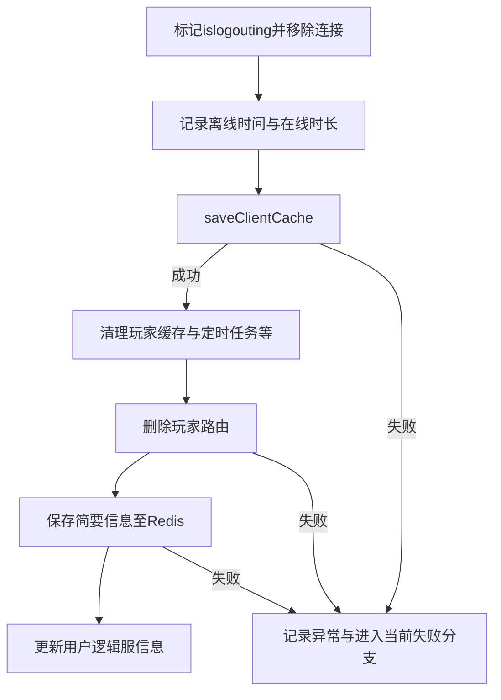
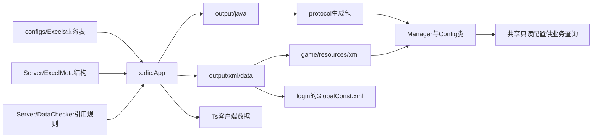

# 游戏服务器系统架构设计全景文档

> 文档版本：v3.1
>
> 核对日期：2026-10-23
>
> 读者：服务端研发、架构维护、测试与运维人员
>
> 配套文档：[开发流程与研发规范手册](02_开发流程与研发规范手册.md)

本文描述当前游戏服务端的模块、运行节点、关键链路、数据归属和故障边界，为后续优化提供可核查的基线。当前架构以 Java 21、Vert.x 集群、按实体 ID 串行的邮箱、玩家模块聚合存储及独立业务表为核心。串行执行、分布式路由和定时保存各解决不同问题，不能合并理解为全局事务或零数据丢失保证。

本文是 `doc/` 中系统架构主题的唯一主文档。[system_architecture_spec.md](system_architecture_spec.md) 保留为旧入口的迁移说明与章节索引，后续架构事实和优化方案统一更新在本文；开发步骤与工程规范统一维护在配套的 02 文档中。

## 0. 阅读方式与事实来源

### 0.1 三类内容

- **当前实现**：从工作树源码、生成类、构建文件和脚本核实的行为；关键章节提供入口链接。
- **开发约束**：来自项目根 [AGENTS.md](../AGENTS.md)、[coding-style.md](../.ai-workspace/context/coding-style.md) 及领域规范，约束新增或直接修改的实现。历史代码不一定全部符合这些规则。
- **优化候选**：尚需测量、设计或演练的改进，集中在第 13 节；不表示已经上线，也不承诺未经测量的收益。

源码核对基于宿主工作树（HEAD `eaaeab57`）及 protocol 工作树（HEAD `95bd316`）。提交号用于定位背景，运行部署版本仍须另行核实。配置生成规则采用 [配置表 AI 编码规范](../../dic_generate/配置表AI编码规范.md)；该规范记录了生成器源码核对版本，但没有证明部署中的 Gen.jar 与源码完全一致。

旧 Word 文档与 [架构描述.md](架构描述.md) 是历史背景，其中 DataServer、MINA、固定 EventLoop 业务线程等描述不能直接作为当前运行事实。部分 context 的旧示例仍有漂移，例如配置数组分隔符、Manager 通用方法和“批量资源操作原子性”；遇到冲突先核对当前实现和最新专项规则，不为符合旧文字改动正确代码。

### 0.2 阅读导航

| 主题 | 章节 |
|---|---|
| 系统边界与模块 | 第 1～2 节 |
| 节点启动、登录、重连 | 第 3～4 节 |
| 邮箱、线程与阻塞 | 第 5 节 |
| 网络协议与 RPC | 第 6～7 节 |
| 数据所有权、存储与退出 | 第 8～9 节 |
| 配置与业务扩展 | 第 10～11 节 |
| 观测、发布与优化 | 第 12～13 节 |

## 1. 系统总体结构

### 1.1 逻辑拓扑



图中是服务职责和依赖，不表示全部节点使用同一个物理数据库、同一 Redis 部署或同一连接池。数据库实例、分片方式、中间件高可用形态和真实端口取决于环境配置。历史资料提及 TDSQL、ShardingSphere；本地 MySQL 环境不能证明生产仍使用其中任一种方案。

### 1.2 三类主要节点

| 节点 | 当前职责 | 状态与扩展边界 | 主入口 |
|---|---|---|---|
| LoginServer | HTTP 登录和账号校验、服务器列表、订单及支付相关接口、运营接口 | 不持有完整在线 Player 聚合，但有本地管理器和缓存；扩容仍依赖共享会话、缓存一致性及入口路由 | [LoginServer](../login/src/main/java/cn/game/login/LoginServer.java)、[RestServer](../login/src/main/java/cn/game/login/RestServer.java) |
| GameServer | WebSocket 接入、玩家生命周期、主要玩法、玩家内存状态与保存 | 有状态；在线玩家与当前节点、连接和邮箱关联。扩容不自动迁移既有在线对象 | [GameServer](../game/src/main/java/cn/game/games/net/game/GameServer.java) |
| CrossServer | 公会等共享对象、跨节点业务接口及相关服务 | 有状态共享对象由特定节点管理；需要对象路由、装载和失败接管 | [CrossServer](../game/src/main/java/cn/game/games/net/cross/CrossServer.java) |

CrossServer 的已核实主链是公会装载和管理。不能仅因为某玩法叫“跨服”，就认定竞技场、世界 Boss、聊天等所有实现都在 CrossServer；新增功能需沿具体 Handler、Service 和远程接口确认归属。

### 1.3 物理节点与逻辑区服

“服务器 ID”在不同上下文中有不同含义，设计和日志必须区分：

| 标识 | 含义与来源 | 使用场景 |
|---|---|---|
| 物理节点 ID | `ServerContext.getServerId()`，启动时解析的进程身份 | EventBus 寻址、节点注册、对象所在节点 |
| 节点类型 | `ServerType.Game/Login/Cross` | 服务发现、按类型投递、Leader 选举分组 |
| 逻辑区服 ID | `VirtualServerConfig`、`VirtualServerRegistry`、账号/角色数据中的区服字段 | 选服、开服时间、角色查询、业务隔离 |
| 账号 UID | 登录服务确认的账号标识 | 账号身份及按账号查找角色 |
| playerId | 角色标识 | Player、玩家邮箱、角色数据主键和对象路由 |
| guildId 等对象 ID | 共享业务对象标识 | 公会路由及该对象的串行处理 |

[VirtualServerRegistry](../core/src/main/java/cn/game/core/base/VirtualServerRegistry.java) 使用 ZooKeeper 保存逻辑服视图，并提供本地缓存、监听和更新能力。当前基础路径是 `/server/login/game/virtual-servers`，还要结合 Curator namespace 理解最终路径。

角色查找使用 `selectByUkUidServerid(uid, serverId)`；对应唯一键变更可见 [update.sql](../game/src/main/resources/sql/update.sql)。账号、逻辑服和角色不是一一等价的概念。玩家路由键中的节点 ID 也不能替代玩家所属逻辑区服。

## 2. 工程模块与职责边界

根 [pom.xml](../pom.xml) 聚合六个 Maven 模块，Java release 为 21，Vert.x 版本属性为 5.0.4。数据库驱动、Spring、MyBatis、Redisson 等具体依赖版本以 POM 为准，不从环境软件版本反推依赖版本。



箭头表示主要内部依赖，省略 parent 继承和第三方依赖；精确直接依赖以各模块 POM 为准。Maven 聚合、代码依赖和 Git 仓库归属是不同维度：protocol 在本机有独立仓库，不能把它当作宿主仓库的普通目录交付。

| 模块 | 主要内容 | 扩展约束 |
|---|---|---|
| util | 时间、随机、序列化、Redis/Apollo 工具、文件监听等 | 不依赖 game 中的玩家业务；修改公共行为需评估调用范围 |
| protocol | proto、Protobuf 产物、配置 Config/Manager/枚举、协议生成器 | 生成资产从真源变更；不承载玩家请求级可变状态 |
| core | 邮箱执行、网络分发、RPC、集群/缓存、调度、公共条件支撑 | 面向多个业务复用；不能为单功能顺手改变通用契约 |
| game | GameServer 与 CrossServer、Handler/Module/Helper、Mapper、玩家和公会数据 | 业务状态遵循实体归属和保存契约 |
| login | HTTP 登录、服务列表、支付订单及运营相关接口 | 核查身份和外部回调，明确共享状态及幂等语义 |
| simulationclient | 协议模拟、带 main 的场景、压测相关代码 | 不等同于 Maven 自动发现的 JUnit 测试 |

普通业务分层为 Handler → Module/Helper → 公共资源、配置、事件、存储能力。Handler 通常是 Spring 单例，不能把当前 Player、Request、临时 Builder 存成实例字段；Module 通常归属于一个 Player。生成配置 Manager 是共享静态数据管理器，与 PlayerManager、GuildManager 这类运行态管理器不能混为一谈。

## 3. 启动与就绪链路

### 3.1 GameServer 启动阶段

当前 `GameServer.start()` 的主要顺序如下，细节以源码调用顺序为准：

1. 解析节点 ID，初始化日志、`Config`、Redis、ZooKeeper 和基础 ServerContext。
2. 初始化 Vert.x 集群、ID 能力、活跃节点监听及 ServerContext。
3. 从 Apollo 加载 Spring 配置，初始化 Quartz、运行配置和内部通信 Verticle。
4. 注册资源文件监听、JMX、退出 Hook 和调度任务。
5. `ManagerHelper.init()` 加载静态配置；初始化玩家管理、条件/活动类映射和分布式对象 ID 管理。
6. 初始化活动、排行、推送、邮件、数据修复等业务服务。
7. 最后部署 WebSocket 接入，开始接受客户端连接。

该顺序体现“业务初始化在外部游戏接入之前”的意图，但日志出现“启动成功”仍不能代替真实登录检查。Spring bean、数据库、配置资源、RPC 消费者、节点注册和 WebSocket 监听需要分别确认。

### 3.2 LoginServer 与 CrossServer

LoginServer 初始化配置、中间件、ServerContext、Spring、服列表管理、GlobalConst、白名单和公告，并部署 HTTP 与内部通信组件。API 路由以 `RestServer` 和对应请求类为准。

CrossServer 初始化集群及内部通信、分布式对象 ID 管理、Leader 相关装载入口、配置监听/加载与 GuildManager。当前 `CrossServer.start()` 中 `initLeaderTask()` 在 `ManagerHelper.init()` 和 `GuildManager.init()` 之前调用；不要把整理后的理想初始化顺序当成源码现状，变更跨服启动必须检查这些依赖及异步装载时序。

### 3.3 就绪不是端口监听

建议环境验收按以下层次记录，现有项目未因此自动具备统一 readiness API：

| 层次 | 验收证据 |
|---|---|
| 进程 | 正确 JDK、主类、节点 ID、配置环境及本轮构建产物 |
| 依赖 | Apollo 可取到目标配置，Redis/ZooKeeper/数据库连接成功 |
| 资源 | 必需 XML 已加载，表数量及配置版本符合预期，无加载错误 |
| 集群 | 目标节点注册可见，内部请求能到达预期实例 |
| 玩家业务 | 测试账号登录、读取状态和一个受控业务请求成功 |
| 持久化与恢复 | 已确认保存完成，重新加载后状态一致 |

本地常见端口 7011、9390、2181、6379、9888 等仅是环境示例，不是协议常量或生产拓扑证明。命令和环境准备见配套手册。

## 4. 登录、重连与玩家生命周期

主要入口：[PlayerHandler](../game/src/main/java/cn/game/games/net/game/handler/PlayerHandler.java)、[PlayerHelper](../game/src/main/java/cn/game/games/net/game/helper/PlayerHelper.java)、[Player](../game/src/main/java/cn/game/games/cache/entity/Player.java)、[GameClientManager](../game/src/main/java/cn/game/games/net/game/manager/GameClientManager.java)。

### 4.1 从连接到正常登录



这是主分支概览，不表示每一步都已具备跨系统事务。当前登录代码仍包含 Future/compose 链；Player 尚未确定之前，也不能假定请求已处于最终 playerId 的队列。

`PlayerHandler.login()` 会处理负载限制、逻辑服有效性、session → UID 查询、重连尝试、角色装载和失败清理。当前 `canLogin(version)` 返回后的拒绝分支存在注释代码，因此不能把“版本检查调用存在”写成“版本不符必然拒绝”。鉴权归属、重复登录和跨节点互斥应通过实际分支及测试验证。

### 4.2 Player 与 Module 恢复

- `Player` 扫描 `cn.game.games` 下的 `BasePlayerModule` 子类，过滤抽象类及 `isComplete()==false` 的模块；需要可用的无参构造。
- 常规模块从 `PlayerData.modules` 中反序列化；找不到某模块时按类创建默认实例。
- 模块 Map 使用完整类名作为键，JSON 还包含多态类型信息。包名/类名变更属于存储兼容变更，不能当作纯重命名。
- `initDefault()` 绑定 Player、准备默认 Mapper、注册事件，并调用 `init()`、`initAfter()`。
- 独立表查询由 `initDbTasks()` 组织；恢复阶段根据模块契约调用 `loadFromDb()` 或 `initFromDbAfter()`。
- `getModuleSorted()` 对相关模块处理提供排序，但构造阶段 `initModule()` 遍历扫描集合，不能依赖 `getInitOrder()` 保证所有 `init()` 都按依赖排序。

`initFromDbAfter()` 用于恢复后整理，也可能参与离线对象加载；实际登录业务放在 `onLogin()` 或对应登录事件，避免查询离线玩家时意外发奖、启动在线定时器。

### 4.3 登录事件与时间校正

当前 `initAfterLogin()` 的核心顺序为：`LoginStart` → 更新登录时间 → `refresh()` → 注册周期保存任务 → `LoginFinish` → `LoginSuccess` → 各 Module 的 `onLogin()`。这个顺序说明 `onLogin()` 已位于跨期刷新之后，不表示任意两个 Module 的 `onLogin()` 有稳定先后关系。

自然日使用 `DateUtil.getDay()` 与 `NewDay`；已有 05:00 业务日使用相应业务日函数与 `NewDay5`。活动或任务必须明确采用哪一种口径，不能混用周期标识。服务器部署时区另行确认。

### 4.4 重连、断开与注销

| 场景 | 当前入口/行为 | 不应作出的推断 |
|---|---|---|
| WebSocket 断开 | close handler 移除连接映射；后续还有空闲检测和玩家生命周期处理 | 连接断开不等于立即删除 Player 或完成存库 |
| 本机重连 | `PlayerHelper.reconnect()` 复用已有 Player、切换连接、发 Reconnect 或 Relogin 等事件 | 不等同于从数据库冷加载 |
| 重连协议 | `PlayerHandler.reconnect()` 与 `reconnectNew()` 还有独立入口 | 不假定它和完整登录具有完全相同校验链 |
| 空闲超时 | GameClientManager 依据 `Config.lastRecvPacketTime` 检测并安排退出 | 超时数值是配置，不能硬编码为固定业务规则 |
| 主动/被动注销 | 标记退出、移除连接，调用 `PlayerHelper.logout()` 保存和清理 | 返回 Future 完成不必然证明所有阶段都成功，见第 9 节 |
| 离线管理操作 | `loadPlayerFromDb(long)` 等专用入口，修改后保存并清理 | 不能绕过在线归属，再创建另一个可写 Player |

测试应分别覆盖首次创建、老玩家登录、本机重连、另一节点接管、断线后超时注销和离线读取，不能只重复发送登录协议替代所有场景。

## 5. 线程模型与并发契约

### 5.1 请求实际调用链

```text
WebSocketVerticle
  → IdVirtualThreadProcessor.process(client, protocol)
  → TaskExecutorService.submitTask(client.getPlayerId(), ...)
  → ActorMailbox / MailboxProcessor
  → AbstractProcessor → Dispatcher → BaseHandler
  → GameBaseHandler 校验 → 业务 Handler → Module/Helper
```

[IdVirtualThreadProcessor](../core/src/main/java/cn/game/core/net/process/IdVirtualThreadProcessor.java) 的任务键来自连接上绑定的 playerId，并不是从任意请求字段直接取出的玩家编号。RPC 使用 Command.objectId 作为处理键；调用方必须选对实体归属。

### 5.2 邮箱的保证与限制

[TaskExecutorService](../core/src/main/java/cn/game/core/execute/TaskExecutorService.java) 默认使用一对一 MailboxManager，以虚拟线程执行邮箱处理器；[ActorMailbox](../core/src/main/java/cn/game/core/execute/ActorMailbox.java) 使用有界 `LinkedBlockingDeque` 和 processing CAS 控制同一邮箱消费。

| 项目 | 当前实现与使用约束 |
|---|---|
| 同实体处理 | 纳入同一邮箱的任务串行；业务安全依赖所有写入口遵循这一归属 |
| 普通顺序 | 普通任务从队尾入、队头取 |
| 优先任务 | `fast=true` 插入队头；重试策略也可能回插队头，不保证全局提交顺序 |
| 队列容量 | TaskExecutionConfig 默认 1000；满队列会拒绝，需检查调用者是否处理失败 |
| 默认超时 | 配置类默认 30 秒；具体 Processor 重载可能另传超时，应沿调用确认 |
| 超时含义 | 返回的 Future 可超时；没有因此自动取消正在执行的业务或回滚状态 |
| 异步返回 | 若任务提交外部异步工作后立即返回，后续回调不自动保有原实体串行上下文 |
| 重试 | 按 ErrorHandler 策略处理；默认不是所有任务自动重试三次 |
| 等待与死锁 | 同邮箱任务互相同步等待、跨实体循环等待都需避免；已有 DeadlockGuard 不能代替业务设计 |
| 邮箱清理 | 服务当前使用空闲 30 分钟、扫描 10 分钟的常量；不能把配置类中其他默认值直接当作服务实际采纳值 |

框架中存在同步锁和并发容器。准确表述是“减少玩家业务层显式互斥”，不是“全流程无锁”。玩家队列也不覆盖共享排行榜、公会、全局活动、数据库事务或其他节点状态。

### 5.3 虚拟线程与异步适配

[AsyncUtils](../core/src/main/java/cn/game/core/util/AsyncUtils.java) 对 Vert.x Future 提供同步等待封装，检查 EventLoop 禁止阻塞，默认 `await(future)` 超时为 30 秒。适用范围是已确认可阻塞的业务执行上下文。

业务新增逻辑优先使用既有 await 方式维持线性流程；外部回调需要修改玩家状态时，先通过 Processor 回投对应玩家队列。不能把 RFuture、CompletionStage、Vert.x Future 当作完全相同类型；必要时通过已有适配器转换后再 await。

虚拟线程挂起期间，同一邮箱的后续业务仍排队。JDK 21 中，在 synchronized 或 native 等场景下阻塞可能发生 pinning，载体线程不一定被释放；参见 [Java 21 虚拟线程说明](https://docs.oracle.com/en/java/javase/21/core/virtual-threads.html)。CPU 密集计算和数据库容量也不会因为虚拟线程而消失。

### 5.4 定时与共享对象

玩家定时逻辑使用 `Player.setTimerTask()` / `setPeriodicTask()`，其回调通过 Processor 回到玩家队列；清理玩家时取消相应 timer。全局调度、Quartz、HTTP 回调、文件监听并不天然处于玩家队列。

共享 Handler/Manager 不保存请求级可变字段；配置对象按只读使用。跨玩家行为应先确定权威对象、调用顺序、幂等键和失败恢复方式，不能在一个玩家的邮箱里直接修改另一个玩家的可变数据。

## 6. 客户端协议、连接与消息分发

### 6.1 当前入口与包结构

当前 Game 主链使用 [WebSocketVerticle](../game/src/main/java/cn/game/games/core/vertx/WebSocketVerticle.java)，按虚拟线程模型部署。仓库中保留的其他 Netty/历史网络实现，不等于启动时全部启用。业务载荷为 Protobuf，外层还有自定义二进制头；不能把整个 WebSocket 帧直接按 protobuf 反序列化。

入站头部为 12 字节，各 int 按大端读取：

| 偏移 | 长度 | 字段 | 当前处理 |
|---|---|---|---|
| 0 | 4 | length | 入口读取；该处未见据此严格校验帧长 |
| 4 | 4 | seq | 请求序号，用于响应关联和连接内重复请求处理 |
| 8 | 4 | msgID | 协议编号，用于解析与 Handler 路由 |
| 12 | 剩余 | body | protobuf 字节 |

出站由 [GameClient](../game/src/main/java/cn/game/games/net/client/GameClient.java) 组装 16 字节头：`length / seq / msgID / errorCode / body`，length 写为 `body.length + 16`。请求与响应的头长度不同，错误码不在入站头里。

**当前需要保留的差异**：模拟客户端 [Client](../simulationclient/src/main/java/cn/game/simulation/client/Client.java) 的入站 length 写 body 长度，而 [JmeterUtil](../simulationclient/src/main/java/cn/game/simulation/test/jmeter/util/JmeterUtil.java) 写 body 长度加 12。不能在说明中宣称两端已经统一为“总包长”。后续若加强包长校验，应先盘点实际客户端、明确兼容策略并联调；本次文档修订不改变报文。

### 6.2 请求合法性与连接状态

未建立 GameClient 的连接只允许登录请求进入建连逻辑，其他请求返回需要登录。文本消息不是当前业务二进制协议。WebSocket 关闭会解除连接关联，但不等于完成角色落库和所有离线流程。

`GameClient.needProcess()` 当前包含请求频率和 seq 处理。频率判断使用代码内的短时间窗口和阈值，不应在运营文档里写成已提供通用可配置限流平台。seq 相关处理包括缓存近期响应、相同缓存序号重发响应以及拒绝部分旧序号；负序号有单独放行路径。

该机制只覆盖连接对象中的有限历史，不能提供跨重连、跨节点、跨数据库事务的业务幂等。领取、购买、结算等操作仍需以服务端持久化业务状态或明确的业务请求号防重；不能以“客户端不会重复发包”作为约束。

### 6.3 协议注册与业务处理

协议号按项目约定划分模块和模块内编号；Request/Response 配对通常为相邻编号，Response = Request + 1。具体新增编号、Push 冲突检查和生成注解见研发手册第 4 节，不能只凭已有文件名猜测可用编号。

Handler 经 `BaseHandler.inititialize()` 注册和分发；该方法名按当前源码保留。GameBaseHandler 在分发前提供部分功能开放、玩家状态检查，但检查受注解和分支条件影响，不代表每个协议自动覆盖全部业务前置条件。

Handler 捕获异常可记录日志并发送错误 Push；`player.fail(...)` 抛出业务异常。它们不会撤销此前已经修改的内存、已扣资源或远端副作用。业务必须在写入前集中校验，并定义中途失败后的状态和恢复方式。

## 7. 节点通信与 RPC

### 7.1 EventBus 和调用方式

[VxHolder](../core/src/main/java/cn/game/core/net/vertx/VxHolder.java) 封装 Vert.x EventBus 的定点/按服务类型发送、请求与广播。服务发现、地址选择和消息编解码属于基础设施；调用者仍需选择正确的权威节点和业务语义。

| 方式 | 适用场景 | 不能据此推导的保证 |
|---|---|---|
| send | 无需同步取得结果的通知 | 已发送不表示远端业务成功、已落库 |
| request | 需要远端响应的操作 | 超时不表示远端未执行，响应成功也需区分内存与持久化完成 |
| broadcast | 同类节点通知 | 无统一事务、无全节点成功聚合保证 |
| 本地调用分支 | 目标对象由本节点持有时复用本地接口 | 仍需遵守实体队列与生命周期，不能绕过所有检查 |

RPC 使用接口代理、Command 载荷和服务端反射分派，并非所有节点间载荷都是客户端 protobuf。`CallType` 包含 PointToPoint、LoadBalancer、Broadcast，应按实际接口/调用点选择。

### 7.2 远端对象处理链



[VertxRPCService](../core/src/main/java/cn/game/core/net/rpc/vertx/VertxRPCService.java) 按 `Command.objectId` 入队，当前使用优先任务参数；不能将远端调用画成完全绕开邮箱，也不能将其优先顺序写成严格 FIFO。链路带有 trace-id，但还需检查日志、异步回调、数据库和后续 RPC 是否持续透传，不能称为已完成全链路追踪。

### 7.3 超时、重试和一致性

RPC 超时与 `executeBlockingWithTimeout` 的超时约束返回的等待结果，不自动撤销远端或线程内正在执行的逻辑。扣款、发奖、入会、结算等非幂等操作，不得在 catch 后无条件重试。

涉及两个权威对象的流程，需要明确：发起方、目标方、业务请求号、重复结果、局部成功状态、补偿/重查入口、最终向客户端返回的语义。项目当前没有可对全部模块作承诺的跨节点强事务框架。可复用既有接口和持久化状态机实现具体业务，但应以测试证明恢复路径。

## 8. 服务发现、对象归属与跨服恢复

### 8.1 进程身份与对象路由

[ServerContext](../core/src/main/java/cn/game/core/base/ServerContext.java) 管理进程身份和运行模式，结合 Zookeeper 的选主/发现，以及 Redis 的部分锁与路由能力。PRODUCTION 下存在 serverId 锁；它用于约束物理实例身份，不等于玩家、公会对象都由同一把锁保护。

[IdCache](../core/src/main/java/cn/game/core/cache/id/IdCache.java) 为分布式对象保存“对象 ID → 当前物理 serverId”路由，采用 Redis 条件写、过期和续约。Game 初始化中注册 PLAYER、GUILD 管理器，本地缓存容量分别设置为 8192、1024；该容量是缓存参数，不是最大玩家数或公会数。

生产模式获取玩家归属使用条件设置；非生产模式存在直接覆盖路由的路径。登录加载函数当前以其传入的 userId 尝试相关分布式锁，随后按用户与逻辑服读取角色，不能在所有分支中笼统描述为“先按最终 playerId 加锁”。新增多角色、多逻辑服或登录重构前应专项核对键语义。

TTL 的命名存在历史差异：`Config.DEFAULT_REDIS_DISTRIBUTED_OBJECT_EXPIRE_SECONDS` 读取 Apollo 的 `DEFAULT_REDIS_DISTRIBUTED_OBJECT_EXPIRE_MINUTES`，默认字符串为 600，实际按秒使用。配置变更须沿调用核对单位，不能仅凭 key 名乘 60。

### 8.2 路由不等于分布式事务

路由续约任务根据本节点管理器仍持有的对象续期，间隔按 TTL 的一半设置。路由键缺失、缓存未及时刷新、节点停顿与网络分区都可能影响判定；带过期的归属键不能自动提供持久化写入的 fencing token 或跨数据库隔离。

优化前应分别验证：

- 同一物理 serverId 重复启动时如何退出，是否错误连到其他环境的 Redis/Zookeeper。
- 同一对象的并发登录/远端加载是否经过同一原子归属入口。
- 续约失败后旧节点是否还能继续处理，数据库是否能拒绝旧 owner 写入。
- 路由释放与保存失败的组合是否可能让新节点读取旧数据。
- 压测/测试模式与生产互斥逻辑不同的情况下，如何建立真实的生产语义测试。

这些是需通过源码专项审查和故障注入证明的属性，不因使用 Redis、Zookeeper 或 Redisson 就自动成立。

### 8.3 Cross 公会加载与节点离开

当前重点可验证链路是 Cross 的公会数据加载：[CrossServerDataLoader](../game/src/main/java/cn/game/games/net/cross/data/CrossServerDataLoader.java) 与 [GuildDataLoader](../game/src/main/java/cn/game/games/net/cross/data/GuildDataLoader.java)。Leader 获取批次游标、按页组织加载任务，通过 Cross 的负载分配交给接收节点；接收节点按游标查数据库，再交 GuildManager 管理。当前分页量为 20。

这不是 Leader 先把全部完整公会对象加载到内存，再把对象逐个传给其他节点。数据量评估应分别测量游标扫描、数据库读取、任务分配和对象初始化。

节点离开时有延后重新加载的机制，延迟与分布式对象 TTL 加 10 秒相关。恢复还依赖选主、服务发现、路由过期、数据库可用和实际加载成功；不能承诺“节点下线立即无损迁移”。新增节点也不等于在线对象自动平滑再均衡。

## 9. 数据模型、保存与退出

### 9.1 两类持久化路径

| 数据形态 | 当前实现 | 设计约束 |
|---|---|---|
| 玩家模块整体快照 | `PlayerData.modules` 字符串，序列化模块对象 | 模块类名、字段名和序列化类型均可能影响兼容性 |
| 独立关系表 | 实体、Mapper、DAO/DbTask | 明确主键、索引、写入时机与多条 SQL 的事务边界 |
| Redis 缓存/索引 | 简要玩家信息、路由等 | 按具体用途区分缓存与权威数据，不能统一视为永久存储 |
| 在线内存 | PlayerManager/GuildManager 持有对象 | 进程崩溃会丢失未可靠保存的状态 |

`modules` 的 Java/Mapper 表达是字符串及 LONGVARCHAR 映射，不能据此宣称线上数据库列一定是原生 JSON 类型；实际 DDL、迁移和线上表结构另行核对。模块映射使用类名等类型信息，重命名类、移动包、字段改型或删除字段都应考虑旧数据读取与回滚。

[DbEntity](../game/src/main/java/cn/game/games/cache/base/DbEntity.java) 是接口，包含 insert/update/delete、主键和 Mapper 等约定，返回异步结果。新增实体使用 `implements DbEntity`，不能照抄不存在的继承基类 API。

模块声明 `alwaysStoreDataInStandaloneTable()` 并不自动让其全部字段从玩家 JSON 消失。独立存储对象需正确使用 transient / JsonIgnore，并核对模块的加载、保存和删除路径，避免双写、重复序列化或冷加载为空。

### 9.2 在线保存链路

登录后建立玩家级周期任务，间隔使用 `Config.ONLINE_SAVE`，当前默认 `config.online_save=300` 秒。定时任务经玩家队列执行，不是所有玩家每隔五分钟同时全服扫描一次。

[PlayerHelper.saveClientCache](../game/src/main/java/cn/game/games/net/game/helper/PlayerHelper.java) 以 PlayerManager 中当前权威在线对象为基础；单表保存分支把全部模块序列化到 PlayerData，再提交数据库更新，完成后清理承载序列化数据的临时字符串。非单表路径按模块的自动保存任务组织。

数据库操作由 [DAO](../game/src/main/java/cn/game/games/util/DAO.java) 等组件转入工作执行环境。`executeDbTaskList` 顺序执行一批任务，不等于显式开启了一个统一数据库事务；insert、update 等入口对 `beforeSave` 的调用也需分别确认，不能声称所有保存入口都会自动执行相同钩子。

默认保存周期只能描述正常触发间隔。排队延迟、保存失败、数据库阻塞和异常恢复会延长未保存窗口，因此不能把它写成“最多只丢五分钟数据”的可靠性保证。

### 9.3 退出和断线不是同一个动作

完整退出主链可概括为：



实际组合链包含将部分异常记录后恢复为正常返回的处理。因此调用方收到 Future 正常完成，不能单独证明上述每一步都成功。排障需结合保存结果、PlayerManager、路由键、简要信息和日志核对；后续可优化为明确结果或可恢复状态，但不能在现状说明中先宣称已具备。

断线后的重连可能复用内存 Player。只有确保旧对象已移除/进程已重启，再从数据库重新构建，才能验证冷加载持久化正确。不能用“断线再连还能看到奖励”替代落库验证。

### 9.4 停服与版本兼容

Game 停止包含通知退出、撤下网络入口、关闭任务相关设施、保存玩家以及关闭上下文/Vert.x 等步骤，具体以 GameServer 的当前调用顺序为准。Cross 当前也有清理归属与保存公会数据的顺序，不能描述成已实现“保存成功后才原子移交所有归属”。涉及停服可靠性时应复核关停顺序、仍在运行的队列、保存失败传播和超时处理。

上线前至少明确：新旧 JSON 字段能否互读、独立表迁移是否兼容、旧代码能否读取新数据、配置 ID 是否仍存在、失败后是否允许回滚。新增字段优先提供兼容默认值；删除数据或不可逆迁移需要独立方案，不能依靠回退 JAR 恢复。

## 10. 配置来源与运行时生效

### 10.1 配置分层

| 来源 | 职责 | 生效边界 |
|---|---|---|
| 启动参数/进程属性 | serverId、模式、配置定位等 | 按实际脚本和启动代码读取；不同属性不必然支持动态变更 |
| Apollo application | 公共应用配置 | 以具体读取点为准 |
| Apollo config | 业务运行参数 | Config 静态字段、监听方式和缓存需逐项核对 |
| Apollo redisson / zookeeper | Redis/Zookeeper 连接与基础设施参数 | 不等于更新后所有既有连接自动重建 |
| Spring XML/资源 | Bean、数据库等装配 | 由 application.springArgs 等入口决定加载资源；不要虚构统一 mysql namespace |
| Excel → Java/XML | 策划静态业务配置 | 生成并复制后由 classpath XML 加载 |
| 持久化业务数据 | 玩家进度、活动记录等 | 不属于静态配置，不因导表自动迁移 |

Apollo 的环境与 `ServerContext` 的运行模式是不同维度，不能将 TEST 字符串简单视为某个 Apollo 环境。实际连接目标由部署配置决定，文档不保存密码、Token 或真实连接凭据。

### 10.2 静态配置完整链路



Excel 是数据真源，ExcelMeta 是结构/索引真源；运行服务不直接读取 Excel。生成器源码、部署 Gen.jar、已复制生成物和运行 classpath 是四个可独立漂移的位置，需用版本与产物差异关联起来。

生成结果 `entity/enum/init/manager` 对应工程 `config/enume/helper/manager` 包，不按原输出目录名字自行创建重复目录。具体数据语法、表类型、索引上限、引用规则及限制详见研发手册第 3 节和[最新配置规范](../../dic_generate/配置表AI编码规范.md)。

### 10.3 加载、校验与热更新边界

Manager 由现有初始化链调用，从 classpath `xml/<表名>.xml` 读取；例如 [QuestManager](../protocol/src/main/java/cn/game/protocol/generated/manager/QuestManager.java) 构建本地映射、检查重复项，再更新其成员映射。这不等于所有表都完成了完整业务校验，也不等于多个成员、多个表和所有节点在同一原子版本切换。

[WatchServiceManager](../util/src/main/java/cn/game/util/file/WatchServiceManager.java) 针对可解析为本地文件路径的资源目录，处理创建/修改 XML，再调用 [ResourceListener](../util/src/main/java/cn/game/util/file/ResourceListener.java) 的 load/reload。单个 ResourceListener 的版本和回调不是分布式配置版本；回调失败记录警告也不能推导出已经整体回滚。删除文件、JAR 内资源、远端部署、关联表同时变化，都需要单独验证。

`hot.update` 等参数存在，不代表所有重载路径都受一个统一开关约束。工具的 `-Dmetafolder` 用于生成/复制定位，也不是运行时 classpath XML 的通用替代路径。

配置发布建议至少保留源表与元数据版本、生成器版本、工程产物版本、加载结果、业务抽查和回退包。涉及已在线对象缓存、活动初始化或奖励结算的配置，需明确“立即取新值”“对象重建后生效”“仅新活动生效”等具体策略，不能统称热更新。

## 11. 业务扩展的共用能力

| 能力 | 当前扩展入口 | 需保持的边界 |
|---|---|---|
| 玩家模块 | BasePlayerModule、生命周期、全量信息构建 | 每玩家数据归所属 Player，持久化字段与运行时字段分开 |
| 事件 | PlayerEvent、EventTypeEnum、模块事件处理 | 当前玩家事件为同步调用链，非持久化消息队列；生产点、参数类型和次数要一致 |
| 条件 | ConditionFactory、条件实现与配置 | 区分行为累计/当前状态/历史累计，避免共享条件实例保存玩家状态 |
| 任务 | 开放、接取、进度、完成、领取 | 分清完成与领奖状态，晚开放补判与后继任务必须明确 |
| 活动 | 活动模块/实例、时间节点、奖励状态 | 预告、开始、结束、销毁不是同一时刻；CLOSE 是否可领奖按活动契约定义 |
| 资源与奖励 | PlayerHelper 等既有扣除/发放能力 | 配置是权威；随机预览不等于实际发放结果；返回实际奖励 |
| 红点 | 既有请求响应与业务判断 | repeated bool 与请求顺序对应，不能把类型/活动 ID 擅自转成位图协议 |
| 定时/跨日 | 玩家定时封装与已有时间工具/事件 | 自然日与 5 点刷新分开；恢复、补触发和幂等需验证 |

共用框架提供调用位置和复用能力，不自动保证任意新功能正确。需求中应记录入口、状态、不变量、重复操作和异常恢复；实现只在对应权威对象中修改状态。详见研发手册第 5、6 节。

## 12. 运行观察、故障定位与发布核对

### 12.1 现有观测与待补齐项

项目已有 LoggerType 分类日志、部分 JMX/统计能力、RPC trace-id 和执行框架诊断代码。存在某类或某个统计开关，不等于已经部署了统一监控平台；部分初始化调用可能未启用。Prometheus/Grafana、自动告警、全链路追踪、容量自动伸缩均不能作为当前已落地事实。

建议按关键链路逐项确认并补齐指标：

- 连接数、登录各阶段耗时/失败原因、重连率、同账号替换登录结果。
- 邮箱长度/等待时间/拒绝数、处理耗时、超时后仍在执行的任务数量。
- DB 连接池、SQL 时延与失败、快照大小、保存积压、冷加载失败率。
- RPC 时延/超时/业务失败、目标路由未命中、跨实体循环等待。
- Redis 路由续约失败、旧 owner 继续写入风险、Zookeeper 会话变化、Cross 恢复耗时。
- 配置各节点版本/加载失败、业务初始化失败及关键引用异常。

日志应能关联物理服、逻辑服、playerId/objectId、msgID、seq、trace-id 和业务请求号；只输出“发生异常”不足以重建链路。日志中避免凭据和整包敏感用户数据。

### 12.2 故障排查入口

| 现象 | 优先检查 | 避免的误判 |
|---|---|---|
| 端口已开但登录失败 | 初始化阶段、RPC就绪、角色加载、配置/数据库 | 端口开放等于服务就绪 |
| 某玩家请求变慢 | 同邮箱前序耗时任务、DB/RPC等待、队列长度 | 只增加虚拟线程数量就能恢复 |
| 超时后重复发奖 | 原请求是否继续执行、业务幂等状态 | 超时必然没有副作用 |
| 重连正常但重启丢数据 | 保存结果、序列化字段、冷加载 | 重连即持久化验证 |
| 公会节点恢复缓慢 | 选主、TTL、游标任务、DB加载、归属 | Zookeeper 事件触发就等于恢复完成 |
| XML已复制但配置未变 | 实际classpath、文件监听、加载异常、实例缓存 | 源码目录更新等于运行进程更新 |
| 单表生成通过但启动失败 | 部署Gen.jar、编译、全表加载、唯一索引/枚举 | 输出文件存在等于可用 |

发布应以实例就绪、业务探活、保存结果和配置版本为依据；关停应核对入口停止、在途请求、队列/定时任务、落库和路由释放。以上是验收建议，未声明当前已有统一发布控制器。

## 13. 后续优化路线与验收口径

优化应先建立基线，再按一个明确问题推进。下列项目是建议待办，不是本次已实现能力；不得预写“性能提升 60%”“零丢失”之类没有测量的数据。

| 优先级 | 方向与证据 | 优化时需要证明的结果 |
|---|---|---|
| P0 | 登录归属键语义、非生产覆盖路由、超时继续执行 | 真实生产路径下并发登录、旧节点停顿与重试不产生双写/重复副作用 |
| P0 | 保存/退出链中的失败恢复与返回语义 | 保存失败可观测、可恢复；退出结果能反映关键失败；冷加载结果与成功响应契约一致 |
| P0 | 配置生成、复制、加载缺少整体成功语义 | 版本可追踪、引用/业务约束可验证、失败不产生未说明的混合状态、有可执行回退路径 |
| P1 | 邮箱优先任务、长耗时等待、队列拒绝 | 先记录等待/执行分布，再验证隔离方案；保持同实体正确性和可控拒绝策略 |
| P1 | Cross 离开重载依赖 TTL 和游标链 | 故障恢复时长可量化；无遗漏、重复加载和旧 owner 覆写 |
| P1 | 序列化类型依赖与独立表双路径 | 旧数据/新数据兼容测试齐全，迁移和回退条件明确 |
| P1 | 启动/关停阶段与运行观测 | 明确 readiness、drain、保存终态；监控覆盖异常分支 |
| P2 | 配置查询、快照成本、批量数据库访问 | 基于火焰图、SQL和对象大小决定；优化后保持结果一致并给出可复现压测条件 |
| P2 | 文档、生成器和测试入口漂移 | 源码/规范/产物差异可自动发现，示例能编译或被明确标为流程示意 |

每个优化项另立明确范围：现有行为、期望行为、不变量、受影响存储/协议、基线、验证场景、灰度/回退条件。架构图用于解释当前链路，不替代具体功能的需求和设计契约。

### 13.1 Worker 与 JDBC 执行方式的对比评估

当前 [DAO](../game/src/main/java/cn/game/games/util/DAO.java) 通过 [VxHolder.executeBlockingWithTimeout](../core/src/main/java/cn/game/core/net/vertx/VxHolder.java) 执行 Mapper/阻塞任务，其内部为 `vertx.executeBlocking(...).timeout(...)`。这提供了明确的实验入口，但尚无证据说明将全部数据库任务切到虚拟线程就是最优方案。

先分开测量玩家邮箱等待、Worker 排队、数据库连接池等待与 SQL 执行时间。在相同连接池容量、数据集和请求负载下，对比现有执行方式、独立且受限的 Worker 池、受并发限制的虚拟线程方案。记录吞吐、尾延迟、连接池饱和度、拒绝率及超时后任务继续执行的情况。

调整执行器不能突破数据库容量，也不能移除必要的背压、超时和关停收尾。验收应同时确认事务/连接的线程绑定、异常传播、任务顺序与失败恢复保持正确；只有测量证明某方案改善了目标瓶颈，才确定实现和回退策略。

### 13.2 JSON 快照增量优化与格式迁移

当前 [PlayerHelper.saveClientCache](../game/src/main/java/cn/game/games/net/game/helper/PlayerHelper.java) 序列化整个 `player.getModules()`，再通过 [PlayerDataMapper](../game/src/main/resources/mapping/PlayerDataMapper.xml) 更新聚合的 modules 列。旧文提出的脏标记和存储格式优化，可拆成三个独立候选：跳过无变更玩家的保存、缓存未变模块的序列化片段、调整存储格式或拆表。

若仍替换单个 modules 列，写入值必须包含完整有效快照，不能仅写脏模块而丢失其余模块。异步保存成功后清除脏状态时，要区分本次快照已经包含的变化和保存期间的新变化；保存失败保留重试依据。新增、删除模块，以及初始化/懒重置造成的变化，也应进入变更跟踪。

格式调整或二进制存储需要独立验证旧数据读取、新旧版本互读/混写、冷加载、体积限制和回退条件；不能只更换序列化调用。比较指标包括序列化/反序列化耗时、内存分配与 GC、快照大小、实际数据库及 Binlog 写入量。收益以相同环境下的测量为准。

### 13.3 trace 上下文跨邮箱传播

[VertxRPCService](../core/src/main/java/cn/game/core/net/rpc/vertx/VertxRPCService.java) 已读取并在响应中传递 `trace-id`；[TaskExecutorService](../core/src/main/java/cn/game/core/execute/TaskExecutorService.java) 当前任务构造没有显式捕获 trace 上下文，不能推导出跨邮箱、DAO 和回调的日志已自动关联。

可选取“请求入口 → 邮箱提交/执行 → DAO/RPC → 异步完成 → 响应”作为试点，逐一定义上下文的创建、捕获、传递、恢复和清理位置。验证正常、异常、超时、优先任务及回调重投路径，确认跨玩家不串号、任务结束不残留，并测量日志开销。

trace-id 用于观测，业务请求号用于幂等和恢复，两者分别保留语义。增加 trace 传播不能改变队列归属、原有异常语义或将日志成功写入视为业务提交成功。
