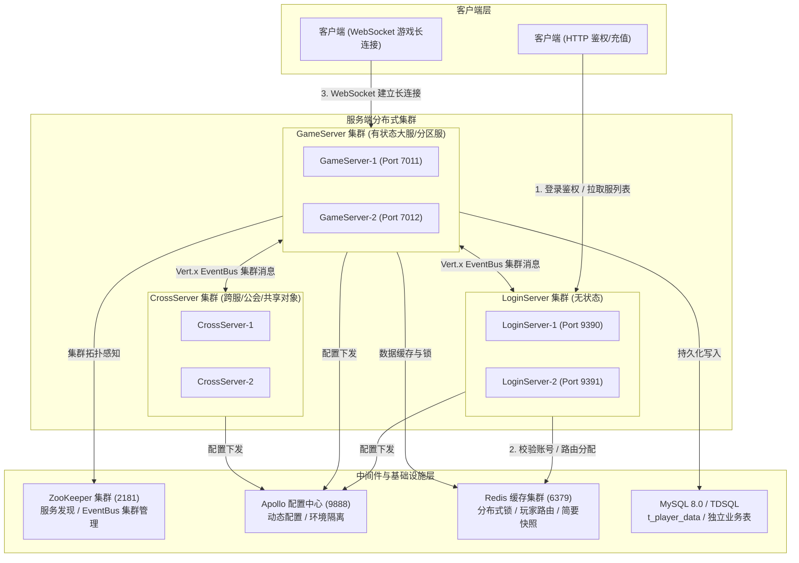
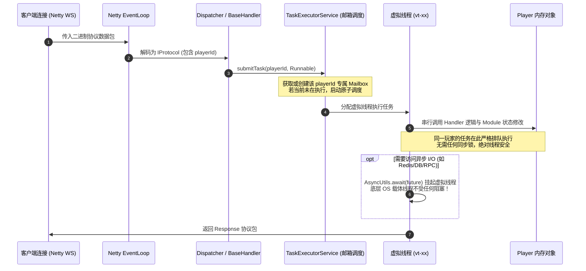
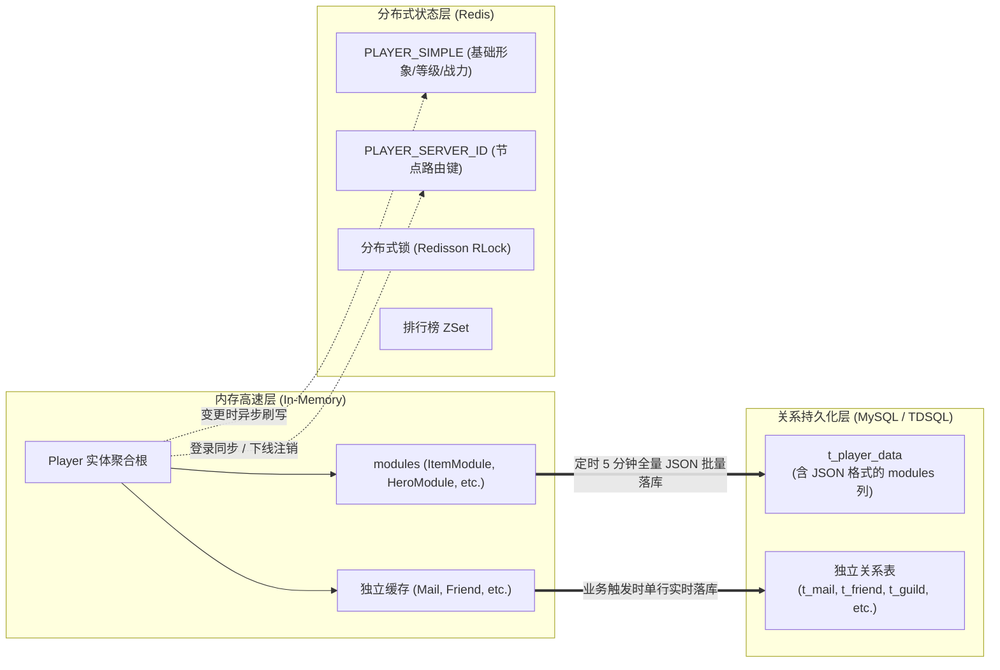

# 游戏服务器系统架构设计全景文档

> **文档版本**：v2.0 (2026 最新架构重构版)  
> **面向对象**：服务端研发团队、架构师、技术评审人员  
> **适用环境**：JDK 21 / Spring / Vert.x 5 / Redisson / ZooKeeper / MySQL 8.0 / Apollo  
> **默认文档作者**：shuyongqiang  

---

## 1. 架构总览与核心设计哲学

本项目是一款基于 **Java 21 (JDK 21)** 构建的高性能、高可用、可水平扩展的分布式大服架构游戏服务端。



### 1.1 核心设计哲学
1. **大服架构 + 逻辑分区**：
   - 告别传统页游/端游每服单进程、物理分服导致的机器资源浪费和维护地狱；
   - 采用大服架构，在统一进程集群内部运行多个虚拟逻辑大区（如 `server1`, `server4`），通过玩家数据的 `serverId` 标签实现逻辑分区分服；
   - 显著收敛进程运维数量，极大简化跨服合服与动态扩缩容。
2. **虚拟线程（Virtual Thread）驱动 + 邮箱模型（Mailbox Actor）**：
   - **全面淘汰旧式异步 Future/CompletableFuture 链式回调**；
   - 引入 JDK 21 虚拟线程，结合自研基于实体 ID 的邮箱串行调度器（[`TaskExecutorService`](file:///D:/work-all/game/server/core/src/main/java/cn/game/core/execute/TaskExecutorService.java) + [`IdVirtualThreadProcessor`](file:///D:/work-all/game/server/core/src/main/java/cn/game/core/net/process/IdVirtualThreadProcessor.java)）；
   - **单玩家强串行、跨玩家高并发、全流程零并发锁竞争**，业务代码书写恢复为最直观、可维护的线性同步逻辑。
3. **混合数据持久化双轨制**：
   - **全量快照定时落地**：绝大多数高频变化的养成、道具、战役等数据，序列化为 JSON 集中存放在 [`t_player_data`](file:///D:/work-all/game/server/game/src/main/java/cn/game/games/cache/entity/PlayerData.java) 的 `modules` 列中，定时 5 分钟统一保存，极大卸除数据库零碎行写 I/O；
   - **离线强交互独立表**：邮件、好友、公会、互助等具备离线写入、按列索引检索特性的数据，独立建表通过 MyBatis 显式落库。
4. **统一协议与微内核驱动**：
   - 全链路采用 Google Protobuf 3 强类型定义；
   - 协议元数据驱动代码生成，自动装配网络路由、解码分发器与自动化客户端测试用例。

---

## 2. 节点分类与核心职责划分

整个服务端由三大核心进程形态组成，各司其职，协同运作：

| 节点类型 | 协议 / 端口 | 状态模型 | 核心职责 | 代表主类 |
| :--- | :--- | :--- | :--- | :--- |
| **LoginServer** | HTTP / 9390 | **无状态**，可无缝水平弹性伸缩 | 1. 玩家第三方 SDK/通行证账号登录认证与 Session 签发<br/>2. 全局游戏区服列表与动态负载状态获取<br/>3. 充值 SDK 回调、支付订单创建与校验<br/>4. 全局禁封账号/IP 判定与白名单放行 | [`LoginServer`](file:///D:/work-all/game/server/login/src/main/java/cn/game/login/LoginServer.java) |
| **GameServer** | WebSocket / 7011 | **有状态**，基于 `serverId` 聚合 | 1. 客户端 WebSocket 长连接承载与协议解包<br/>2. 玩家生命周期（登录、初始化、跨天、下线）管理<br/>3. 核心游戏玩法逻辑（战斗、背包、英雄、任务、抽卡、商城）<br/>4. 玩家内存数据聚合与定时/下线持久化落库 | [`GameServer`](file:///D:/work-all/game/server/game/src/main/java/cn/game/games/net/game/GameServer.java) |
| **CrossServer** | 内部 RPC / EventBus | **共享/半有状态**，跨服中枢 | 1. 跨服公会（Guild）大对象常驻内存管理与分布式调度<br/>2. 跨服天梯、竞技场切磋、世界 Boss 状态同步<br/>3. 跨服聊天频道广播与跨服活动调度 | [`CrossServer`](file:///D:/work-all/game/server/game/src/main/java/cn/game/games/net/cross/CrossServer.java) |

---

## 3. 线程模型与并发控制深度剖析

游戏服务器最容易滋生 Bug 和死锁的领域在于**多线程并发修改玩家状态**。本项目彻底摒弃了繁琐的悲观锁（`synchronized`/`ReentrantLock`）以及难以追踪的回调地狱（`CompletableFuture`），构建了基于 **Actor 邮箱 + 虚拟线程** 的并发控制体系。



### 3.1 核心组件实现原理
1. **邮箱调度器 [`TaskExecutorService`](file:///D:/work-all/game/server/core/src/main/java/cn/game/core/execute/TaskExecutorService.java)**：
   - 内部维护 `ConcurrentHashMap<Long, ActorMailbox>`；
   - 每个 `playerId` 拥有独立的 FIFO 任务队列；
   - 采用 CAS 状态位标志当前邮箱是否正在由虚拟线程处理（`processing.compareAndSet(false, true)`）；
   - 使用基于 JDK 21 的 `Executors.newThreadPerTaskExecutor(Thread.ofVirtual().name("vt-", 0).factory())` 分配虚拟线程。
2. **协议路由入口 [`IdVirtualThreadProcessor`](file:///D:/work-all/game/server/core/src/main/java/cn/game/core/net/process/IdVirtualThreadProcessor.java)**：
   - 网络底层收到网络包后，依据包头中的连接/玩家属性，调用 `TaskExecutorService.submitTask(playerId, ...)`；
   - 确保外部客户端请求进入业务逻辑层后，直接置于该玩家的串行队列中。
3. **定时器与延迟任务安全接入**：
   - 玩家对象上的定时任务（如 [`player.setPeriodicTask()`](file:///D:/work-all/game/server/game/src/main/java/cn/game/games/cache/entity/Player.java#L167)、`player.setTimerTask()`）即使被底层 Vert.x 定时线程触发，也会重新封装并提交到 `TaskExecutorService.process(playerId, ...)`；
   - **保证定时逻辑与玩家网络请求在同一个队列中排队，彻底消除竞态条件**。
4. **异步转同步机制 [`AsyncUtils.await`](file:///D:/work-all/game/server/core/src/main/java/cn/game/core/util/AsyncUtils.java#L96-L120)**：
   - 当业务需要调用远程 RPC、查询 Redis 或等待数据库异步操作时，**严禁使用 callback 回调**；
   - 统一调用 `AsyncUtils.await(future, timeout, unit)`；
   - 在虚拟线程中，该方法触发 Vert.x 5 原生虚拟线程挂起机制（`future.await()`），仅暂停虚拟线程上下文，**底层的操作系统载体线程（Carrier Thread）立即释放去处理其他任务**，超时或完成后自动唤醒恢复。

---

## 4. 网络通信与集群 RPC 体系

### 4.1 协议二进制格式设计
客户端与 GameServer 之间基于 WebSocket 通信，载荷（Payload）采用自定义紧凑二进制协议：

```
+---------------+---------------+---------------+-------------------------------+
|  Length (4B)  |  MsgId (4B)   |   Seq (4B)    |    Protobuf Binary Payload    |
| (整个包字节长)| (16进制协议号)| (请求序列号)  |   (Google Protobuf 序列化字节)|
+---------------+---------------+---------------+-------------------------------+
```
- **MsgId 规范**：全局唯一 32 位整型（16 进制表达，如 `0x30000001`）。
  - 高 8 位（如 `0x30`）：功能模块 ID（Module ID）；
  - 低 24 位（如 `0x000001`）：模块内命令字。
- **配对规则**：`Request ID + 1 = Response ID`。服务端响应带回客户端请求相同的 `Seq`，用于支持客户端同步阻塞或异步回调关联。

### 4.2 集群通信框架（Vert.x EventBus + ZooKeeper）
服务器各节点之间的通信完全基于 Vert.x 集群模式构建（[`VxHolder`](file:///D:/work-all/game/server/core/src/main/java/cn/game/core/net/vertx/VxHolder.java)），ZooKeeper 充当 `ClusterManager`：

1. **节点标识与寻址机制**：
   - 每个服务器启动时向集群注册自身唯一 ID（如 `game_test`）以及服务类型（如 `Game`, `Login`, `Cross`）；
   - 每个节点监听以自身唯一 ID 为地址的频道，以及以服务器类型为地址的广播/平衡频道。
2. **四大通信模式**：
   - **点对点指定投递**：`VxHolder.sendRemoteServer(targetServerId, message)`
   - **点对点 RPC 请求-响应**：`VxHolder.requestRemoteServer(targetServerId, requestMessage)`（返回 Future，业务中可直接 await）
   - **同类型服务负载均衡**：`VxHolder.requestRemoteServer(ServerType.Login, message)`（Vert.x EventBus 自动在所有活着的 Login 节点间轮询分发）
   - **集群全员广播**：`VxHolder.broadcastRemoteServer(ServerType.Game, message)`（常用于全服跑马灯、全服活动状态广播、跨服停服维护）
3. **玩家位置路由（Player-to-Server Mapping）**：
   - 玩家成功登录 GameServer 时，在 Redis 写入 `PLAYER_SERVER_ID_{playerId}` -> `serverId` 并设置 TTL；
   - 跨节点发起针对指定玩家的业务（如好友申请、跨服送礼、后台踢人）时，先查询 Redis 获取玩家所在 `serverId`，再通过 EventBus 精确投递到目标服务器的玩家 Mailbox。

---

## 5. 数据管理与双轨持久化架构

服务端数据存储采用 **内存高速缓存 + Redis 状态中介 + MySQL/TDSQL 持久化** 的三层分层体系：



### 5.1 双轨持久化策略对比

| 维度 | 轨迹 A：全量 JSON 聚合持久化 | 轨迹 B：独立关系表持久化 |
| :--- | :--- | :--- |
| **适用场景** | 强归属于玩家个人、无需跨玩家离线复杂 SQL 检索的业务模块（如背包、英雄、战令、时装、配置进度、神兵等）。 | 具备强离线交互、大容量累积、支持多维度查询或全局共享的业务（如邮件 `t_mail`、好友申请 `t_friend_application`、公会 `t_guild`）。 |
| **存储载体** | `t_player_data` 表的 `modules` 列（MySQL 8.0 原生 `json` 类型）。 | 单独的物理表（如 `t_mail`、`t_friend`）。 |
| **序列化机制** | Jackson 默认类型多态绑定（`["cn.game...Module", {...}]`）。 | MyBatis Mapper 对象字段映射。 |
| **保存时机** | 1. 定时任务触发（默认每 5 分钟定时扫写）<br/>2. 玩家正常登出或断线注销时触发 | 业务逻辑产生变更时显式调用（如调用 [`DAO.insert()`](file:///D:/work-all/game/server/game/src/main/java/cn/game/games/util/DAO.java#L32)、`DAO.update()`、`DAO.delete()`）。 |
| **开发约束** | 模块继承 [`BasePlayerModule`](file:///D:/work-all/game/server/game/src/main/java/cn/game/games/core/BasePlayerModule.java)，非持久化临时字段必须加 `transient` 或 `@JsonIgnore`。 | 实体类继承 [`DbEntity`](file:///D:/work-all/game/server/game/src/main/java/cn/game/games/cache/base/DbEntity.java)，复写 `getMapperClass()` 与 `primaryKey()`。 |

### 5.2 跨服公会等大对象的常驻与分布式装载
针对公会（Guild）等跨服多人协作对象，系统采用 **主节点分布式平衡加载机制**：
1. CrossServer 选举主节点（Master Node）；
2. 主节点从数据库分页分批拉取公会数据（ID 游标分页）；
3. 主节点通过 EventBus 将公会对象均匀分发给所有的 CrossServer 节点；
4. 节点在装载前尝试获取 Redis 对应的公会分布式锁，确保全局同一公会仅在单一节点常驻。

---

## 6. 配置中心与环境编排架构

### 6.1 Apollo 命名空间与配置流向
系统通过 Apollo 配置中心统一纳管所有运行时基础设施与核心参数，彻底杜绝配置硬编码：
- **`application` 命名空间**：服务 ID、端口、运行模式（`dev`/`test`/`pressure`/`production`）、日志等级。
- **`zookeeper` 命名空间**：ZooKeeper 集群连接串（`test:2181`）、会话超时参数。
- **`redis` 命名空间**：Redis 主机、端口、密码、连接池配置。
- **`mysql` 命名空间**：数据源驱动、主从 JDBC URL、用户名/密码、连接池容量（HikariCP）。

### 6.2 运行环境与启动参数映射

| 启动参数 | 含义说明 | 示例取值 |
| :--- | :--- | :--- |
| `-Dapp.id` | 标识微服务组件身份 | `game`, `login`, `cross` |
| `-Denv` | 运行环境 profile | `local` (本机), `dev` (开发内网), `test` (集成测试), `pro` (线上生产) |
| `-Dapollo.cluster` | Apollo 集群分组 | `SYQ` (开发者专属集群), `default` |
| `-Ddev_meta` | Apollo 元数据中心地址 | `http://test:9888` |
| `-Dserver.run.mode` | 服务器运行模式 | `test` (开放 GM 与详细日志), `production` (生产严格校验) |
| `-Dworkspace` | 服务端源码根目录 | `D:\work-all\game\server` |
| `-Dmetafolder` | 策划配置表导出的 XML 资源路径 | `D:\work-all\game\configs\Server` |

---

## 7. 现有架构的潜在瓶颈与优化建议

结合对全系统源码的深入审计及实际测试反馈，为后续系统优化梳理出以下核心改进方向：

### 7.1 架构优化建议一览表

| 优化方向 | 当前现状与缺陷分析 | 推荐优化方案 | 预期成效 |
| :--- | :--- | :--- | :--- |
| **1. 虚拟线程与 Worker 线程池混用** | [`DAO.java`](file:///D:/work-all/game/server/game/src/main/java/cn/game/games/util/DAO.java#L116) 内部仍在调用 `VxHolder.executeBlockingWithTimeout`，本质依然在 Vert.x 的固定大小 Worker 线程池中等待 JDBC，在高并发 I/O 时可能耗尽 Worker 线程。 | 将 `DAO` 底层的阻塞执行完全切换至虚拟线程池执行；直接在虚拟线程内调用 MyBatis，无需经过 Vert.x Worker 线程中转。 | 彻底打破 Worker 线程数限制，消除长阻塞对 Vert.x 核心事件循环调度的潜在挤占。 |
| **2. JSON 大字段序列化性能与膨胀** | 随着玩家深入体验，`t_player_data.modules` 列的 JSON 字符串体积可增长至几十甚至上百 KB，每次全量 Jackson 反序列化与序列化耗时递增。 | 1. 拆分模块脏标记（Dirty Flag）：只有发生变动的 Module 才在本次周期参与序列化。<br/>2. 针对高频不变静态结构，引入轻量 Protobuf 二进制压缩替代大文本 JSON。 | 降低单次入库 CPU 序列化负担 60% 以上，显著减小数据库 Binlog 写入压力。 |
| **3. 跨节点/跨玩家的一致性与补偿** | 当前跨玩家（如送礼、申请、扣点）依赖 Redis 锁或简单的直接远端 RPC；若调用中途网络抖动或节点重启，存在状态半成缺陷。 | 建立标准化的“本地事务消息 + 幂等重试/回滚”机制（Saga 模式轻量实现），避免长事务持锁等待。 | 杜绝由于远程超时导致的丢物品或重复发奖隐患。 |
| **4. 统一调用链路追踪 (Distributed Tracing)** | 当前在部分 EventBus 消息中传递了 `trace-id`，但在虚拟线程内部调度及日志打印（Log4j2 MDC）中尚未形成全链路贯通。 | 在 `TaskExecutorService` 提交任务时自动传播 `traceId` 到 MDC，让所有日志天然携带玩家 ID、请求序号及 TraceId。 | 线上故障排查效率提升数倍，单请求跨多节点调用一目了然。 |
