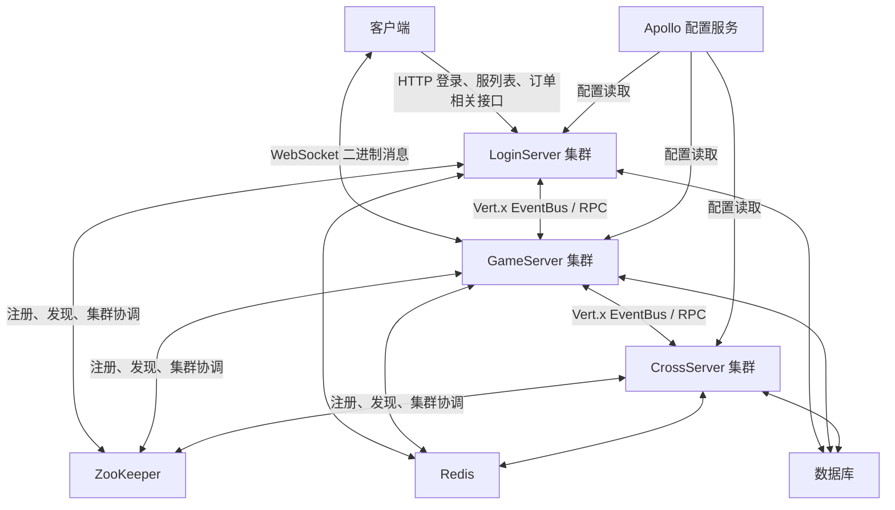
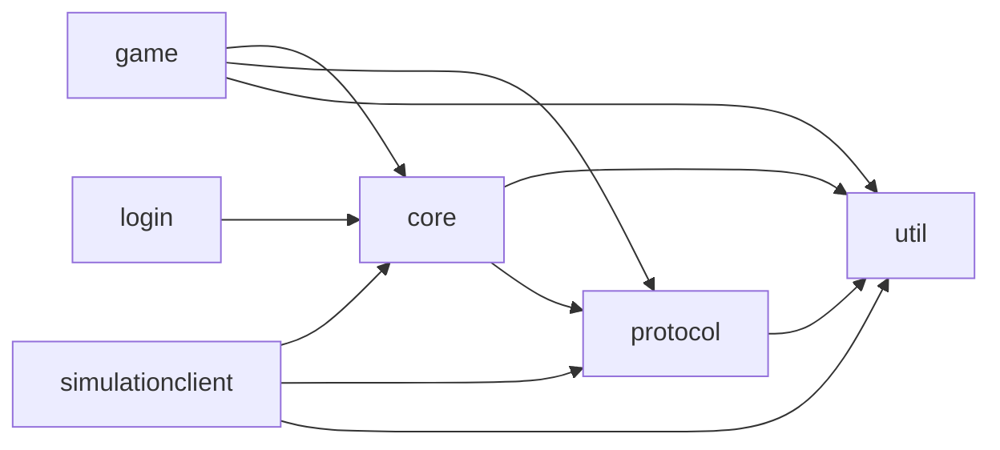
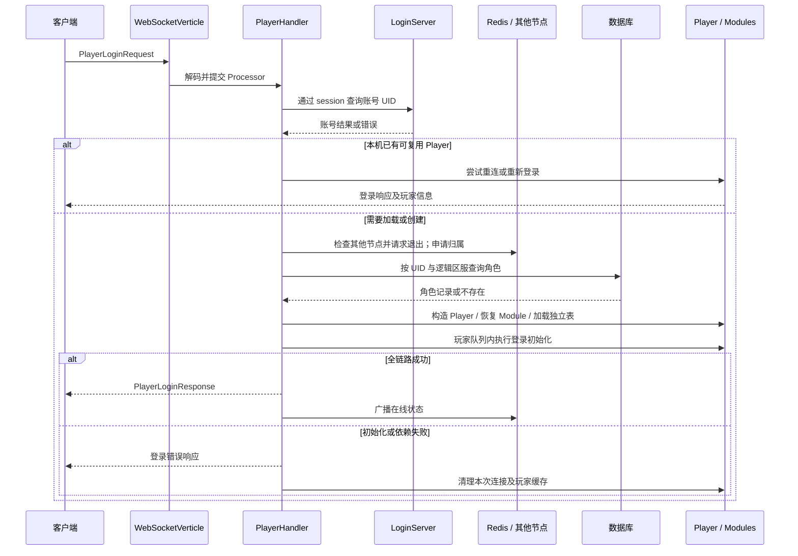
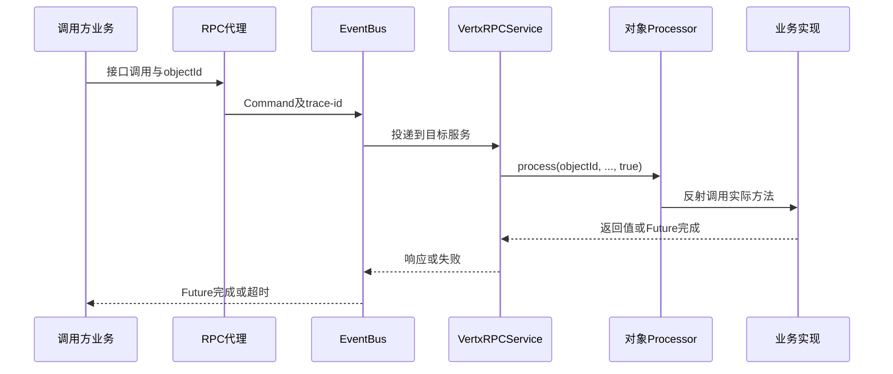
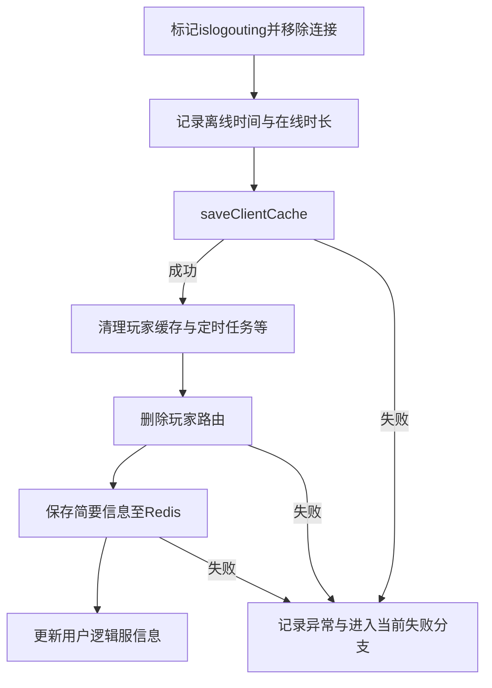
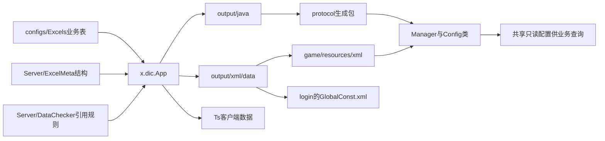

# 游戏服务器系统架构设计全景文档

> 文档版本：v3.1
>
> 核对日期：2026-10-23
>
> 读者：服务端研发、架构维护、测试与运维人员
>
> 配套文档：[开发流程与研发规范手册](02_开发流程与研发规范手册.md)

本文描述当前游戏服务端的模块、运行节点、关键链路、数据归属和故障边界，为后续优化提供可核查的基线。当前架构以 Java 21、Vert.x 集群、按实体 ID 串行的邮箱、玩家模块聚合存储及独立业务表为核心。串行执行、分布式路由和定时保存各解决不同问题，不能合并理解为全局事务或零数据丢失保证。

本文是 `doc/` 中系统架构主题的唯一主文档。[system_architecture_spec.md](system_architecture_spec.md) 保留为旧入口的迁移说明与章节索引，后续架构事实和优化方案统一更新在本文；开发步骤与工程规范统一维护在配套的 02 文档中。

## 0. 阅读方式与事实来源

### 0.1 三类内容

- **当前实现**：从工作树源码、生成类、构建文件和脚本核实的行为；关键章节提供入口链接。
- **开发约束**：来自项目根 [AGENTS.md](../AGENTS.md)、[coding-style.md](../.ai-workspace/context/coding-style.md) 及领域规范，约束新增或直接修改的实现。历史代码不一定全部符合这些规则。
- **优化候选**：尚需测量、设计或演练的改进，集中在第 13 节；不表示已经上线，也不承诺未经测量的收益。

源码核对基于宿主工作树（HEAD `eaaeab57`）及 protocol 工作树（HEAD `95bd316`）。提交号用于定位背景，运行部署版本仍须另行核实。配置生成规则采用 [配置表 AI 编码规范](../../dic_generate/配置表AI编码规范.md)；该规范记录了生成器源码核对版本，但没有证明部署中的 Gen.jar 与源码完全一致。

旧 Word 文档与 [架构描述.md](架构描述.md) 是历史背景，其中 DataServer、MINA、固定 EventLoop 业务线程等描述不能直接作为当前运行事实。部分 context 的旧示例仍有漂移，例如配置数组分隔符、Manager 通用方法和“批量资源操作原子性”；遇到冲突先核对当前实现和最新专项规则，不为符合旧文字改动正确代码。

### 0.2 阅读导航

| 主题 | 章节 |
|---|---|
| 系统边界与模块 | 第 1～2 节 |
| 节点启动、登录、重连 | 第 3～4 节 |
| 邮箱、线程与阻塞 | 第 5 节 |
| 网络协议与 RPC | 第 6～7 节 |
| 数据所有权、存储与退出 | 第 8～9 节 |
| 配置与业务扩展 | 第 10～11 节 |
| 观测、发布与优化 | 第 12～13 节 |

## 1. 系统总体结构

### 1.1 逻辑拓扑



图中是服务职责和依赖，不表示全部节点使用同一个物理数据库、同一 Redis 部署或同一连接池。数据库实例、分片方式、中间件高可用形态和真实端口取决于环境配置。历史资料提及 TDSQL、ShardingSphere；本地 MySQL 环境不能证明生产仍使用其中任一种方案。

### 1.2 三类主要节点

| 节点 | 当前职责 | 状态与扩展边界 | 主入口 |
|---|---|---|---|
| LoginServer | HTTP 登录和账号校验、服务器列表、订单及支付相关接口、运营接口 | 不持有完整在线 Player 聚合，但有本地管理器和缓存；扩容仍依赖共享会话、缓存一致性及入口路由 | [LoginServer](../login/src/main/java/cn/game/login/LoginServer.java)、[RestServer](../login/src/main/java/cn/game/login/RestServer.java) |
| GameServer | WebSocket 接入、玩家生命周期、主要玩法、玩家内存状态与保存 | 有状态；在线玩家与当前节点、连接和邮箱关联。扩容不自动迁移既有在线对象 | [GameServer](../game/src/main/java/cn/game/games/net/game/GameServer.java) |
| CrossServer | 公会等共享对象、跨节点业务接口及相关服务 | 有状态共享对象由特定节点管理；需要对象路由、装载和失败接管 | [CrossServer](../game/src/main/java/cn/game/games/net/cross/CrossServer.java) |

CrossServer 的已核实主链是公会装载和管理。不能仅因为某玩法叫“跨服”，就认定竞技场、世界 Boss、聊天等所有实现都在 CrossServer；新增功能需沿具体 Handler、Service 和远程接口确认归属。

### 1.3 物理节点与逻辑区服

“服务器 ID”在不同上下文中有不同含义，设计和日志必须区分：

| 标识 | 含义与来源 | 使用场景 |
|---|---|---|
| 物理节点 ID | `ServerContext.getServerId()`，启动时解析的进程身份 | EventBus 寻址、节点注册、对象所在节点 |
| 节点类型 | `ServerType.Game/Login/Cross` | 服务发现、按类型投递、Leader 选举分组 |
| 逻辑区服 ID | `VirtualServerConfig`、`VirtualServerRegistry`、账号/角色数据中的区服字段 | 选服、开服时间、角色查询、业务隔离 |
| 账号 UID | 登录服务确认的账号标识 | 账号身份及按账号查找角色 |
| playerId | 角色标识 | Player、玩家邮箱、角色数据主键和对象路由 |
| guildId 等对象 ID | 共享业务对象标识 | 公会路由及该对象的串行处理 |

[VirtualServerRegistry](../core/src/main/java/cn/game/core/base/VirtualServerRegistry.java) 使用 ZooKeeper 保存逻辑服视图，并提供本地缓存、监听和更新能力。当前基础路径是 `/server/login/game/virtual-servers`，还要结合 Curator namespace 理解最终路径。

角色查找使用 `selectByUkUidServerid(uid, serverId)`；对应唯一键变更可见 [update.sql](../game/src/main/resources/sql/update.sql)。账号、逻辑服和角色不是一一等价的概念。玩家路由键中的节点 ID 也不能替代玩家所属逻辑区服。

## 2. 工程模块与职责边界

根 [pom.xml](../pom.xml) 聚合六个 Maven 模块，Java release 为 21，Vert.x 版本属性为 5.0.4。数据库驱动、Spring、MyBatis、Redisson 等具体依赖版本以 POM 为准，不从环境软件版本反推依赖版本。



箭头表示主要内部依赖，省略 parent 继承和第三方依赖；精确直接依赖以各模块 POM 为准。Maven 聚合、代码依赖和 Git 仓库归属是不同维度：protocol 在本机有独立仓库，不能把它当作宿主仓库的普通目录交付。

| 模块 | 主要内容 | 扩展约束 |
|---|---|---|
| util | 时间、随机、序列化、Redis/Apollo 工具、文件监听等 | 不依赖 game 中的玩家业务；修改公共行为需评估调用范围 |
| protocol | proto、Protobuf 产物、配置 Config/Manager/枚举、协议生成器 | 生成资产从真源变更；不承载玩家请求级可变状态 |
| core | 邮箱执行、网络分发、RPC、集群/缓存、调度、公共条件支撑 | 面向多个业务复用；不能为单功能顺手改变通用契约 |
| game | GameServer 与 CrossServer、Handler/Module/Helper、Mapper、玩家和公会数据 | 业务状态遵循实体归属和保存契约 |
| login | HTTP 登录、服务列表、支付订单及运营相关接口 | 核查身份和外部回调，明确共享状态及幂等语义 |
| simulationclient | 协议模拟、带 main 的场景、压测相关代码 | 不等同于 Maven 自动发现的 JUnit 测试 |

普通业务分层为 Handler → Module/Helper → 公共资源、配置、事件、存储能力。Handler 通常是 Spring 单例，不能把当前 Player、Request、临时 Builder 存成实例字段；Module 通常归属于一个 Player。生成配置 Manager 是共享静态数据管理器，与 PlayerManager、GuildManager 这类运行态管理器不能混为一谈。

## 3. 启动与就绪链路

### 3.1 GameServer 启动阶段

当前 `GameServer.start()` 的主要顺序如下，细节以源码调用顺序为准：

1. 解析节点 ID，初始化日志、`Config`、Redis、ZooKeeper 和基础 ServerContext。
2. 初始化 Vert.x 集群、ID 能力、活跃节点监听及 ServerContext。
3. 从 Apollo 加载 Spring 配置，初始化 Quartz、运行配置和内部通信 Verticle。
4. 注册资源文件监听、JMX、退出 Hook 和调度任务。
5. `ManagerHelper.init()` 加载静态配置；初始化玩家管理、条件/活动类映射和分布式对象 ID 管理。
6. 初始化活动、排行、推送、邮件、数据修复等业务服务。
7. 最后部署 WebSocket 接入，开始接受客户端连接。

该顺序体现“业务初始化在外部游戏接入之前”的意图，但日志出现“启动成功”仍不能代替真实登录检查。Spring bean、数据库、配置资源、RPC 消费者、节点注册和 WebSocket 监听需要分别确认。

### 3.2 LoginServer 与 CrossServer

LoginServer 初始化配置、中间件、ServerContext、Spring、服列表管理、GlobalConst、白名单和公告，并部署 HTTP 与内部通信组件。API 路由以 `RestServer` 和对应请求类为准。

CrossServer 初始化集群及内部通信、分布式对象 ID 管理、Leader 相关装载入口、配置监听/加载与 GuildManager。当前 `CrossServer.start()` 中 `initLeaderTask()` 在 `ManagerHelper.init()` 和 `GuildManager.init()` 之前调用；不要把整理后的理想初始化顺序当成源码现状，变更跨服启动必须检查这些依赖及异步装载时序。

### 3.3 就绪不是端口监听

建议环境验收按以下层次记录，现有项目未因此自动具备统一 readiness API：

| 层次 | 验收证据 |
|---|---|
| 进程 | 正确 JDK、主类、节点 ID、配置环境及本轮构建产物 |
| 依赖 | Apollo 可取到目标配置，Redis/ZooKeeper/数据库连接成功 |
| 资源 | 必需 XML 已加载，表数量及配置版本符合预期，无加载错误 |
| 集群 | 目标节点注册可见，内部请求能到达预期实例 |
| 玩家业务 | 测试账号登录、读取状态和一个受控业务请求成功 |
| 持久化与恢复 | 已确认保存完成，重新加载后状态一致 |

本地常见端口 7011、9390、2181、6379、9888 等仅是环境示例，不是协议常量或生产拓扑证明。命令和环境准备见配套手册。

## 4. 登录、重连与玩家生命周期

主要入口：[PlayerHandler](../game/src/main/java/cn/game/games/net/game/handler/PlayerHandler.java)、[PlayerHelper](../game/src/main/java/cn/game/games/net/game/helper/PlayerHelper.java)、[Player](../game/src/main/java/cn/game/games/cache/entity/Player.java)、[GameClientManager](../game/src/main/java/cn/game/games/net/game/manager/GameClientManager.java)。

### 4.1 从连接到正常登录



这是主分支概览，不表示每一步都已具备跨系统事务。当前登录代码仍包含 Future/compose 链；Player 尚未确定之前，也不能假定请求已处于最终 playerId 的队列。

`PlayerHandler.login()` 会处理负载限制、逻辑服有效性、session → UID 查询、重连尝试、角色装载和失败清理。当前 `canLogin(version)` 返回后的拒绝分支存在注释代码，因此不能把“版本检查调用存在”写成“版本不符必然拒绝”。鉴权归属、重复登录和跨节点互斥应通过实际分支及测试验证。

### 4.2 Player 与 Module 恢复

- `Player` 扫描 `cn.game.games` 下的 `BasePlayerModule` 子类，过滤抽象类及 `isComplete()==false` 的模块；需要可用的无参构造。
- 常规模块从 `PlayerData.modules` 中反序列化；找不到某模块时按类创建默认实例。
- 模块 Map 使用完整类名作为键，JSON 还包含多态类型信息。包名/类名变更属于存储兼容变更，不能当作纯重命名。
- `initDefault()` 绑定 Player、准备默认 Mapper、注册事件，并调用 `init()`、`initAfter()`。
- 独立表查询由 `initDbTasks()` 组织；恢复阶段根据模块契约调用 `loadFromDb()` 或 `initFromDbAfter()`。
- `getModuleSorted()` 对相关模块处理提供排序，但构造阶段 `initModule()` 遍历扫描集合，不能依赖 `getInitOrder()` 保证所有 `init()` 都按依赖排序。

`initFromDbAfter()` 用于恢复后整理，也可能参与离线对象加载；实际登录业务放在 `onLogin()` 或对应登录事件，避免查询离线玩家时意外发奖、启动在线定时器。

### 4.3 登录事件与时间校正

当前 `initAfterLogin()` 的核心顺序为：`LoginStart` → 更新登录时间 → `refresh()` → 注册周期保存任务 → `LoginFinish` → `LoginSuccess` → 各 Module 的 `onLogin()`。这个顺序说明 `onLogin()` 已位于跨期刷新之后，不表示任意两个 Module 的 `onLogin()` 有稳定先后关系。

自然日使用 `DateUtil.getDay()` 与 `NewDay`；已有 05:00 业务日使用相应业务日函数与 `NewDay5`。活动或任务必须明确采用哪一种口径，不能混用周期标识。服务器部署时区另行确认。

### 4.4 重连、断开与注销

| 场景 | 当前入口/行为 | 不应作出的推断 |
|---|---|---|
| WebSocket 断开 | close handler 移除连接映射；后续还有空闲检测和玩家生命周期处理 | 连接断开不等于立即删除 Player 或完成存库 |
| 本机重连 | `PlayerHelper.reconnect()` 复用已有 Player、切换连接、发 Reconnect 或 Relogin 等事件 | 不等同于从数据库冷加载 |
| 重连协议 | `PlayerHandler.reconnect()` 与 `reconnectNew()` 还有独立入口 | 不假定它和完整登录具有完全相同校验链 |
| 空闲超时 | GameClientManager 依据 `Config.lastRecvPacketTime` 检测并安排退出 | 超时数值是配置，不能硬编码为固定业务规则 |
| 主动/被动注销 | 标记退出、移除连接，调用 `PlayerHelper.logout()` 保存和清理 | 返回 Future 完成不必然证明所有阶段都成功，见第 9 节 |
| 离线管理操作 | `loadPlayerFromDb(long)` 等专用入口，修改后保存并清理 | 不能绕过在线归属，再创建另一个可写 Player |

测试应分别覆盖首次创建、老玩家登录、本机重连、另一节点接管、断线后超时注销和离线读取，不能只重复发送登录协议替代所有场景。

## 5. 线程模型与并发契约

### 5.1 请求实际调用链

```text
WebSocketVerticle
  → IdVirtualThreadProcessor.process(client, protocol)
  → TaskExecutorService.submitTaskWithResult(client.getPlayerId(), ...)
  → ActorMailbox / MailboxProcessor
  → AbstractProcessor → Dispatcher → BaseHandler
  → GameBaseHandler 校验 → 业务 Handler → Module/Helper
```

[IdVirtualThreadProcessor](../core/src/main/java/cn/game/core/net/process/IdVirtualThreadProcessor.java) 的任务键来自连接上绑定的 playerId，并不是从任意请求字段直接取出的玩家编号。RPC 使用 Command.objectId 作为处理键；调用方必须选对实体归属。

### 5.2 邮箱的保证与限制

[TaskExecutorService](../core/src/main/java/cn/game/core/execute/TaskExecutorService.java) 默认使用一对一 MailboxManager，以虚拟线程执行邮箱处理器；[ActorMailbox](../core/src/main/java/cn/game/core/execute/ActorMailbox.java) 使用有界 `LinkedBlockingDeque`。管理器按实际邮箱 ID 协调获取、入队和退役，实例以消费权代次校验消费者及延迟回调；业务执行位于协调区域外。

| 项目 | 当前实现与使用约束 |
|---|---|
| 同实体处理 | 纳入同一邮箱的任务串行；业务安全依赖所有写入口遵循这一归属 |
| 普通顺序 | 普通任务从队尾入、队头取 |
| 优先任务 | `fast=true` 插入队头；重试策略也可能回插队头，不保证全局提交顺序 |
| 队列容量 | TaskExecutionConfig 默认 1000；满队列会拒绝，需检查调用者是否处理失败 |
| 默认超时 | 配置类默认 30 秒；具体 Processor 重载可能另传超时，应沿调用确认 |
| 超时含义 | 返回的 Future 可超时；没有因此自动取消正在执行的业务或回滚状态 |
| 异步返回 | 若任务提交外部异步工作后立即返回，后续回调不自动保有原实体串行上下文 |
| 重试 | 按 ErrorHandler 策略处理；延迟期间保留消费权，新任务不得提前唤醒。重试入队满、策略抛错或调度拒绝均明确失败；默认不是所有任务自动重试三次 |
| 等待与死锁 | 同邮箱任务互相同步等待、跨实体循环等待都需避免；已有 DeadlockGuard 不能代替业务设计 |
| 邮箱清理 | 服务定时清理使用空闲 30 分钟、扫描 10 分钟的常量，监控清理另用 TaskExecutionConfig；两条路径均核对实际 ID、当前实例、空队列及无消费权，旧引用不能复活退役邮箱 |
| 阻塞诊断 | 按当前单次任务执行区间告警（含错误策略与同步结果回调），线程和开始时间同锁采样；连续短任务及延迟重试等待不累加为阻塞，采样后的线程栈仅供诊断。监控不强制复位 processing，等待超时不能证明旧任务已终止 |
| 关闭收尾 | 停止受理并结束监控，尚未开始的任务明确失败；运行任务由实际执行结果收尾，不伪报已取消。此处不等于节点数据已保存或可安全接管 |

`submitTask` 的布尔值来自提交时的受理状态，不再忽略队列满或调度拒绝，也不通过业务 Future 的瞬时失败猜测受理。true 不保证随后一定执行：关闭仍可拒绝排队任务。需要观察终态时使用 `submitTaskWithResult` 的 `TaskSubmission.result()`，结果失败后结合 `hasStarted()` 区分尚未执行与已经执行过；等待超时不能替代该判定，重试也不清除开始标记。

`IdVirtualThreadProcessor.processAsync` 将确认未开始的失败标记为 `TaskNotExecutedException`，已执行异常按执行失败传播：内层未执行标记会被包装并保留原因（详见第 7.2 节），不自动重试。网络入口对真正新请求的开始前拒绝返回现有 `system_overload` 错误码，重复请求按第 6 节的登记/缓存规则处理；GameClient 使用原请求 seq，保持零/负值，不修改当前业务 seq，也不写入正常回复缓存。无结果的内部 `process(Runnable)` 路径会记录失败，需要恢复动作的调用方应改用有结果入口。

确定性回归位于 [MailboxLifecycleTest](../core/src/test/java/cn/game/core/execute/MailboxLifecycleTest.java) 和 [TaskAdmissionTest](../core/src/test/java/cn/game/core/execute/TaskAdmissionTest.java)，覆盖消费权、清理、重试拒绝、旧回调、共享/零 ID、fast 顺序、关闭竞争及真实网络/RPC处理器入口。定向执行时使用 [目标清单](../core/src/test/resources/task-admission-expected.json)，并包含 GameClient 序号回归；这些替身边界测试不等于真实集群或客户端联调。

框架中存在同步锁和并发容器。准确表述是“减少玩家业务层显式互斥”，不是“全流程无锁”。玩家队列也不覆盖共享排行榜、公会、全局活动、数据库事务或其他节点状态。

### 5.3 虚拟线程与异步适配

[AsyncUtils](../core/src/main/java/cn/game/core/util/AsyncUtils.java) 对 Vert.x Future 提供同步等待封装，检查 EventLoop 禁止阻塞，默认 `await(future)` 超时为 30 秒。适用范围是已确认可阻塞的业务执行上下文。

业务新增逻辑优先使用既有 await 方式维持线性流程；外部回调需要修改玩家状态时，先通过 Processor 回投对应玩家队列。不能把 RFuture、CompletionStage、Vert.x Future 当作完全相同类型；必要时通过已有适配器转换后再 await。

虚拟线程挂起期间，同一邮箱的后续业务仍排队。JDK 21 中，在 synchronized 或 native 等场景下阻塞可能发生 pinning，载体线程不一定被释放；参见 [Java 21 虚拟线程说明](https://docs.oracle.com/en/java/javase/21/core/virtual-threads.html)。CPU 密集计算和数据库容量也不会因为虚拟线程而消失。

### 5.4 定时与共享对象

玩家定时逻辑使用 `Player.setTimerTask()` / `setPeriodicTask()`，其回调通过 Processor 回到玩家队列；清理玩家时取消相应 timer。全局调度、Quartz、HTTP 回调、文件监听并不天然处于玩家队列。

共享 Handler/Manager 不保存请求级可变字段；配置对象按只读使用。跨玩家行为应先确定权威对象、调用顺序、幂等键和失败恢复方式，不能在一个玩家的邮箱里直接修改另一个玩家的可变数据。

## 6. 客户端协议、连接与消息分发

### 6.1 当前入口与包结构

当前 Game 主链使用 [WebSocketVerticle](../game/src/main/java/cn/game/games/core/vertx/WebSocketVerticle.java)，按虚拟线程模型部署。仓库中保留的其他 Netty/历史网络实现，不等于启动时全部启用。业务载荷为 Protobuf，外层还有自定义二进制头；不能把整个 WebSocket 帧直接按 protobuf 反序列化。

入站头部为 12 字节，各 int 按大端读取：

| 偏移 | 长度 | 字段 | 当前处理 |
|---|---|---|---|
| 0 | 4 | length | 入口读取；该处未见据此严格校验帧长 |
| 4 | 4 | seq | 请求序号，用于响应关联和连接内重复请求处理 |
| 8 | 4 | msgID | 协议编号，用于解析与 Handler 路由 |
| 12 | 剩余 | body | protobuf 字节 |

出站由 [GameClient](../game/src/main/java/cn/game/games/net/client/GameClient.java) 组装 16 字节头：`length / seq / msgID / errorCode / body`，length 写为 `body.length + 16`。请求与响应的头长度不同，错误码不在入站头里。

**当前需要保留的差异**：模拟客户端 [Client](../simulationclient/src/main/java/cn/game/simulation/client/Client.java) 的入站 length 写 body 长度，而 [JmeterUtil](../simulationclient/src/main/java/cn/game/simulation/test/jmeter/util/JmeterUtil.java) 写 body 长度加 12。不能在说明中宣称两端已经统一为“总包长”。后续若加强包长校验，应先盘点实际客户端、明确兼容策略并联调；本次文档修订不改变报文。

### 6.2 请求合法性与连接状态

未建立 GameClient 的连接只允许登录请求进入建连逻辑，其他请求返回需要登录。文本消息不是当前业务二进制协议。WebSocket 关闭会解除连接关联，但不等于完成角色落库和所有离线流程。

`GameClient.needProcess()` 当前包含请求频率和 seq 处理。频率判断使用代码内的短时间窗口和阈值，不应在运营文档里写成已提供通用可配置限流平台。seq 相关处理包括缓存近期响应、相同缓存序号重发响应以及拒绝部分旧序号；负序号有单独放行路径。

`IdVirtualThreadProcessor` 的两个网络入口在入队前调用请求登记钩子。对同一个 GameClient 的正 seq，排队/执行中的重发被抑制，当前或旧序号没有缓存时沿用原抑制语义。已有完成缓存的请求仍正常入队，保留 `needProcess` 先限流后重放的顺序；如果入队拒绝则返回已有结果快照（即使缓存随后淘汰），不能改报原请求未执行。真正新请求的开始前拒绝仍反馈 `system_overload`。登记在执行终态或同步提交异常时释放，拒绝路径先调用发送再释放，且仅移除身份匹配的登记。零与负序号继续原路径。拒绝路径的缓存重放不经过原限流，不能据此宣称所有入站报文都受统一 10/s 限制。该保护不保证跨连接/跨节点幂等；断线重连缓存共享与业务异步响应归属仍需单独设计。[GameClientSubmissionTest](../game/src/test/java/cn/game/games/net/client/GameClientSubmissionTest.java) 用可控调度和发送交错验证这一边界。

该机制只覆盖连接对象中的有限历史，不能提供跨重连、跨节点、跨数据库事务的业务幂等。领取、购买、结算等操作仍需以服务端持久化业务状态或明确的业务请求号防重；不能以“客户端不会重复发包”作为约束。

### 6.3 协议注册与业务处理

协议号按项目约定划分模块和模块内编号；Request/Response 配对通常为相邻编号，Response = Request + 1。具体新增编号、Push 冲突检查和生成注解见研发手册第 4 节，不能只凭已有文件名猜测可用编号。

Handler 经 `BaseHandler.inititialize()` 注册和分发；该方法名按当前源码保留。GameBaseHandler 在分发前提供部分功能开放、玩家状态检查，但检查受注解和分支条件影响，不代表每个协议自动覆盖全部业务前置条件。

Handler 捕获异常可记录日志并发送错误 Push；`player.fail(...)` 抛出业务异常。它们不会撤销此前已经修改的内存、已扣资源或远端副作用。业务必须在写入前集中校验，并定义中途失败后的状态和恢复方式。

## 7. 节点通信与 RPC

### 7.1 EventBus 和调用方式

[VxHolder](../core/src/main/java/cn/game/core/net/vertx/VxHolder.java) 封装 Vert.x EventBus 的定点/按服务类型发送、请求与广播。服务发现、地址选择和消息编解码属于基础设施；调用者仍需选择正确的权威节点和业务语义。

| 方式 | 适用场景 | 不能据此推导的保证 |
|---|---|---|
| send | 无需同步取得结果的通知 | 已发送不表示远端业务成功、已落库 |
| request | 需要远端响应的操作 | 超时不表示远端未执行，响应成功也需区分内存与持久化完成 |
| broadcast | 同类节点通知 | 无统一事务、无全节点成功聚合保证 |
| 本地调用分支 | 目标对象由本节点持有时复用本地接口 | 仍需遵守实体队列与生命周期，不能绕过所有检查 |

RPC 使用接口代理、Command 载荷和服务端反射分派，并非所有节点间载荷都是客户端 protobuf。`CallType` 包含 PointToPoint、LoadBalancer、Broadcast，应按实际接口/调用点选择。

### 7.2 远端对象处理链



[VertxRPCService](../core/src/main/java/cn/game/core/net/rpc/vertx/VertxRPCService.java) 按 `Command.objectId` 入队，当前使用优先任务参数；不能将远端调用画成完全绕开邮箱，也不能将其优先顺序写成严格 FIFO。链路带有 trace-id，但还需检查日志、异步回调、数据库和后续 RPC 是否持续透传，不能称为已完成全链路追踪。

RPC 在提交之前建立回复 Promise，并观察 `processAsync` 的实际结果。队列满、关闭及调度拒绝在确认本次调用未执行时返回 `system_overload` 接收方错误；业务实际失败沿原业务异常路径处理，回复只取一个终态，不等待传输超时才暴露拒绝。业务已开始后，内层任务的 `TaskNotExecutedException`（包括业务返回的异步 Future）不能代表外层请求未执行；处理器保留原始原因并包装为执行失败，RPC 另以本次业务调用的开始标记校验归属。调用方不能通过遍历异常链中的内层标记来认定外层可以安全重试。[RpcRejectionOriginTest](../core/src/test/java/cn/game/core/net/rpc/vertx/RpcRejectionOriginTest.java) 覆盖已有副作用后的同步/异步内层拒绝与单次回包。

### 7.3 超时、重试和一致性

`RpcClient` 的同步、Vert.x Future、CompletionStage 与 JDK Future 共用响应解码：普通值和 null 为成功，Throwable 响应体为远端失败；LogicException 保留业务错误码，远端 Error 包装为运行时异常。传输超时、无消费者等仍作为失败传播，不转换成空成功。异步广播仅表示本地发送，不代表远端业务已完成。定向回归见 [RpcClientSemanticsTest](../core/src/test/java/cn/game/core/net/rpc/RpcClientSemanticsTest.java)，使用可控传输结果验证返回契约，不代替真实集群通信验收。

RPC 超时与 `executeBlockingWithTimeout` 的超时约束返回的等待结果，不自动撤销远端或线程内正在执行的逻辑。扣款、发奖、入会、结算等非幂等操作，不得在 catch 后无条件重试。

涉及两个权威对象的流程，需要明确：发起方、目标方、业务请求号、重复结果、局部成功状态、补偿/重查入口、最终向客户端返回的语义。项目当前没有可对全部模块作承诺的跨节点强事务框架。可复用既有接口和持久化状态机实现具体业务，但应以测试证明恢复路径。

## 8. 服务发现、对象归属与跨服恢复

### 8.1 进程身份与对象路由

[ServerContext](../core/src/main/java/cn/game/core/base/ServerContext.java) 管理进程身份和运行模式，结合 Zookeeper 的选主/发现，以及 Redis 的部分锁与路由能力。PRODUCTION 下存在 serverId 锁；它用于约束物理实例身份，不等于玩家、公会对象都由同一把锁保护。

[IdCache](../core/src/main/java/cn/game/core/cache/id/IdCache.java) 为分布式对象保存“对象 ID → 当前物理 serverId”路由，采用 Redis 条件写、过期和续约。Game 初始化中注册 PLAYER、GUILD 管理器，本地缓存容量分别设置为 8192、1024；该容量是缓存参数，不是最大玩家数或公会数。

生产模式获取玩家归属使用条件设置；非生产模式存在直接覆盖路由的路径。登录加载函数当前以其传入的 userId 尝试相关分布式锁，随后按用户与逻辑服读取角色，不能在所有分支中笼统描述为“先按最终 playerId 加锁”。新增多角色、多逻辑服或登录重构前应专项核对键语义。

TTL 的命名存在历史差异：`Config.DEFAULT_REDIS_DISTRIBUTED_OBJECT_EXPIRE_SECONDS` 读取 Apollo 的 `DEFAULT_REDIS_DISTRIBUTED_OBJECT_EXPIRE_MINUTES`，默认字符串为 600，实际按秒使用。配置变更须沿调用核对单位，不能仅凭 key 名乘 60。

### 8.2 路由不等于分布式事务

路由续约任务根据本节点管理器仍持有的对象续期，间隔按 TTL 的一半设置。路由键缺失、缓存未及时刷新、节点停顿与网络分区都可能影响判定；带过期的归属键不能自动提供持久化写入的 fencing token 或跨数据库隔离。

优化前应分别验证：

- 同一物理 serverId 重复启动时如何退出，是否错误连到其他环境的 Redis/Zookeeper。
- 同一对象的并发登录/远端加载是否经过同一原子归属入口。
- 续约失败后旧节点是否还能继续处理，数据库是否能拒绝旧 owner 写入。
- 路由释放与保存失败的组合是否可能让新节点读取旧数据。
- 压测/测试模式与生产互斥逻辑不同的情况下，如何建立真实的生产语义测试。

这些是需通过源码专项审查和故障注入证明的属性，不因使用 Redis、Zookeeper 或 Redisson 就自动成立。

### 8.3 Cross 公会加载与节点离开

当前重点可验证链路是 Cross 的公会数据加载：[CrossServerDataLoader](../game/src/main/java/cn/game/games/net/cross/data/CrossServerDataLoader.java) 与 [GuildDataLoader](../game/src/main/java/cn/game/games/net/cross/data/GuildDataLoader.java)。Leader 获取批次游标、按页组织加载任务，通过 Cross 的负载分配交给接收节点；接收节点按游标查数据库，再交 GuildManager 管理。当前分页量为 20。

这不是 Leader 先把全部完整公会对象加载到内存，再把对象逐个传给其他节点。数据量评估应分别测量游标扫描、数据库读取、任务分配和对象初始化。

节点离开时有延后重新加载的机制，延迟与分布式对象 TTL 加 10 秒相关。恢复还依赖选主、服务发现、路由过期、数据库可用和实际加载成功；不能承诺“节点下线立即无损迁移”。新增节点也不等于在线对象自动平滑再均衡。

## 9. 数据模型、保存与退出

### 9.1 两类持久化路径

| 数据形态 | 当前实现 | 设计约束 |
|---|---|---|
| 玩家模块整体快照 | `PlayerData.modules` 字符串，序列化模块对象 | 模块类名、字段名和序列化类型均可能影响兼容性 |
| 独立关系表 | 实体、Mapper、DAO/DbTask | 明确主键、索引、写入时机与多条 SQL 的事务边界 |
| Redis 缓存/索引 | 简要玩家信息、路由等 | 按具体用途区分缓存与权威数据，不能统一视为永久存储 |
| 在线内存 | PlayerManager/GuildManager 持有对象 | 进程崩溃会丢失未可靠保存的状态 |

`modules` 的 Java/Mapper 表达是字符串及 LONGVARCHAR 映射，不能据此宣称线上数据库列一定是原生 JSON 类型；实际 DDL、迁移和线上表结构另行核对。模块映射使用类名等类型信息，重命名类、移动包、字段改型或删除字段都应考虑旧数据读取与回滚。

[DbEntity](../game/src/main/java/cn/game/games/cache/base/DbEntity.java) 是接口，包含 insert/update/delete、主键和 Mapper 等约定，返回异步结果。新增实体使用 `implements DbEntity`，不能照抄不存在的继承基类 API。

模块声明 `alwaysStoreDataInStandaloneTable()` 并不自动让其全部字段从玩家 JSON 消失。独立存储对象需正确使用 transient / JsonIgnore，并核对模块的加载、保存和删除路径，避免双写、重复序列化或冷加载为空。

### 9.2 在线保存链路

登录后建立玩家级周期任务，间隔使用 `Config.ONLINE_SAVE`，当前默认 `config.online_save=300` 秒。定时任务经玩家队列执行，不是所有玩家每隔五分钟同时全服扫描一次。

[PlayerHelper.saveClientCache](../game/src/main/java/cn/game/games/net/game/helper/PlayerHelper.java) 以 PlayerManager 中当前权威在线对象为基础；单表保存分支与创建入口 `savePlayerToDb` 均在玩家所属串行执行上下文调用 `beforeSave`，生成完整带类型模块 JSON，并把 Mapper 实际读取的全部字段复制到本次独享的 `PlayerData` 参数。当前 insert/update 共读取 32 个基本类型或 String 属性；模块图已由 JSON 字符串隔离。捕获成功后同步清理在线对象承载的旧 JSON，异步成功、失败或等待超时都不再改写在线或已提交参数。非单表路径保留模块 `autoSaveTasks`、各实体 `beforeSave` 和原更新方式。

数据库操作由 [DAO](../game/src/main/java/cn/game/games/util/DAO.java) 等组件转入工作执行环境。`executeDbTaskList` 顺序执行一批任务，不等于显式开启了一个统一数据库事务；insert、update 等入口对 `beforeSave` 的调用也需分别确认，不能声称所有保存入口都会自动执行相同钩子。

S2A 的参数隔离由 [PlayerSaveSnapshotTest](../game/src/test/java/cn/game/games/net/game/helper/PlayerSaveSnapshotTest.java) 验证：A/B 交错、完成后晚读、调用方及 DAO 等待超时、全字段绑定、钩子与模块类型保留。测试加载生产 Mapper XML，通过真实 MyBatis 参数处理器向 PreparedStatement 替身绑定；没有建立数据库连接，JSON 往返也不代表数据库冷加载验收。参数捕获要求在线状态在调用期间不被并发修改；S2A 本身只隔离参数；S2B 的同进程保存保序与 UNKNOWN 核对见下文，仍不提供跨表业务事务。

默认保存周期只能描述正常触发间隔。排队延迟、保存失败、数据库阻塞和异常恢复会延长未保存窗口，因此不能把它写成“最多只丢五分钟数据”的可靠性保证。

### 9.2.1 S2B：同玩家保存保序与结果不明

创建与单表周期/登出/充值/离线修改入口统一进入 `PlayerSaveCoordinator`。每玩家一个实际写入在途，最多 16 个后继快照 FIFO 排队，所有快照均不合并。每次请求具有独立代次、捕获时点和结果；队列满明确失败并保留已观察的未保存状态。默认等待 30 秒，等待超时只结束该等待视图，不取消写入、不释放写入权；已超时的排队请求仍执行。不同玩家可独立推进。

`PlayerSnapshotWriter` 在独立虚拟线程使用现有 `SqlSessionFactory` 打开 `SIMPLE`、非自动提交的专用会话，JDBC 工厂经 Mapper 与显式 `commit(true)` 确认后报告成功；SpringManaged 工厂先由同数据源 `DataSourceTransactionManager` 开启并绑定事务，必须等 `TransactionTemplate` 返回后才确认提交，完成通知不回投玩家邮箱。要求 JDBC 或 SpringManaged 事务工厂，不能加入外部事务；配置不符合时在写入前明确失败。零行或非一行更新须回滚成功后报告未写入。进入 Mapper 后的异常保守进入 UNKNOWN；关闭连接或请求回滚不能证明代理/数据库端不会晚提交。原独立表路径未改成跨表事务。

UNKNOWN 保留原请求和后继队列，拒绝新提交，不自动重投或放行。受信服务端恢复接口 `reconcile(coordinatorId, playerId, generation, resolution, evidence)` 原子校验本实例身份、当前 UNKNOWN 和代次；UNKNOWN 仅由实际写入器退出后的结果建立。运维必须先排除数据库及 ShardingSphere 后端旧命令/事务继续提交，再核对 COMMITTED/NOT_COMMITTED，并记录操作者、数据库目标、事件编号、终止证明及结果证明。该记录是外部受信裁决，不是程序自动证明；单次 SELECT、关闭客户端连接或非空说明字符串都不足以解除 UNKNOWN。不能可靠核对时继续保留，不提供强制恢复开关。核对不改写已返回的失败/超时；NOT_COMMITTED 不自动重投原请求，已排队的新快照可继续。

`status(playerId)` 返回确认代次、确认时间、快照覆盖时点、在途/UNKNOWN、排队数、等待超时与已观察脏状态。`earliestUnsavedChangeAt=null` 表示业务变更起点未知；`riskFirstObservedSnapshotAt` 是当前风险期间首次观察到快照的保守起点，部分确认后仍可指向已确认的早期快照，不能称当前最早未确认快照；无法推知部分确认后剩余业务变更起点时 `earliestUnsavedChangeAt` 恢复 null。`markDirty` 是后续完整业务埋点入口，本批未覆盖全部业务变更，不能据此证明严格五分钟风险上界。`PlayerManager.getDisconnectedSaveRisks()` 查询已断线但仍驻留的保存风险对象，不依赖在线连接列表。

PlayerManager 登记/删除与通道状态协调：旧对象驻留时拒绝覆盖；在途、排队、UNKNOWN 或已观察未保存状态时拒绝删除。异步清理携带原 Player 身份，防止旧回调删除新对象。健康删除后释放通道记录，实例内代次不复用。状态仅驻留本进程，不是持久化写入日志或跨节点接管凭证；进程故障/节点接管仍由后续 S4 完善。既有 logout 期间重连复用同一 Player 的连接/退出代次窗口尚未解决，不能把对象身份保护宣称为完整会话生命周期保护。压测直接建号、停服维护删档等不属于在线快照通道，禁止与业务保存并行运行。

S2B 单元验收使用真实保存装配、真实邮箱及专用事务写入器的受控会话替身，覆盖超时晚完成、UNKNOWN、核对代次、队列满、对象保留、零行更新和 commit 边界。未启动服务或连接真实数据库；线上代理事务行为、故障连接和冷加载仍需后续集成验收。

### 9.2.2 S2C：五分钟风险预算与写入保护

聚合单表模式的普通业务仍可先返回、后持久化。风险预算固定为 **300 秒**，独立巡检每秒运行：未确认变化达到 240 秒尝试新快照，270 秒告警，300 秒拒绝新的业务写作用域；UNKNOWN 立即保护。该策略提前留出 60 秒处理余量，不能把它等同于数据库故障、停机或长时间在途操作下仍绝不丢超过五分钟的硬保证。已开始的业务不会被强行中断；真实数据库冷读/故障验收及延迟负载验收另行执行。

`PlayerSaveCoordinator.Status` 区分捕获开始、实际提交确认、最近尝试，以及最早未覆盖变化、风险年龄、告警/保护、连续失败数与下次重试时间。纯注册只登记权威对象，不制造提交或风险；加载后的初始化hook按可能变更保守跟踪，即使最终没有实际修改也可能触发保存和保护。运行时以 DateUtil 墙钟为原点并用单调计时推进，避免校时回拨冻结风险。业务入口采用**保守变化作用域**，并非逐字段脏跟踪：可能写入的请求即使最后没有实际变更也可能触发保存；纯心跳豁免。不在每请求上序列化全部玩家数据。

已接入网络实际执行、两类登录/重连、加载后的业务初始化hook、玩家业务定时器、addTask、在线/离线 modifyPlayer、活动调度、驻留玩家 RPC，以及公会、下单、匹配等已识别的异步写回调。迟到回调须重新入玩家邮箱并验证原对象；进入作用域前检查预算。版本区段按捕获/已接受快照边界保留，确认 A 只删除 A 覆盖的变化；A 捕获后 B 变化或作用域仍活动时，不会误清脏。失败快照不再引用的区段合并，日志空间受队列容量约束。

独立保存巡检不依赖登录timer或连接，驻留断线玩家也参与；每玩家最多一个待派发自动任务，全局最多 128 个未结束自动任务。实际捕获在玩家邮箱执行，事务完成独立推进。临时且明确未写入的拒绝/建连错误最多重试 3 次，按 1/2/4 秒退避（等待期限仍是 S2B 的 30 秒）；配置、零影响行、捕获错误等停止自动重试，等待显式修复保存。等待超时不代表事务终止，不会启动第二笔在途写入；UNKNOWN 不自动重试，仍走 S2B 的受信核对。实际完成序号防止旧等待失败污染后来的提交成功。

写保护保留 Player 和未确认数据，保存/核对/跨服与GM退出保存通道仍可执行。一次性业务timer若在开始前因保护被拒绝，按原对象保留最多64个延期动作，恢复后重新进玩家邮箱执行；取消全部timer会取消未开始动作，已执行失败的业务不重放，超过容量明确报错。离线充值先关闭同步业务作用域，再捕获保存和按原对象清理，避免成功保存后人为制造新脏版本。保护只在风险已被确认完整覆盖、无在途/排队/UNKNOWN/活动作用域时解除；旧快照成功不单独解锁。独立表模式保留原定时保存，不以主表确认声明其跨表持久性。充值跨系统幂等、关停排空、跨节点接管仍属后续阶段。

可控时钟和真实网络分派/邮箱的回归见 `PlayerSaveRiskTest` 与 `save-risk-regression-expected.json`：预算边界、冷加载、部分确认、作用域跨快照、连续失败、重试上限、迟到超时、UNKNOWN、断线维护和拒绝回包。事务使用受控替身；**未连接实际数据库，不作为 S2-C3 冷读取证**。


### 9.2.3 S3A：可支付订单发布门槛

现金充值在代金券与测试免支付分支之后进入 `PaymentOrderPublisher`。仅聚合表模式允许向 Login 创单；捕获原玩家、连接、会话、请求序号及复制后的参数，RPC 返回后重新进入玩家邮箱。先拒绝无效或重复订单，再在写保护作用域内加入 `PlayerModule.payItems`，关闭作用域后调用统一保存通道；只有本次保存返回玩家提交回执才注册临时付款回调并尝试发送可支付订单。

保存失败、超时或 UNKNOWN 不推单；保留已经加入的关联，不自动重放创单或推单。超时后的迟到提交不能改变已返回的失败结果。同步发送拒绝或异常按订单及同一 Promise 精确移除本次回调，防止后续发货对已完成 false 的承诺重复完成。重复订单不覆盖原记录或回调。推单只表示网络写入被同步接受，不证明客户端收到；`Player.pay` 此时仍未完成，必须等待实际付款回调。

关联、保存捕获和发布前均核对权威对象、原连接、会话及退出状态。订单推送及失败响应固定原请求序号和缓存；其他旧购买消费者的错误响应尚未全部具备这一保证。`AllRecharge1` 下实际价格为一元，Login 请求、推送和持久关联的 SDK 商品 ID 统一为 `1007`，修正此前后两处仍使用原配置商品 ID 的不一致。

保存等待在该玩家邮箱内，SDK 发货任务只能随后执行；实际数据库确认来自独立线程，不依赖同一邮箱。该玩家后续请求可能等待约 30 秒，不能将本路径纳入已经达到 10ms 的承诺。保存前早到的发货、Login 已创单但 Game 关联尚未保存的崩溃窗口、完整奖励幂等和最终成功持久化仍待后续 S3A。

`PaymentOrderPublisherTest` 覆盖真实邮箱与保存协调器的时序、异常、身份及请求归属；实际 `Player.pay` 参数接线测试只替代外部事件总线。`PlayerSaveDatabaseIT.payableOrderPublicationColdReloadsAssociation` 经同一发布器、生产快照和 Writer，在 JDBC/SpringManaged 两种事务下推单后重建新 Player，核对完整关联和临时回调未落库。不等于真实支付平台或完整发货链路验收。

### 9.2.4 S3A：发货实例归属与离线收尾

`ServerHandler.ship` 保持异步离线加载；同一 Handler 内同玩家的并发发货共用正在初始化的加载 Future，不消费提前登记但尚未完成初始化的实例。加载内部需要回投玩家邮箱，因此不能在同一邮箱同步等待加载。`PlayerHelper` 将成功登记后的初始化失败包装为携带原实例的 `OfflinePlayerInitializationFailure`，保留原原因；登记前竞争失败保持原异常。本 Handler 只隔离失败中携带且仍驻留的原实例，不能按玩家 ID 误伤抢先登录的后继对象，也不能把删除在途记录理解为初始化成功；失败不直接清除对象。隔离采用弱实例键，旧实例安全释放后不延长其生命周期，新实例不继承该标记。隔离仅是本 Handler 的保守保护，不代替全局加载、重启或跨节点初始化状态管理。

实际发货任务在邮箱中重新核对权威 Player、活跃和退出状态，并根据当前在线状态选择原在线 callback 或离线 `offlinePay`。在线登录未完成时拒绝；离线加载沿用 `islogining=true` 的历史默认值，只有没有真实通道的临时连接可按离线对象处理。`online=false` 却已经换成真实连接属于矛盾状态，拒绝本次发货/保存确认，不改写全局在线标志。

业务作用域关闭后，在同一个玩家任务内等待统一保存通道，只接受属于该玩家的本次提交回执，确认前后均检查原实例。失败、等待超时、UNKNOWN 或身份失效只向本次 Login RPC 回失败，保留风险对象；不再给重连后的客户端发送旧发货通用错误。清理同样留在邮箱，只有仍属原实例、原临时连接、离线且未退出时才尝试安全删除。提交确认后的发送或清理异常独立记录，不能追加相反的第二次响应。独立表缺乏统一订单/奖励回执，进入业务前拒绝。

本批不把历史 `finish` 升级为可信发奖证明，重复 finish 订单仍按原契约拒绝。奖励与保存完成契约见下一节；十天日龄删除证据风险已由 S3B 保守保留策略阻断；可信归档/容量治理、孤儿订单恢复及跨节点接管仍待后续。保存可能占用同玩家邮箱约 30 秒，不代表达到 10ms。

`PaymentDeliveryLifecycleTest` 直接调用实际 ship/find/process/persist/cleanup，使用真实邮箱、callback、Charge 分派、离线 PayType 分支及保存协调器；仅替代加载/事务 IO 和最终活动奖励依赖。真实库用例 `offlineDeliveryCommitsBeforeReplyAndCleanup` 在 JDBC/SpringManaged 两种事务下拦住实际 commit，确认提交前零回复/零清理，再用新 Session、新 Player 核对订单及测试奖励标记。该标记验证保存生命周期，不等于所有商品奖励或真实平台发货已经验收。

### 9.3 退出和断线不是同一个动作

完整退出主链可概括为：



S2B 已让 logout/logoutDebug 保留并传播失败，保存缺失/不活跃/空任务也明确失败；保存风险对象不会被离线失败清理。仍不能把这一局部成功直接推广为跨节点接管或所有退出步骤的事务保证。排障需结合保存结果、PlayerManager、路由键、简要信息和日志核对；后续可优化为明确结果或可恢复状态，但不能在现状说明中先宣称已具备。

断线后的重连可能复用内存 Player。只有确保旧对象已移除/进程已重启，再从数据库重新构建，才能验证冷加载持久化正确。不能用“断线再连还能看到奖励”替代落库验证。

### 9.4 停服与版本兼容

Game 停止包含通知退出、撤下网络入口、关闭任务相关设施、保存玩家以及关闭上下文/Vert.x 等步骤，具体以 GameServer 的当前调用顺序为准。Cross 当前也有清理归属与保存公会数据的顺序，不能描述成已实现“保存成功后才原子移交所有归属”。涉及停服可靠性时应复核关停顺序、仍在运行的队列、保存失败传播和超时处理。

上线前至少明确：新旧 JSON 字段能否互读、独立表迁移是否兼容、旧代码能否读取新数据、配置 ID 是否仍存在、失败后是否允许回滚。新增字段优先提供兼容默认值；删除数据或不可逆迁移需要独立方案，不能依靠回退 JAR 恢复。

### 9.2.5 S3A：充值奖励完成契约

依据任务 `s3a-payment-completion-contract`，现金支付把三个结果分开：`Player.pay` 的付款承诺、`PaymentCompletion` 的完整奖励执行、`PlayerSaveCoordinator.Receipt` 的玩家快照提交。订单发布后绑定的 Boolean Promise 不再直接触发发奖；`execPayCallback` 必须找到显式奖励步骤，并在原发货邮箱等待其实际结果。缺失完整绑定是明确失败，不能退回离线发奖。没有在线回调时才沿用对应 `PayType.offlinePay`。

本次必要步骤是下表的购买变更及其直接奖励、同步 `Charge` 分派（包括 VIP 经验与累充处理），以及这些调用显式返回的异步结果。任何新增异步奖励必须纳入奖励 Future，不能返回“已入队”作为完成；禁止等待需要同一玩家邮箱后继任务的 Future。月卡充值邮件直接复用原 Player 的 `MailModule.sendOnline`，等待实际插入 Future，成功后才推进领取时间；常规跨天邮件保持既有行为。资源变化/邮件新增推送仍是增量通知，不代表最终充值成功。

| 注册消费位置 | 必要购买及奖励步骤 | 离线关联 |
|---|---|---|
| ShopHandler 的 XianShiLiBao / fundPassBuy / recharge / buyShopItem / buyMonthCard / buyChapterPacks | 原模块购买状态、原配置奖励、商店次数及 BuyItems；月卡另等邮件插入 | 复用相同 PayType；ShopItem 新订单附 shopId、count，保持购买倍率 |
| ActivityHandler 的 singleChargeBuy / westLuckyBuy / dayGiftBuy / fundPassSignBuy | 首充解锁、西游礼包、每日单件/打包发奖、基金签到解锁及原响应内容 | 每日礼包复用 buy/packageBuy；基金签到记录 activityId；西游礼包使用 WestLucky(13)，避免误走 FirstCharge |
| ActivityJQB.asyncReceive | 原随机奖励与原 checkRefreshActivity，刷新移入奖励步骤 | 原 ActivityJQB 离线路径 |
| LimitedTimeGiftModule.buy | 原次数变化、礼包移除及奖励；离线免支付结果显式为 true | 实际等待 buy(id,false) 返回，不再拆箱 null |
| VipHandler.buyVipGift | 原已购列表及原 VIP 礼包随机奖励 | 原 VipGift 离线路径 |

发货在任何奖励前写 `completionState=EXECUTING`；全部奖励及同步 Charge 正常返回后才写 `REWARDS_COMPLETED` 和 `finish`。关闭变更作用域后进入同一保存协调器。只有本次提交回执确认且原实例仍有效，才完成在线购买结果并回复 Login 成功；业务回包统一捕获原连接/序号。离线补单没有原奖励响应对象，不能伪造在线购买结果，原临时承诺明确失败，Login 仍可在本次保存确认后成功。

奖励、Charge 同步异常或异步失败均保留 `REVIEW_REQUIRED`，不自动回滚部分资源、不 reset finish、不回退到其他发奖路径。历史状态非空或仅 finish 的重复通知仍拒绝；本批新凭证的去重规则见 9.2.6。失败状态纳入现有 PayItem JSON；本次不增加数据库。旧 JSON 缺省 null；缺少离线数量/活动定位参数的旧订单保守拒绝，不推测购买策略，也不将旧 FirstCharge 订单猜成西游礼包。保存失败、超时和 UNKNOWN 保留原对象及既有保存保护；晚提交不补发成功。失败后仅能核对实际资源、事件、邮件及保存代次再安排专门恢复，不提供本批自动解除 REVIEW_REQUIRED 的 API。

证明范围：真实发货入口、真实奖励绑定与玩家保存协调器的受控测试，三类实际购买 Handler 到发货的接线，以及月卡实际离线购买到邮件结果的等待。JSON 往返只证明字段兼容，不是冷读验收；月卡邮件 IO 在本轮测试中受控。本轮未连接真实数据库/充值平台，不证明跨重启恰好一次、全平台对账、跨节点接管、全项目任意异步事件或网络送达。进程在阻断状态保存前崩溃的恢复窗口仍属于后续孤儿订单治理，不能用内存状态宣称已解决。


### 9.2.6 S3A：重复通知与单调回执

本批依据用户明确要求实现任务 `s3a-payment-idempotency`（T2）。完整奖励、同步 Charge 与日志正常完成后，`PayItem` 创建 version=1 的 `completionProof`，绑定 playerId/orderId/sdkOrderId、金额、购买类型、商品和附加参数。凭证与奖励、finish 一同写入原玩家聚合快照，不另起一次保存。新生成的内存凭证由不序列化的等待位锁住；仅原保存回执确认且原权威实例仍有效后启用。失败、UNKNOWN、等待超时及迟到提交不解锁内存凭证、不重发奖励。可信数据库冷读得到的同版本、同身份、同参数凭证可以直接成功回复本次 Login RPC，不再执行奖励、Charge、邮件或保存。JSON 往返不是提交证据，只有现有受信存储加载链可提供冷读来源。

历史 finish、REWARDS_COMPLETED、无凭证或未知版本一律不能推断成功；REVIEW_REQUIRED 不解除。旧 JSON 缺省无凭证，仍可读取。基线字段模式回归实际验证旧 Jackson 拒绝 completionProof；本次属于不兼容持久格式更新，必须停止旧 Game 写入器、排空在途支付及保存后整体更新，不支持新旧 Game 混跑。新版本写入凭证后禁止直接回滚旧 JAR，故障应停写并前向修复；不自动剥离字段、reset finish 或重发奖励。该测试验证字段读取限制，不代表已执行真实集群部署/回滚。十天清理的证据删除风险由 S3B 保守保留策略阻断；跨节点写入与重启前部分副作用窗口仍未解决。SDK 单号冲突、玩家或购买参数变化均拒绝。

Login 的畅游、微信发货推送、iOS 回执和 GM 补单统一通过 `mergePaymentReceipt` 条件 SQL 合并。交付只允许 false → true；失败不更新为 false，也不整行回写旧订单。第三方单号/交易号冲突及玩家/金额不匹配不得更新，零行写入须读取并核对目标终态。成功必须来自 Game 提交结果，Login 合并完成后才响应平台。畅游取消提前 status=1；先检查玩家、账号、精确金额和已绑定订单号，验单返回 state=200/data=0 后才发货，Game 和 Login 确认后才执行平台订单更新。

上轮将内部 itemId 与 gameGoodsId 强制相等、固定数量为 1 并拒绝缺少 debug_text 的历史订单，缺少契约依据，已移除。仓内 ChangYouPaymentNotification 示例的 gameGoodsId 是 com.cy.gyxy.yuanbao1；Game 创单传入内部数字 SKU，不能假设两者相等。本批保留原 SDK 验单链、玩家/账号、精确金额和已绑定平台单号冲突校验；旧 Login 订单仍经 Game 核对，历史 Game finish 无凭证仍拒绝去重。

金额转换沿用原实现的元→分语义并改为精确比较；state=200/data=0、回调 status=1/0 均源自既有代码，不等于正式平台保证。SDK 的验单请求只含 receipt；pushInfo.gameOrderId 的 MD5 校验不含秘密，不能证明其与已验平台订单的可信绑定。仓内缺少正式商品映射/数量/金额单位、验单与本地订单绑定、更新正文成功码与重试契约，必须由平台资料明确；本批不放宽真实性校验，也不以猜测新增会误拒合法订单的限制，不宣称跨平台支付真实性或全链恰好一次已验收。orderUpdate 的 Future 成功只表明请求返回正文；未证明业务接收成功，更新失败不能回退本地交付。上述缺口需独立审核及业务决策，本批可独立交付的是本地持久凭证与 Login 状态单调性。

Login 真实库验收使用 PaymentOrderDatabaseIT 和独立清单，先通过 JDBC 元数据检查现有表结构，仅 INSERT 唯一随机主键专用订单，不创建业务账号；回执 callback 遵守真实 JSON 列类型。每次合并与冷读使用新会话，覆盖 8 路旧快照并发成功/失败、迟到失败、重复成功、两种 MySQL 影响行数配置、身份/金额/单号冲突及未知支付状态。SQL 与零行核对同时绑定 third_uid，只允许已知支付状态 1/2；未知状态继续待核对。精确条件 DELETE 并冷查确认夹具清理。

当前配置来自 Apollo：Game 使用 game/default/jdbc；run_login.bat 的 app.id=login 及 Login Spring jdbc namespace 支持 Login 使用 login/default/jdbc。game 配置下缺少订单表时不能造表或冒称验收；改用当前 Login 配置验证。仅测试进程临时私有 Properties 设置 S2_DB_CONFIG，正确转义并在 finally 删除；不修改 Apollo、不记录配置值。

本批测试覆盖真实 Game/畅游处理链和精确 fixture 的数据库冷读，实际执行结果与限制以本任务 development-report.json 为准。原请求连接/序号、同玩家邮箱、权威实例/重连保护和保存失败驻留机制继续使用既有路径。没有全局事务、自动对账或孤儿补偿，不启动生产服务或调用真实充值平台。


本轮关联修复任务 `s3a-payment-review-fixes`：GM 对非数字第三方单号直接走第三方查询，拒绝空请求、未知支付状态、无效订单/玩家/金额，同步及异步异常均结束原 HTTP。Login 的 PayOrder 没有 itemId 字段，不伪造商品约束；实际购买参数由 Game 的持久 PayItem 前置校验。四入口均以创单绑定的 thirdOrderId 作为 SDK 身份，null/blank 统一空串；微信 mchOrderNo/transactionId 不冒充 thirdOrderId，iOS prepayId 与 transactionId 不是同一种标识。

微信/iOS 验证原账号、金额、支付状态及已有流水后，先用条件 SQL 绑定支付事实（delivered=false），再请求 Game；SQL 同时检查 mch_order_no 冲突，避免并发不同流水先发奖后才拒绝。支付事实的提前记录不代表交付，Game 原快照提交和最终 Login 合并成功后才响应成功；失败不回退终态。iOS SDK 配置延迟到实际验签/创单时初始化，测试加载处理链不下载证书。

微信创单的 goodsPrice 原价写入本地 price，回调核对 GoodsInfo.OrigPrice 的分值；ActualPrice 必填且非负，允许优惠后实付低于原价。不乘 Quantity、不套用畅游元转分。单位依据[腾讯官方小游戏支付参数](https://intl.cloud.tencent.com/jp/document/product/1219/69511)，该文档是 SAS 同名字段契约；本项目当前 buyQuantity 固定 1；正式商品/优惠活动、非微信渠道缺省 WeChatPayInfo 的适用范围仍须正式平台资料验证，不宣称本轮已经真实平台验收。当前入口沿用已有 WeChatPayInfo 处理范围。

PayItem 与 CompletionProof 局部忽略未知 JSON 字段，未知凭证版本仍拒绝成功去重；全局 JSON 策略不变。此兼容仅作用于升级后的读取器，不修复已发行旧 JAR；前述停旧写入器、整体升级及禁止直接回滚约束继续适用。本轮真实 HTTP 接口代理测试调用 GM/微信 handle 与 iOS 完整生产处理链，仅替换验签、存储、RPC/审计边界，不调用外部支付平台。

## 10. 配置来源与运行时生效

### 10.1 配置分层

| 来源 | 职责 | 生效边界 |
|---|---|---|
| 启动参数/进程属性 | serverId、模式、配置定位等 | 按实际脚本和启动代码读取；不同属性不必然支持动态变更 |
| Apollo application | 公共应用配置 | 以具体读取点为准 |
| Apollo config | 业务运行参数 | Config 静态字段、监听方式和缓存需逐项核对 |
| Apollo redisson / zookeeper | Redis/Zookeeper 连接与基础设施参数 | 不等于更新后所有既有连接自动重建 |
| Spring XML/资源 | Bean、数据库等装配 | 由 application.springArgs 等入口决定加载资源；不要虚构统一 mysql namespace |
| Excel → Java/XML | 策划静态业务配置 | 生成并复制后由 classpath XML 加载 |
| 持久化业务数据 | 玩家进度、活动记录等 | 不属于静态配置，不因导表自动迁移 |

Apollo 的环境与 `ServerContext` 的运行模式是不同维度，不能将 TEST 字符串简单视为某个 Apollo 环境。实际连接目标由部署配置决定，文档不保存密码、Token 或真实连接凭据。

### 10.2 静态配置完整链路



Excel 是数据真源，ExcelMeta 是结构/索引真源；运行服务不直接读取 Excel。生成器源码、部署 Gen.jar、已复制生成物和运行 classpath 是四个可独立漂移的位置，需用版本与产物差异关联起来。

生成结果 `entity/enum/init/manager` 对应工程 `config/enume/helper/manager` 包，不按原输出目录名字自行创建重复目录。具体数据语法、表类型、索引上限、引用规则及限制详见研发手册第 3 节和[最新配置规范](../../dic_generate/配置表AI编码规范.md)。

### 10.3 加载、校验与热更新边界

Manager 由现有初始化链调用，从 classpath `xml/<表名>.xml` 读取；例如 [QuestManager](../protocol/src/main/java/cn/game/protocol/generated/manager/QuestManager.java) 构建本地映射、检查重复项，再更新其成员映射。这不等于所有表都完成了完整业务校验，也不等于多个成员、多个表和所有节点在同一原子版本切换。

[WatchServiceManager](../util/src/main/java/cn/game/util/file/WatchServiceManager.java) 针对可解析为本地文件路径的资源目录，处理创建/修改 XML，再调用 [ResourceListener](../util/src/main/java/cn/game/util/file/ResourceListener.java) 的 load/reload。单个 ResourceListener 的版本和回调不是分布式配置版本；回调失败记录警告也不能推导出已经整体回滚。删除文件、JAR 内资源、远端部署、关联表同时变化，都需要单独验证。

`hot.update` 等参数存在，不代表所有重载路径都受一个统一开关约束。工具的 `-Dmetafolder` 用于生成/复制定位，也不是运行时 classpath XML 的通用替代路径。

配置发布建议至少保留源表与元数据版本、生成器版本、工程产物版本、加载结果、业务抽查和回退包。涉及已在线对象缓存、活动初始化或奖励结算的配置，需明确“立即取新值”“对象重建后生效”“仅新活动生效”等具体策略，不能统称热更新。

## 11. 业务扩展的共用能力

| 能力 | 当前扩展入口 | 需保持的边界 |
|---|---|---|
| 玩家模块 | BasePlayerModule、生命周期、全量信息构建 | 每玩家数据归所属 Player，持久化字段与运行时字段分开 |
| 事件 | PlayerEvent、EventTypeEnum、模块事件处理 | 当前玩家事件为同步调用链，非持久化消息队列；生产点、参数类型和次数要一致 |
| 条件 | ConditionFactory、条件实现与配置 | 区分行为累计/当前状态/历史累计，避免共享条件实例保存玩家状态 |
| 任务 | 开放、接取、进度、完成、领取 | 分清完成与领奖状态，晚开放补判与后继任务必须明确 |
| 活动 | 活动模块/实例、时间节点、奖励状态 | 预告、开始、结束、销毁不是同一时刻；CLOSE 是否可领奖按活动契约定义 |
| 资源与奖励 | PlayerHelper 等既有扣除/发放能力 | 配置是权威；随机预览不等于实际发放结果；返回实际奖励 |
| 红点 | 既有请求响应与业务判断 | repeated bool 与请求顺序对应，不能把类型/活动 ID 擅自转成位图协议 |
| 定时/跨日 | 玩家定时封装与已有时间工具/事件 | 自然日与 5 点刷新分开；恢复、补触发和幂等需验证 |

共用框架提供调用位置和复用能力，不自动保证任意新功能正确。需求中应记录入口、状态、不变量、重复操作和异常恢复；实现只在对应权威对象中修改状态。详见研发手册第 5、6 节。

## 12. 运行观察、故障定位与发布核对

### 12.1 现有观测与待补齐项

项目已有 LoggerType 分类日志、部分 JMX/统计能力、RPC trace-id 和执行框架诊断代码。存在某类或某个统计开关，不等于已经部署了统一监控平台；部分初始化调用可能未启用。Prometheus/Grafana、自动告警、全链路追踪、容量自动伸缩均不能作为当前已落地事实。

建议按关键链路逐项确认并补齐指标：

- 连接数、登录各阶段耗时/失败原因、重连率、同账号替换登录结果。
- 邮箱长度/等待时间/拒绝数、处理耗时、超时后仍在执行的任务数量。
- DB 连接池、SQL 时延与失败、快照大小、保存积压、冷加载失败率。
- RPC 时延/超时/业务失败、目标路由未命中、跨实体循环等待。
- Redis 路由续约失败、旧 owner 继续写入风险、Zookeeper 会话变化、Cross 恢复耗时。
- 配置各节点版本/加载失败、业务初始化失败及关键引用异常。

日志应能关联物理服、逻辑服、playerId/objectId、msgID、seq、trace-id 和业务请求号；只输出“发生异常”不足以重建链路。日志中避免凭据和整包敏感用户数据。

### 12.2 故障排查入口

| 现象 | 优先检查 | 避免的误判 |
|---|---|---|
| 端口已开但登录失败 | 初始化阶段、RPC就绪、角色加载、配置/数据库 | 端口开放等于服务就绪 |
| 某玩家请求变慢 | 同邮箱前序耗时任务、DB/RPC等待、队列长度 | 只增加虚拟线程数量就能恢复 |
| 超时后重复发奖 | 原请求是否继续执行、业务幂等状态 | 超时必然没有副作用 |
| 重连正常但重启丢数据 | 保存结果、序列化字段、冷加载 | 重连即持久化验证 |
| 公会节点恢复缓慢 | 选主、TTL、游标任务、DB加载、归属 | Zookeeper 事件触发就等于恢复完成 |
| XML已复制但配置未变 | 实际classpath、文件监听、加载异常、实例缓存 | 源码目录更新等于运行进程更新 |
| 单表生成通过但启动失败 | 部署Gen.jar、编译、全表加载、唯一索引/枚举 | 输出文件存在等于可用 |

发布应以实例就绪、业务探活、保存结果和配置版本为依据；关停应核对入口停止、在途请求、队列/定时任务、落库和路由释放。以上是验收建议，未声明当前已有统一发布控制器。

## 13. 后续优化路线与验收口径

优化应先建立基线，再按一个明确问题推进。下列项目是建议待办，不是本次已实现能力；不得预写“性能提升 60%”“零丢失”之类没有测量的数据。

| 优先级 | 方向与证据 | 优化时需要证明的结果 |
|---|---|---|
| P0 | 登录归属键语义、非生产覆盖路由、超时继续执行 | 真实生产路径下并发登录、旧节点停顿与重试不产生双写/重复副作用 |
| P0 | 保存/退出链中的失败恢复与返回语义 | 保存失败可观测、可恢复；退出结果能反映关键失败；冷加载结果与成功响应契约一致 |
| P0 | 配置生成、复制、加载缺少整体成功语义 | 版本可追踪、引用/业务约束可验证、失败不产生未说明的混合状态、有可执行回退路径 |
| P1 | 邮箱优先任务、长耗时等待、队列拒绝 | 先记录等待/执行分布，再验证隔离方案；保持同实体正确性和可控拒绝策略 |
| P1 | Cross 离开重载依赖 TTL 和游标链 | 故障恢复时长可量化；无遗漏、重复加载和旧 owner 覆写 |
| P1 | 序列化类型依赖与独立表双路径 | 旧数据/新数据兼容测试齐全，迁移和回退条件明确 |
| P1 | 启动/关停阶段与运行观测 | 明确 readiness、drain、保存终态；监控覆盖异常分支 |
| P2 | 配置查询、快照成本、批量数据库访问 | 基于火焰图、SQL和对象大小决定；优化后保持结果一致并给出可复现压测条件 |
| P2 | 文档、生成器和测试入口漂移 | 源码/规范/产物差异可自动发现，示例能编译或被明确标为流程示意 |

每个优化项另立明确范围：现有行为、期望行为、不变量、受影响存储/协议、基线、验证场景、灰度/回退条件。架构图用于解释当前链路，不替代具体功能的需求和设计契约。

### 13.1 Worker 与 JDBC 执行方式的对比评估

当前 [DAO](../game/src/main/java/cn/game/games/util/DAO.java) 通过 [VxHolder.executeBlockingWithTimeout](../core/src/main/java/cn/game/core/net/vertx/VxHolder.java) 执行 Mapper/阻塞任务，其内部为 `vertx.executeBlocking(...).timeout(...)`。这提供了明确的实验入口，但尚无证据说明将全部数据库任务切到虚拟线程就是最优方案。

先分开测量玩家邮箱等待、Worker 排队、数据库连接池等待与 SQL 执行时间。在相同连接池容量、数据集和请求负载下，对比现有执行方式、独立且受限的 Worker 池、受并发限制的虚拟线程方案。记录吞吐、尾延迟、连接池饱和度、拒绝率及超时后任务继续执行的情况。

调整执行器不能突破数据库容量，也不能移除必要的背压、超时和关停收尾。验收应同时确认事务/连接的线程绑定、异常传播、任务顺序与失败恢复保持正确；只有测量证明某方案改善了目标瓶颈，才确定实现和回退策略。

### 13.2 JSON 快照增量优化与格式迁移

当前 [PlayerHelper.saveClientCache](../game/src/main/java/cn/game/games/net/game/helper/PlayerHelper.java) 序列化整个 `player.getModules()`，再通过 [PlayerDataMapper](../game/src/main/resources/mapping/PlayerDataMapper.xml) 更新聚合的 modules 列。旧文提出的脏标记和存储格式优化，可拆成三个独立候选：跳过无变更玩家的保存、缓存未变模块的序列化片段、调整存储格式或拆表。

若仍替换单个 modules 列，写入值必须包含完整有效快照，不能仅写脏模块而丢失其余模块。异步保存成功后清除脏状态时，要区分本次快照已经包含的变化和保存期间的新变化；保存失败保留重试依据。新增、删除模块，以及初始化/懒重置造成的变化，也应进入变更跟踪。

格式调整或二进制存储需要独立验证旧数据读取、新旧版本互读/混写、冷加载、体积限制和回退条件；不能只更换序列化调用。比较指标包括序列化/反序列化耗时、内存分配与 GC、快照大小、实际数据库及 Binlog 写入量。收益以相同环境下的测量为准。

### 13.3 trace 上下文跨邮箱传播

[VertxRPCService](../core/src/main/java/cn/game/core/net/rpc/vertx/VertxRPCService.java) 已读取并在响应中传递 `trace-id`；[TaskExecutorService](../core/src/main/java/cn/game/core/execute/TaskExecutorService.java) 当前任务构造没有显式捕获 trace 上下文，不能推导出跨邮箱、DAO 和回调的日志已自动关联。

可选取“请求入口 → 邮箱提交/执行 → DAO/RPC → 异步完成 → 响应”作为试点，逐一定义上下文的创建、捕获、传递、恢复和清理位置。验证正常、异常、超时、优先任务及回调重投路径，确认跨玩家不串号、任务结束不残留，并测量日志开销。

trace-id 用于观测，业务请求号用于幂等和恢复，两者分别保留语义。增加 trace 传播不能改变队列归属、原有异常语义或将日志成功写入视为业务提交成功。

### S3B：证据保留与有界离线核对

本批任务 `s3b-payment-evidence-retention`（T2）以人工明确需求为依据。实际清理入口 `PlayerModule.initFromDbAfter` 不再按 finish 和十天日龄删除 PayItem。当前无可信归档或平台终态证明，全部订单保守保留，包括普通未完成记录、历史 finish 无凭证、version=1 凭证、未知版本、EXECUTING、REVIEW_REQUIRED 与结果不明记录。历史 finish 不追认为成功，也不清理后重发。本批不改变持久 JSON 格式或数据库结构，继续遵守停旧写入器、排空后整体升级、新凭证写入后禁止直接回滚旧 JAR 的限制。

`PaymentEvidenceCli` 是显式本地运维入口，一次只接受一个正 playerId/orderId（最多十九位且必须在 long 范围内），不支持分页、列表扫描或任意 SQL。分别按 Game 玩家主键及 Login 订单主键读一行；模块 JSON 限 4 MiB，连接/socket/SQL 各限两秒，CLI 总等待限七秒。只用普通 JSON 树读取现有类型包装，不加载类、不构造 Player、不经过登录/初始化/加载 hook，因而不触发任务、邮件、奖励、保存或清理。未知字段可读取，未知版本、损坏 JSON、无记录、字段异常、查询错误/超时分别保守报告。

返回最小化分类：Game 关联、历史 finish、阶段、凭证版本/一致性；Login 支付/交付值、玩家/订单/金额（Game 元与 Login 分）和绑定平台单号是否匹配。金额/身份冲突不能忽略；不输出原始单号、凭证正文、receipt、完整玩家快照或账号。每次库读取起止时间可见，source 固定为 OFFLINE_STORAGE_NON_ATOMIC；在途及仅内存状态均 NOT_OBSERVABLE，事务终止和 UNKNOWN 解除均 NOT_PROVEN，canResend 固定 false。一致凭证只表示当前持久快照字段一致，不能证明跨库原子终态、在线健康或平台真实性。

当前已具备可查证据与清理保护；未实现自动补偿、孤儿重放、跨节点接管或全平台真实性对账。保留成本随每玩家订单数线性增长，每次全量快照与恢复均承担该成本，没有自动淘汰或硬数量限额；S3C 增加容量观测，CLI 的 4 MiB 限制只限制诊断，不限制保存。S3C 第一阶段补充下述可验证本地封存回执；外置持久去重索引、平台终态证明和安全删除仍未实现，原 `payment-evidence-capacity-and-archive` 待办整体保持 PENDING。

### S3C：订单容量观测（s3c-payment-capacity-monitoring，T2）

本任务仅实现容量监控。`PlayerDataSnapshot.capture` 在所属玩家串行队列内复用一次完整 modules 序列化结果，读取 `PlayerModule.retainedPaymentOrderCount()` 的 HashMap.size，并单次遍历字符串计算准确 UTF-8 字节数；不另行序列化、不扫描订单集合、不分配等大 UTF-8 数组。原开发环境 `ByteHelp.estimateUtf8Bytes` 只是字符数乘四的上界估算，不能作为实际字节证据。字节口径为完整带类型 `modules` 字段，包含其他模块及元数据，不能解释为订单区域单独占用或数据库物理磁盘大小。

封存标量随本次 Mapper 参数传递，持久 JSON/表结构不增加字段。只有 coordinator 收到真实 COMMITTED 后，才在锁外的通知线程发出容量指标与告警；NOT_WRITTEN、UNKNOWN、等待超时和构建快照均不冒充落库。`status(playerId)` 的 `confirmedPaymentOrders`、`confirmedModulesUtf8Bytes` 与最近确认 generation/confirmedSnapshotAt 对齐，未确认或探针失败为 null；后续保存失败不把旧确认值当成新快照。人工受信 reconcile 的确认同样更新诊断标量，但不重写原 UNKNOWN 请求的失败回执。在线对象释放后用离线主键诊断，不额外维护无界玩家指标表。

复用 Vertx 的默认 Micrometer registry，两个固定无标签 DistributionSummary 为 `payment.capacity.committed.orders` 和 `payment.capacity.committed.modules.bytes`，记录有界异步出口实际处理的已确认快照样本，不是全库订单总量、完整提交次数或唯一玩家统计；registry 未就绪时跳过指标，容量日志仍可用。部署是否收集 JMX/Prometheus 仍以实际设施为准。玩家 ID 仅存在有界限频状态和告警日志，不作为指标标签；日志只包含 ID、固定维度/级别、数值与阈值，不包含 SDK 单号、receipt、账号或正文。

JVM 启动属性统一前缀 `payment.capacity.`，首次确认保存时读取一次；调整需重启进程。以下均为运营初始预算，未作吞吐/尾延迟实测，不代表 10ms SLA。等于阈值即触发，数量与字节独立分级，窗口内从 warn 升级 critical 仍受同维度限频。

| 属性后缀 | 默认值 | 约束 |
|---|---:|---|
| `orders.warn` / `orders.critical` | 1000 / 5000 | 正整数且 warn < critical |
| `modulesBytes.warn` / `modulesBytes.critical` | 1048576 / 4194304 | UTF-8 字节，正整数且 warn < critical |
| `alertIntervalMillis` | 300000 | 1000～86400000 毫秒 |
| `trackedPlayers` | 8192 | 1～65536 个玩家限频槽 |
| `alertsPerInterval` | 128 | 1～1024 条进程级窗口告警预算 |

缺省使用默认；任一无效、倒置或溢出配置整组回退默认并输出脱敏警告，不能用零值禁用。时钟可注入，契约为单调经过毫秒；生产与保存协调器既有做法一致，以 System.nanoTime 差值派生 elapsed，告警及故障日志限频均不使用墙钟，墙钟快进再回归不会冻结窗口。日志时间戳仍由既有 DateUtil/日志设施负责，不改变全局时间。每玩家每维度每窗口最多一次告警，进程总输出也有上限；表满只回收已到期的最旧名额，未到期则抑制新玩家告警，不以轮换驱逐绕过限频。达到全局预算同样抑制，故日志是有界抽样，不承诺逐玩家告警必达；保存确认标量仍逐次保留在 status，按主键 status/CLI 可定向核查。保存回执先完成，再向进程共享后台出口提交标量；出口最多一个工作线程、一个排队样本，繁忙时丢弃观测，不能解释为可靠遥测。生产指标、容量告警和注入 observer 均在该边界内，不占用保存通知线程，也不阻碍后继写入。短锁只更新标量和名额，日志及指标均在锁外执行。监控探针/出口异常由另一进程共享故障出口异步记录脱敏日志，同样最多一个工作线程、一个排队故障、繁忙丢弃，以单调时长每进程五分钟限频。故障日志自身抛错时在最终边界终止递归报告；阻塞日志最多占用该有界资源，不能影响快照封存、保存成功/失败、UNKNOWN 或写保护。

人工处置：warn 时按玩家主键检查订单数及完整 modules 字节趋势、复核预算配置、测量保存与恢复开销；critical 时增加存储/备份余量并由运维评估扩容、冷恢复演练及可信归档方案。两级均继续保留全部证据和已支付履约，不删除、截断、覆盖旧证据，不按容量拒绝已支付发货，不自动重放或解除 UNKNOWN。容量阶段本身不提供归档、去重或终态证明；后续S3C/S3D分别交付可信封存及同库持久去重，平台独立终态和安全清理仍待后续验收，原归档待办保持PENDING。

`PaymentEvidenceCli` 仍仅按 Game 玩家主键与 Login 订单主键读取；同一 Game SELECT 返回 OCTET_LENGTH(CONVERT(modules USING utf8mb4)) 和有条件正文，显式计算 UTF-8 字节而不假设数据库列编码。超过 4 MiB 时只回传 `modulesUtf8Bytes`、`FULL_MODULES_UTF8`、`diagnosticLimitBytes`、`INPUT_LIMIT` 与 `retainedOrders=NOT_READ_INPUT_LIMIT`，不制造大占位字符串、不加载正文、不全表扫描。未超限时从既有树解析补充 retainedOrders；这不授予补发/解锁/归档权限，跨库仍非原子观察。4 MiB 是诊断正文上限，与保存和容量 critical 预算分别独立。

### S3C：单订单可信证据封存（s3c-payment-trusted-archive，T2）

显式本地 `PaymentArchiveCli` / `payment-archive.ps1` 增加 archive、verify；原 PaymentEvidenceCli 两参数诊断保持兼容。一次只采集一个显式 playerId/orderId，复用既有主键 SELECT、4 MiB modules、两秒连接/socket/SQL和七秒总采集等待。采集线程只读；超时取消后也不能在后台写归档。普通树解析拒绝重复键、尾随文档、超过64层及异常数字，不解析类型包装的类名、不构造 Player、不运行登录、奖励、保存或清理 hook。只提取指定 PayItem（全部购买参数、完成凭证或风险状态）及 Login 最小关联字段，不保留完整玩家/其他订单/账号/receipt。

自包含 `payment-<playerId>-<orderId>.json` 同时包含正文与认证回执，根目录由调用方显式给定绝对路径，文件名不来自归档内容。V1 信封包含 schemaVersion=1、algorithm=HMAC-SHA256、keyId、content、mac；content 绑定玩家/订单、全部 PayItem、最小 Login、两次读取起止时间/固定来源、可重算 assessment 和所有业务限制。V1 规范化以 UTF-8 编码，对象键按 Java String 排序、数组保序、整数十进制；拒绝浮点、超 long 数字及未知信封版本/额外信封字段。HMAC 使用 JCA HmacSHA256，域前缀 `S3C-PAYMENT-ARCHIVE-V1\n` 后接除 mac 外的全部规范信封，mac 用 MessageDigest.isEqual 比较。keyId 是外部32字节 key 的 SHA-256 指纹，不能作为独立认证；没有 key 不降级为摘要校验。verify 必须显式提供期望玩家/订单，即便 MAC 正确，错单也不接受。

独立32字节随机 key 文件必须在归档根之外，由受控运维单独保管；不内嵌、不输出、不写仓库、无硬编码默认值。根、key、正文及锁文件必须为当前执行身份私有且是常规路径。创建时设置私有权限，不修改已有 ACL；已有共享权限直接失败。逐级拒绝符号链接、junction/reparse 重定向和点段；Windows还拒绝UNC网络路径与NTFS替代数据流。当前身份从原生令牌获取，不信任可覆盖的JVM user.name。此边界不抵御相同权限的恶意管理员、目录竞态替换或密钥泄漏。备份/迁移需分别保护归档和 key；轮换后保留原 key 来验证历史，不能重新签名覆盖原观察。stdout 仅固定脱敏状态，不输出 SDK 单号、账号、正文、凭据、key 或路径。

每个根使用 OS 文件锁立即 tryLock，不等待、不自动接管；竞争失败显式返回失败。正文 CREATE_NEW、完整写入、force(true)、关闭、新通道冷读，再核对 MAC/内容/显式身份后才成功。单文件避免“回执成功但正文不存在”的多文件事务。精确相同完整观察内容可 VERIFIED_EXISTING；新读取时间也是内容，重复 archive 的新观察若不同则冲突，不能把旧回执冒充新观察，已有证据应使用 verify。任意内容/key冲突或半写/截断产物保留且拒绝覆盖，人工先调查和独立保全，不自动修补或重签。磁盘满、写/force/读失败或读回不符本轮均失败；force失败后可能已有完整文件，后续显式 verify 只证明当前可读完整性，不改写原失败结果。FileChannel.force依赖文件系统/设备实现，不提供父目录 fsync、断电持久性保证、跨节点锁或跨库事务原子性。

所有成功回执仍为 OFFLINE_STORAGE_NON_ATOMIC，platformAuthenticity/transactionResolution 固定 NOT_PROVEN，canDelete=false、canResend=false。历史 finish、未知 proof version 和执行中记录只能作为 RISK_ONLY 风险证据，不能追认为履约完成；未知PayItem/凭证字段拒绝按旧schema封存，避免默默承载新语义或额外隐私；Game V1 一致也只是本地持久字段一致，Login payState/isDeliver 不构成独立平台终态证明。读取错误/超限/损坏/重复键及玩家、订单、金额、已知 SDK 关联冲突不产生可接受回执。源 PayItem 和当前持久去重依据全部保留，不删除/淘汰、不压缩改写聚合快照、不补发、不解除 UNKNOWN、不跨节点接管。S3C本身没有减少在线快照容量；后续S3D提供同库持久去重，平台独立终态和安全清理仍待后续验收。

### S3D：Game 同库持久履约去重（s3d-payment-durable-dedup，T2）

本批依据已明确的“归档后持久去重”需求，只增加履约凭证与原子保存，不实现热 PayItem 清理。验收点为：同库事务原子提交/回滚，持久占位拦截同单并发，重复通知零奖励/Charge/邮件/保存副作用，无热订单的真实数据库冷加载仍可去重，故障及迟到提交保守阻断，默认未迁移部署保持旧功能。平台支付/退款合同、价格验证、原五分钟保存预算不变。

生产表名固定为 `t_payment_fulfillment_claim`、`t_payment_fulfillment_receipt`，DDL 位于 `game/src/main/resources/db/migration/payment-durable-dedup-v1.sql`，不自动执行。两表和 `t_player_data` 必须为 InnoDB 基础表；启用路径每次冷查询及占位建连均检查完整V1结构契约（见S3E），无成功缓存。order_id 为主键、sdk_order_id 独立完整唯一且区分大小写；单号最多191个Java字符，空值/空白拒绝。现有消息只有游戏订单、玩家与SDK单号，没有平台命名空间；全局SDK重号保守冲突，不承诺多平台重号可正常履约，不能据此扩展平台合同。

占位表只 INSERT：保存版本1的完整购买身份（player/order/sdk、rmb元、payType/payId、sdkGoodsId、保序paySubIds、addId/addCount）和随机token。只有本次成功提交占位的请求才能发奖，不借用查询到的token，不按时间、租约、保存代次或重启回收占位。相同key无论同内容重入还是不同参数竞争，失败者均不得执行奖励。占位提交丢失确认也不能继续；该占位只能人工调查，不能自动补偿或解除。

完整奖励及Charge成功后，将原PayItem V1完成证明的完整正文、SHA-256和占位身份封存到本次保存附件。`PlayerDataSnapshot` 核对该正文与本次热订单一致；附件不进入模块JSON、不全扫历史PayItem。`PlayerSnapshotWriter` 先在原玩家事务UPDATE聚合，再通过同一连接INSERT不可覆盖完成凭证，两步统一commit。JDBC和SpringManaged均使用真实事务边界；不复用普通DAO的等待超时包装。INSERT失败、唯一键冲突、影响行数异常或提交UNKNOWN不能回成功；不先回包后异步补索引。完成表无UPDATE/DELETE/upsert，普通业务账号仅需新表SELECT/INSERT。摘要只检测正文变化，可信性来自Game数据库写权限、占位来源和事务边界，不来自本地HMAC归档。

启用后重复通知先核对当前原对象是否被隔离，再从Game新连接读取两表。完成版本、身份、全部购买参数、token、原V1证明及摘要均匹配才回幂等成功；热PayItem存在时额外比对其全部购买参数，热记录不存在时依据独立完成凭证验证。该路径不访问归档目录、不发奖/Charge/邮件、不保存或修改付款事实。不存在只表示“无凭证”，仍必须有合法未执行热订单、原权威对象、写保护通过以及新占位提交才能开始首次履约；缺热订单、占位未完成、旧finish/V1无新凭证、未知版本、正文损坏、错身份、查询失败或依赖缺失均拒绝并需人工复核。

一旦占位后产生部分副作用、捕获失败、凭证事务失败或保存等待超时，原对象进入永久 `PAYMENT_FROZEN`（真实结果不明时仍显示UNKNOWN），取消未开始的排队快照，阻断普通保存、自动重试、玩家变化和释放。真实在途事务仍允许结束；迟到commit不能改写原失败，也不能自动解冻对象。此隔离不被普通UNKNOWN核对自动解除，需停服保全、排除旧事务、冷核对占位/完成凭证/聚合及外部副作用后由受信运维制定恢复；本批不开放自动恢复写入口。

唯一键和持久占位防止同订单重复执行，但不建立完整跨节点玩家权威或外部邮件事务：不同节点仍可能持有旧的整份玩家快照，独立表/外部副作用也不受Game聚合事务回滚。此部署必须停止旧写入器并确保每玩家单节点写入；不承诺跨节点接管或整体奖励exactly-once。所有热订单继续保留，`canDelete=false`。未来安全清理仍须平台独立终态证明、跨节点权威/旧事务终止与旧版本回写保护、可信归档保全和逐单数据库冷查；原capacity-and-archive整体待办保持PENDING。

历史V1不自动升级、不全库扫描/静默回填。现有 `PaymentEvidenceCli` 的显式player/order只读冷查可提供资格线索：完整V1和Game/Login身份一致是必要条件，单独HMAC、finish或Login状态不提供授权；还需排除旧事务与跨节点写入，并将凭证补建和已完成奖励快照绑定同一Game事务。当前没有补建写入口，不能用新发货路径重放历史奖励来制造凭证。

### S3D：逐单只读安全清理预检（s3d-payment-safe-cleanup-gate，T2）

本任务在当前可信归档及Game持久claim/receipt基础上，只实现显式单玩家、单订单的本地证据就绪报告，没有实现删除热订单或凭证，没有扫描、调度、批量查询、自动回填/恢复或生产开关。现有容量及归档整体待办保持PENDING，不声称减少在线快照容量；所有归档产物、密钥、claim/receipt行和热订单继续保留。

`PaymentCleanupCli` 每次从显式绝对根和根外私有32字节key重新读取真实V1归档字节，复用原HMAC、ACL、无链接路径、4MiB、重复键/尾随JSON/深度及精确schema边界。先前VERIFIED状态、文件名或SHA不构成信任。只解析普通JSON树和固定PayItem数据对象，不从归档反射加载Player/Module，不初始化登录/恢复hook；不调用业务callback、奖励、Charge、邮件、保存或数据库写入。

冷读复用Game的`t_player_data.modules`主键有界读取和Login最小字段；新的两条Game只读SELECT按order/sdk键查claim/receipt，LIMIT 3识别歧义，每条2秒，LONGTEXT在服务端限制4MiB；连接及socket沿用2秒，CLI共享数据库总预算12秒，实际调用及清理退出后报告（边界见Task4）。生产表名固定，无表名覆盖参数；测试表接缝仅包内且随机后缀受严格校验。复用`PaymentDedupStore`原身份、V1完成正文及摘要校验，而清理预检额外要求receipt完整正文（含finishTime）与认证归档完全相等，当前热项的全部身份/购买参数/证明和Login也必须与归档一致。当前Player聚合中的其他业务字段只读取，不进入报告。

读取失败/超时/缺表、损坏、未知版本、身份或参数冲突、无claim/receipt、只有CLAIMED、旧finish、UNKNOWN/执行中/风险归档、缺失冷记录以及当前内容变化均给出具体localBlockers，`localEvidenceReady=false`。热项不存在单独报告`ALREADY_NOT_PRESENT_OBSERVED`和`HOT_ITEM_ALREADY_NOT_PRESENT_NO_DELETION_PERFORMED`；这是已经不存在的观察，不是可删除或清理成功。

全部局部核对一致可以报告`localEvidenceReady=true`，但status仍为`BLOCKED_EXTERNAL_PROOFS`，`canDelete=false`且`canResend=false`。固定外部阻断为`PLATFORM_TERMINAL_NOT_PROVEN`和`OLD_WRITERS_AND_UNKNOWN_NOT_FENCED`，对应未来任务必须接入的独立认证平台终态来源、可信旧写入者/旧事务隔离及UNKNOWN排除证明。当前receipt或Login payState/isDeliver均不能替代这些证明。多连接只读观察不是原子快照，存在检查与使用之间的TOCTOU，未来删除设计还需原子重新校验；不能把本报告当作任何写入授权。

### S3E：持久去重启用结构预检（s3e-payment-enable-preflight，T2）

本次只实现结构防错与只读观察。`PaymentDedupSchema` 是发货与运维预检共用的 V1 契约，权威DDL仍是 `payment-durable-dedup-v1.sql`。`PaymentDedupStore.lookup` 和 `claim` 的新连接均完整检查：缺表/元数据不可读或不兼容抛错，实际Handler在占位和奖励前拒绝。检查不缓存，先前lookup成功不能免除claim再次检查。默认开关仍OFF，未启用路径不检查新表。

三表必须为InnoDB基础表；玩家表这里只验证事务引擎，不宣称审核了全部玩家Mapper结构。claim精确字段为有符号BIGINT order_id/player_id、VARCHAR(191) utf8mb4/utf8mb4_bin sdk_order_id、MEDIUMTEXT utf8mb4/utf8mb4_bin intent及CHAR(36) ascii/ascii_bin token。receipt额外要求有符号INT version、MEDIUMTEXT utf8mb4/utf8mb4_bin proof及CHAR(64) ascii/ascii_bin proof_sha256。全部字段NOT NULL、无显式默认、无EXTRA或生成表达式；拒绝所有额外字段（包含当前可能可写的nullable/default额外列），避免默许未经设计的新持久语义。字段顺序不影响显式列名INSERT；整数旧式显示宽度只影响展示，忽略宽度但不忽略UNSIGNED/ZEROFILL。除此不放宽类型、长度、容量或排序规则。

每表必须有完整单列order_id主键和完整单列sdk_order_id唯一BTREE，唯一索引名不影响语义；逐列读取SUB_PART/SEQ_IN_INDEX，不用GROUP_CONCAT推断。前缀/复合唯一键、额外唯一键、CHECK/FOREIGN KEY以及可见触发器均拒绝；普通非唯一索引仅允许引用已知列的BTREE，不允许函数/隐藏生成表达式或FULLTEXT/SPATIAL等其他索引类型，避免表达式在INSERT时产生额外失败。该规则不推断所有DDL变更等价或所有数据库版本兼容。

每条固定information_schema SELECT绑定单一表名，超时2秒，LIMIT及maxRows=129；128行上限以额外一行判超限，不给截断结果签名。报告包含contractVersion=1、固定角色/字段/预期规则及SHA256观察签名；原始默认值/表达式、表归属注释、连接值、玩家和订单正文不进入诊断。签名只绑定本次读到的元数据，不是跨查询原子快照，不证明并发DDL不存在、权限完整可见或发布安全。运维须确保元数据可见性（尤其TRIGGER权限）并在部署窗口排除DDL；读取器无法发现权限不可见的触发器。每次lookup/claim多次元数据查询有实际开销，本次未做缓存优化。

`PaymentEnablementCli` / `payment-enable-preflight.ps1`无业务参数，固定生产表，仅SELECT元数据，不读订单或玩家数据、不迁移、不修改Apollo/JVM开关、不回填/补发/解冻/删除。私有Game连接与socket超时各2秒，整条诊断共享12秒数据库截止点（包括全部schema SELECT），实际JDBC调用及连接清理退出后返回，不再用取消守护Future替代数据库操作终止。成功结构观察也为BLOCKED_EXTERNAL_PREREQUISITES，canEnable/canDelete/canResend始终false；平台全局SDK命名空间、旧写入器/UNKNOWN隔离、历史凭证覆盖始终列为外部阻断，schema签名不能替代。全局平台终态/旧事务排除等原清理前提也未建立。

检查后至claim/奖励/receipt事务仍有并发DDL窗口；部署应停受理、隔离旧写入器并冻结DDL。不能因预检通过直接在线启用。DDL/连接/权限/SQL mode/容量或外部副作用仍可能造成晚期故障；原同事务聚合+receipt提交、失败/UNKNOWN永久隔离及不自动重放语义继续适用。未证明数据库权限、部署fencing或历史完成订单迁移完成，生产命名新表不存在仍是预期默认关闭状态。


### Task4：数据库等待与未知结果边界（s3e-payment-database-timeout-boundaries，T2）

实际Game启动由`GameServer`的`SpringApolloLoader`加载`dataserver.xml,gameserver.xml`，远程配置为`SqlSessionFactoryBean`、`HikariConfig/HikariDataSource`，连接获取配置60000ms；本地Login Druid及替代`DynamicDataSource`不证明当前Game接线。当前依赖HikariCP 6.2.1、Connector/J 8.0.26、MyBatis 3.5.10/mybatis-spring 2.0.7。本任务只读核对Apollo，不更改远程设置、不启动服务或启用持久去重。

`PaymentDatabaseBoundary`用于专用玩家保存和持久lookup/claim。默认本地参数`payment.db.acquireMillis=65000`（覆盖池60000+一次validationTimeout默认5000）、`networkMillis=5000`、`queryMillis=5000`、`totalMillis=75000`；参数必须为有限正整数、total>acquire且不超过300000ms，不合法则在Mapper前失败。只接受已初始化的精确Hikari实现、经驱动URL验证的单主机DriverManagerDataSource，或明确声明获取/废弃能力的隔离适配器；未知路由/池和不支持网络设置的驱动不被当作已支持。Hikari获取及存活校验配置不能超过本地获取预算，不为一次调用修改共享池。未初始化池必须由启动流程先完成初始化，不能把首次同步初始化的耗时伪装为connectionTimeout。

借用后核对并设置connection networkTimeout，语句执行前按同一单调截止点设置剩余网络/查询预算，结果集推进和commit/rollback也消耗此截止点；schema的多条SELECT与receipt SELECT/INSERT没有新预算。JDBC查询超时单位为秒向上取整，毫秒级剩余预算另由网络超时约束。Connector/J连接私有`queryTimeoutKillsConnection=true`使查询超时强制关闭该连接，避免取消时另起KILL QUERY建连；正常归还恢复原值及networkTimeout/autocommit/readOnly/isolation并逐项核对，失败或未结束事务直接物理废弃。失败连接不得靠恢复autocommit=true隐式提交；Hikari摘除后不再关闭已摘除代理触发错误恢复。连接级设置只属于独占借用期。

JDBC路由将预算连接传给原工厂，Spring路由预先按原数据源身份绑定ConnectionHolder，再用同一数据源的事务管理器/原工厂；聚合与完成凭证仍用同一连接原子提交。Mapper前获取/能力校验失败为NOT_WRITTEN；进入Mapper后任何SQL/提交异常或迟到确认超出截止点保持UNKNOWN，协调器继续隔离后继。真实提交已确认后的恢复/关闭失败不抹除COMMITTED，但连接仍需废弃。等待者10ms或30秒超时不取消JDBC，不提前释放真实在途写权；数据库/代理端事务终止仍需受信运维证明。

Evidence/Archive/Cleanup/Enablement的生产读取器共享整条12秒数据库截止点，私有connect/socket及每语句上限2秒，不重写URL或改SSL等安全选项。本机Connector/J的Properties优先于URL；额外验证URL显式超时，拒绝无限/超预算值、重连、非单主机和自定义连接路径。生产CLI同步等待真实调用/清理；只有测试注入任意读取器的兼容等待入口可先报告超时，此时显式readerExited=false，不宣称停止。

预算不是硬实时上限：Hikari物理建连属于池自身工作线程及生命周期，本任务不改变其connect/socket配置；现有Apollo未显式配置物理connect/socket上限，运维须独立补证并配置，不把池借用超时称为物理建连取消。DNS、TLS/认证多次读写、JVM暂停、OS调度、驱动缺陷/自定义代理停顿可使真实退出晚于名义总预算；不会以Future取消提前报告事务结束。网络/查询超时、socket关闭及冷读结果都不能单独证明服务端已回滚或旧事务不会晚提交。没有DDL缓存、性能优化、历史盘点、自动重放、解冻、生产DDL/开关或平台调用。

### Task5：有界只读历史订单盘点（s3e-payment-legacy-inventory，T2）

`PaymentLegacyInventoryCli` / `payment-legacy-inventory.ps1` 仅接受显式 `playerId:orderId` 逗号清单、pageSize和cursor；没有默认范围、玩家发现、范围查询或全库扫描。最多100个不同订单、每页1–10项，正long溢出、重复订单（包括跨玩家重复）、多余参数均拒绝。按玩家和订单数值排序，初始cursor为`-`，后续使用报告nextCursor（版本域+排序清单SHA-256及下一输入位置）；清单改变拒绝游标，排序重排不改变范围。SHA只绑定输入，无认证/业务授权意义。scopeExhausted只说明显式输入位置耗尽，不是历史数据库已盘点；各页可重复观察，无跨页一致性。

固定按Game玩家主键读取原始modules、Login订单主键读取最小字段；不创建Player/PlayerModule，不解析包装类名、不调用登录/恢复、奖励、通知、Charge或保存hook。严格JSON树复用归档解析器（重复键、尾随、深度64、数字长度32），完成项复用清理的精确字段和PaymentDedupStore V1验证；持久claim/receipt复用原严格观察，receipt未知未来版本保守标记。历史finish无V1、未完成/pending/UNKNOWN、身份或金额/SDK冲突、未来版本、有效V1热完成但新表中无行、有效当前claim+receipt、仅claim、损坏/不可读、缺依赖分别计数。没有生产新表是默认OFF的正常部署可能性，报告MISSING_DEPENDENCY，绝不解释为空凭证；只在两表查询均成功且无匹配行时报告无新凭证。缺热订单不从receipt或归档推断；本工具不接收归档文件（若未来扩展，必须复用实际HMAC认证，不能只查摘要）。

配置由S2_DB_CONFIG显式绝对路径提供，复用归档的当前执行身份owner/私有ACL、无链接路径及64KiB读取上限；不自动读取Apollo。复用Task4的真实JDBC预算/URL解析/只读连接惯例：整轮单调12秒（含配置、解析、连接及清理），每次获取/网络/查询2秒、最多30个连接/40条应用SELECT每页；modules每项4MiB，claim intent/receipt intent/proof各4MiB，Login SDK最多764 UTF-8字节（超长不加载正文、读取失败）。这些是有限合作式等待及正文预算，不能承诺DNS/驱动/OS暂停下的硬实时截止，更不证明服务端事务终止。输出仅固定聚合分类/原因/覆盖和游标（<12000字节），不含平台单号、玩家JSON、凭据或明细文件；明确输入本身可留在本机进程命令行，操作员须使用受控终端。

`observed`为本页已完整分类的输入，counts之和等于observed。`attempted`含已经启动但失败的那一项；unreadableAttempts仅计失败项，dependencyOpenFailed单列配置/读取器创建失败。任一连接/查询/预算故障立即停止，保留前项计数，nextCursor停在失败输入，后项不读取；无法读取不冒充空页或缺行。已到末尾的游标返回成功空页且不创建读取器。退出码0=本页完成（可有风险分类，不能认定可处理），1=参数非法，2=部分读取/配置/连接/超时失败。跨Game/Login及claim/receipt读取存在TOCTOU，无原子观察或旧写入者/UNKNOWN隔离证明。

所有报告canDelete/canResend/canBackfill恒false；“候选”仅意为needs manual evidence review。下一步需独立认证的平台终态、可信旧写入器及UNKNOWN排除证据，以及另行设计/授权的原子重验证与写入方案。没有回填、重发、删除、退款、解冻、DDL或开关/Apollo修改入口。本轮只验收新建随机所有权表/专用fixture，不执行真实历史或业务账号盘点；生产历史分布和平台契约未验收。

### S4：有界请求计时与10ms基线

`TimingMetrics` 以固定 Stage × Route × Outcome 单元记录单调纳秒耗时，默认关闭；显式 JVM 属性 `-Dgame.timing.enabled=true` 开启。复用 `ExecutionMonitor.collectStatistics().timings` 提供拉取快照，不假定监控后端已安装，也不自动写 Apollo。没有每玩家、订单、SDK、trace-id 或任意协议名/地址标签。REQUEST 仅分 HEARTBEAT、LOGIN、OTHER；其他阶段归 ALL。固定364单元、每单元32桶，无遥测队列、线程、外部 observer 或逐请求日志。业务写入使用 tryLock，快照/并发采样争用时丢观测，记录全局及对应行 dropped；不会等待慢快照读取者。快照读取是诊断操作，须放在监控/运维线程。时钟故障只累计 failures，刻意不在完成链输出可能阻塞的故障日志。

| Stage | 实际起止与结果口径 |
|---|---|
| REQUEST | IdVirtualThreadProcessor 完成既有入口去重后、提交前，到同连接/原seq、请求号+1或通用错误协议的首次写入Future完成。成功还要求协议errorCode=0；发送同步异常/失活为FAILURE。未执行拒绝在拒绝确定时记REJECTED，其耗时不是拒绝回包写完；同步dispatch返回且未发起匹配发送为NO_RESPONSE |
| MAILBOX_QUEUE | TaskWrapper创建至本次markStarted；每次重试重新起点，包含实际退避和重排队。未开始被拒绝记REJECTED |
| EXECUTION | 每次task.execute调用至返回/抛错，包含业务内DB/RPC同步等待，排除结果Promise监听器和错误策略。与既有MailboxStats包含结果回调/策略的诊断时长不同 |
| TASK_ACTUAL / TASK_WAIT | 实际提交生命周期（含重试）至真实结果；以及execute入口至原等待Future结果。等待超时记TIMEOUT，不取消/放行实际任务；等待超时后真实完成另记LATE_SUCCESS/LATE_FAILURE，不与SUCCESS相加当请求数 |
| DB_WORKER_QUEUE / DB_WORKER / DB_WAIT | VxHolder执行前的worker调度等待、实际Callable执行、原timeout等待视图。实际结果与超时/迟到完成分开；保留DAO原错误/超时与线程模型 |
| CONNECTION / SQL | 仅PaymentDatabaseBoundary支持的专用支付/聚合保存路径：实际getConnection调用，以及实际Statement execute*/commit/rollback调用。SQL不含prepare、预算设置、结果集后续遍历和连接恢复；通用DAO未拆分连接/SQL，以DB_WORKER观测其整体工作 |
| TRANSACTION / SNAPSHOT | PlayerSnapshotWriter.execute的实际边界（含获取、Mapper、commit/rollback及清理），仅实际committed为SUCCESS；以及PlayerDataSnapshot中唯一完整modules JSON序列化调用。未改变参数隔离、JSON格式、保存保序、UNKNOWN与持久去重 |
| RPC_WAIT | RpcClient的请求模式，含传输及统一响应解码；同步/异步失败保留原原因，超时单独分类。广播不制造等待样本；传输超时不能证明远端实际退出，不制造远端迟到完成 |

REQUEST不含socket读取、此前解码、客户端网络或确认收包；异常响应/拒绝有独立结果。仅关联上述相邻协议号约定，特殊响应号不猜测关联；同seq的其他推送被排除。线程上下文只在同步dispatch期间持有连接引用与seq，finally恢复/清理；匹配发送发起后，原写入Future回调只捕获计时，不捕获玩家对象。脱离作用域的异步发送、另一个processor/HTTP入口不自动传播，因此NO_RESPONSE表示此观测边界未见匹配发送，不表示业务失败。尚未完成的写入不产生终态样本。没有引入新的trace ID或业务幂等身份。

每行count是已记录的终态样本分母，dropped是该行争用丢样数，over10ms直接比较原始纳秒且严格大于10,000,000；比例为over10ms/count（count=0时无比例），不能把丢样算成达标。maxNanos为已记录真实最大值；p50/p95/p99UpperMicros是1us、2us、4us…2^30us桶的最近秩上界近似值，溢出桶为Long.MAX_VALUE，空行分位数为0。活跃快照逐单元读取并非全局原子；排空后每阶段count+dropped可与实际次数精确核对。竞争丢样可能有偏，不能把直方图当全流量精确分布。reset替换窗口，已开始Span仍属于旧窗口；跨重置的不同阶段按各自开始时窗口归属，不强行凑成同一请求。旧ExecutionMonitor全局任务字段修正为当前保留邮箱累计值之和，重复读取不再重复累加；邮箱回收后这些旧字段会下降，不是进程终身累计。

有限基准 `RequestTimingBenchmark` 在新JVM运行：真实TaskExecutorService、IdVirtualThreadProcessor、BaseHandler/GameBaseHandler、PlayerHandler.heartbeat、Protobuf解析及GameClient二进制响应构造，只有分发注册及WebSocket传输为本地替身。每次新建独占GameClient/seq=1，只发一次合法空心跳，使用固定进程内实体键，不登录、不加载实际账号、不触碰共享用户；单实体热点与按生产者分散实体分别测试1/4/16并发，队列容量64，虚拟线程消费者、1/4/16生产线程，无DB池。固定seed=84017；每矩阵配置128预热、512测量，OFF/ON各一轮，共24窗口/7680次，预热1536与测量6144分开。所有原始纳秒、精确最近秩分位数、>10ms分子/分母、错误数、排空时长、直方图与丢样均保存；每阶段count+dropped核对真实完成数，校验执行类字节前后哈希及资源退出。每操作最多等待5秒、窗口等待30秒，子JVM总90秒，失败强制回收子进程；正常关闭还必须确认消费者与生产线程退出。原有服务close仍沿用既有等待契约。

首次开发测量环境：JDK21.0.9+7-LTS-338、HotSpot64、Windows10.0 amd64、Intel64 Family6 Model151 Stepping5、8逻辑处理器。开启观测测量窗口的p99为0.052–0.597ms，六窗均0/512超过10ms；16并发热点的排队p95桶上界256us，执行p95桶上界16us，显示该场景队列占比更高。分散并发出现观测争用丢样，完整原始基准样本仍逐次保留。此结果仅是一次进程内空心跳基线，非已部署Game/Login、认证、真实网络或DB/RPC/快照E2E；相关DB/RPC/快照样本明确为0，不能推断支付/保存或所有请求10ms达标。OFF/ON固定顺序且宿主未校准，不宣称仪表开销百分比或性能提升。真实DB拆分另由本轮独有fixture保存、SQL/连接/事务观测与冷读验证，不冒称请求负载基准。平台延迟、GC和部署实例环境仍需后续有归属测试环境测量，不能为满足10ms削弱持久化。
