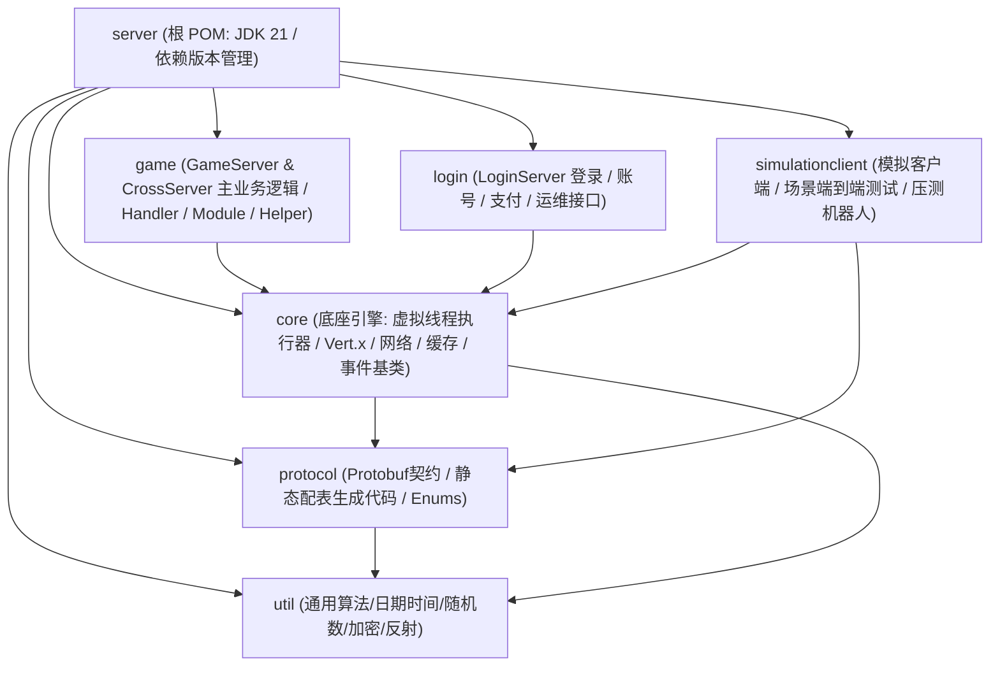
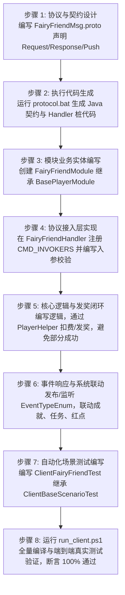

# 游戏服务器开发流程与研发规范手册

> **文档版本**：v2.0 (2026 最新研发实战标准版)  
> **面向对象**：游戏业务逻辑开发人员、系统开发人员、测试工程师  
> **适用技术栈**：Java 21 / Protobuf 3 / Maven / Vert.x 5 / MyBatis / Apollo  
> **默认文档作者**：shuyongqiang  

---

## 1. 工程结构与模块依赖规范

项目采用标准 Maven 多模块单向依赖拓扑，严禁出现模块间循环引用：



### 1.1 模块职责边界一览

| 模块名 | 核心定位 | 包含内容与使用原则 |
| :--- | :--- | :--- |
| **`util/`** | 纯工具函数库 | 提供与业务无关的高性能通用工具，如 [`DateUtil`](file:///D:/work-all/game/server/util/src/main/java/cn/game/util/DateUtil.java)（时间换算）、[`Rnd`](file:///D:/work-all/game/server/util/src/main/java/cn/game/util/Rnd.java)（随机算法）、[`JsonUtil`](file:///D:/work-all/game/server/util/src/main/java/cn/game/util/JsonUtil.java)、[`LockUtil`](file:///D:/work-all/game/server/util/src/main/java/cn/game/util/LockUtil.java)。**严禁依赖上层业务模块**。 |
| **`protocol/`** | 通信与配置契约库 | 1. 存放所有 `.proto` 协议文件与生成的 Protobuf Java 实体类；<br/>2. 存放策划静态配置解析后的 `XxxConfig`、`XxxManager`、`GlobalConst`、`XxxEnum`；<br/>3. **禁止包含任何玩家有状态业务逻辑**。 |
| **`core/`** | 通用服务端引擎内核 | 1. 虚拟线程调度中枢（[`TaskExecutorService`](file:///D:/work-all/game/server/core/src/main/java/cn/game/core/execute/TaskExecutorService.java)、`IdVirtualThreadProcessor`）；<br/>2. 集群网络通信（[`VxHolder`](file:///D:/work-all/game/server/core/src/main/java/cn/game/core/net/vertx/VxHolder.java)、`BaseHandler`）；<br/>3. 分布式缓存封装（`RedisLocalCache`）；<br/>4. 基础事件总线（`AbstractEventBus`）。 |
| **`game/`** | 游戏核心逻辑业务层 | 包含 GameServer 与 CrossServer 的全部业务实现：Handler 协议入口、Module 业务模块、Helper 资源聚合、MyBatis Mapper 与数据库持久化实体。 |
| **`login/`** | 登录与充值认证服务 | 处理客户端 HTTP 鉴权、第三方 SDK 登录（如微信、官方 Passport）、服务器列表查询分发、充值订单创建与回调。 |
| **`simulationclient/`** | 仿真客户端与测试套件 | 提供黑盒模拟真实客户端网络交互能力的自动化测试工具；包含场景自动化测试用例（`Client[Feature]Test`）与分布式高并发压测机器人。 |

---

## 2. 静态配置表（Excel）开发与维护全流程

为了实现策划数值与代码逻辑的解耦，所有静态配置表采用 **Excel 维护 -> 工具转 XML -> 自动生成 Java 代码 -> 运行时单例管理** 的闭环体系。

### 2.1 Excel 表头规范与设计约定
策划维护的 `.xlsx` 文件存放在配置仓库中。一个 Excel 文件可包含多个 Sheet（表单），Sheet 命名格式为 `[配置表名]#[中文说明]`（如 `Quest#任务配置`）。
每个 Sheet 严格采用**前四行固定表头**结构，从第 5 行开始为数据区：

```
+----+-------------+---------------+-----------------------------------------------+
| 行 | 含义        | 规则说明                                                      | 示例                                          |
+----+-------------+---------------+-----------------------------------------------+
| 1  | 端读取标记  | c (客户端读) / s (服务端读) / cs (双端都读)                   | s                                             |
| 2  | 字段英文名  | 第一列固定叫 ID，其余字段采用 CamelCase 驼峰命名法            | ID | Type | Condition | Reward               |
| 3  | 数据类型    | 支持 int, long, String, boolean, int[], int[][], Date 等      | int | int | int | int[][]                        |
| 4  | 中文注释    | 详细的策划注释与取值说明                                      | 任务ID | 任务类型 | 完成条件ID | 奖励配置        |
| 5+ | 数据内容行  | 具体的静态数值配置                                            | 1001 | 1 | 2001 | 1001;100\|1002;50            |
+----+-------------+---------------+-----------------------------------------------+
```

### 2.2 复合类型的配置格式
- **一维数组（`int[]`）**：逗号分隔，如 `1001,1002,1003`。
- **二维数组 / 阶梯消耗（`int[][]`）**：`|` 分隔外层组，`;` 分隔内层元素。
  - *示例*：消耗 1001 号道具 10 个 + 1002 号道具 5 个，配置为 `1001;10|1002;5`。
  - *阶梯消耗示例*：第 1 次消耗 100 金币，第 2 次消耗 200 金币，配置为 `1;100|1;200`。
  - 服务端直接使用 [`PlayerHelper.delResources(player, int[][] costs)`](file:///D:/work-all/game/server/game/src/main/java/cn/game/games/net/game/helper/PlayerHelper.java) 批量原子扣除。

### 2.3 导表生成与研发同步流程
1. **策划导出**：策划执行配置导表工具，生成 Java 代码（`XxxConfig`、`XxxManager`、`GlobalConst`、`XxxEnum`）及 `.xml` 数据文件；
2. **同步到工程**：执行 `update_copy.bat` 将生成的类与 XML 覆盖到 `protocol` 源码目录及 `game/src/main/resources/xml/`；
3. **安全准则**：
   - **严禁直接手动修改生成的 `XxxConfig.java` 或 `XxxManager.java`**（重新导表会被覆盖）；
   - **加载期强校验（Fail-Fast）**：在系统启动时（如 `ManagerHelper.init()`），自动校验配置 ID 是否合法，数组越界或外键找不到时抛出异常中断启动，严禁将坏配置放行到玩家运行时。

---

## 3. 通讯协议（Protobuf）开发全流程

### 3.1 协议文件与命名规范
- **文件路径**：`protocol/src/main/proto/` 目录下。
- **文件命名**：`[模块名]Msg.proto`（例如 `FriendMsg.proto`、`ItemMsg.proto`）。
- **统一包名**：`package cn.game.protocol.protobuf;`。
- **消息命名公式**：`[模块名][动作][类型]_[16进制协议ID]`
  - 请求（Request）：客户端发起，如 `FriendListRequest_30000001`
  - 响应（Response）：服务端应答，如 `FriendListResponse_30000002`（`Request ID + 1`）
  - 推送（Push）：服务端主动通知，如 `FriendApplyPush_30000022`

### 3.2 协议注释驱动生成（Annotations）
在 `.proto` 顶部增加宏注释，供 `PbProtocolGenerator` 识别生成代码：
```protobuf
syntax = "proto3";
package cn.game.protocol.protobuf;

import "BaseMsg.proto";
import "RewardMsg.proto";

//@HandlerPackage cn.game.games.net.game.module.friend
//@ClientHandlerPackage cn.game.simulation.client.handler
//@Function Friend
//@MessageModule 30
```
- `@HandlerPackage`：服务端 Handler 放置路径；
- `@MessageModule 30`：分配给该模块的 16 进制高 8 位编号（不可与其他 proto 冲突）；
- `@Function`：关联 `InitialUI` 功能开放枚举，用于框架层自动做“功能未开启”拦截。

### 3.3 数据同步双轨原则
1. **登录全量同步（`PlayerAllInfo`）**：
   - 核心养成、资产、背包、关卡进度等高频数据，由各 Module 复写 `buildPlayerAllInfo(PlayerAllInfo.Builder builder)` 拼装；
   - 客户端登录时一次性获取全量数据并在本地建立高速缓存。
2. **操作增量同步**：
   - **消耗资源（隐式通知）**：服务端调用 `PlayerHelper.delResources` 后底层自动推送通用的资源扣减事件/包，具体业务 Response **不需要**重复包含扣除的道具；
   - **获得资源（显式携带）**：新生成的装备/卡牌实例或随机掉落物，必须在具体 Response 中显式包含 `repeated RewardInfo rewards = 1;`，以便客户端展示结算弹窗。

---

## 4. 业务功能标准开发落地实践（SOP）

当研发需要为一个全新业务（如“仙友/伙伴游历系统”）开发功能时，必须严格执行以下标准落地流程：



### 详细步骤操作说明

#### 步骤 1：协议定义（Protobuf）
在 `protocol/src/main/proto/` 新建或修改 `XxxMsg.proto`，确保协议 ID 唯一且遵循 `+1` 规则。

#### 步骤 2：代码生成
运行根目录下的 `protocol.bat`（执行 `PbProtocolGenerator`），自动重新生成 `PbProtocol.java` 路由注册表与客户端桩代码。

#### 步骤 3：定义业务 Module
在 `game/src/main/java/cn/game/games/net/game/module/xxx/` 创建 `XxxModule`：
```java
package cn.game.games.net.game.module.xxx;

import cn.game.games.core.BasePlayerModule;
import cn.game.protocol.protobuf.PlayerMsg.PlayerAllInfo;

/**
 * 业务模块功能说明
 * @author shuyongqiang
 */
public class XxxModule extends BasePlayerModule {

    /** 业务持久化数据（自动存入 t_player_data.modules） */
    private int level = 1;

    /** 临时缓存或运行时对象，必须加 transient 或 @JsonIgnore */
    private transient long tempSessionTime;

    @Override
    public void buildPlayerAllInfo(PlayerAllInfo.Builder builder) {
        // 将本模块核心数据填充到登录下发包中
    }

    @Override
    public void onLogin() {
        // 登录业务逻辑（跨天更新后触发）
    }

    @Override
    public void handleEvent(PlayerEvent event) {
        // 监听特定事件推进业务状态
    }
}
```

#### 步骤 4：编写协议处理器 Handler
创建 `XxxHandler`，继承 [`GameBaseHandler`](file:///D:/work-all/game/server/game/src/main/java/cn/game/games/net/game/handler/GameBaseHandler.java)：
```java
@Component
public class XxxHandler extends GameBaseHandler {

    @Override
    protected int getModule() {
        return 0x35; // 与 proto 声明的 MessageModule 保持严格一致
    }

    @Override
    protected InitialUI getInitialUI() {
        return InitialUI.XxxFeature; // 功能开启校验枚举
    }

    @Override
    protected void inititialize() {
        putInvoker(PbProtocol.XxxActionRequest_35000001, this::action);
    }

    private void action(NetClient client, Object message) {
        XxxActionRequest_35000001 req = (XxxActionRequest_35000001) message;
        Player player = PlayerManager.getInstance().getPlayer(client.getPlayerId());

        // 1. 获取模块
        XxxModule module = player.getModule(XxxModule.class);

        // 2. 校验与扣除消耗（如果消耗不足，内部自动触发 player.fail 抛出异常中断，无需手动 if）
        PlayerHelper.delResources(player, req.getCostId(), req.getCostNum(), OpType.XxxConsume);

        // 3. 执行核心业务逻辑
        List<RewardInfo> rewards = module.doAction(req);

        // 4. 返回响应（显式带回获得的物品）
        XxxActionResponse_35000002 resp = XxxActionResponse_35000002.newBuilder()
                .addAllRewards(rewards)
                .build();
        client.sendProtocol(resp);
    }
}
```

---

## 5. 编码规范与 API 白名单铁律

在编写服务端 Java 代码时，必须时刻遵守以下 API 白名单与开发禁令：

### 5.1 核心 API 规范对照表

| 场景 | 严格禁止 ❌ | 必须使用 ✅ | 违规后果与技术理由 |
| :--- | :--- | :--- | :--- |
| **获取时间** | `System.currentTimeMillis()`<br/>`new Date()` | [`DateUtil.currentTimeMillis()`](file:///D:/work-all/game/server/util/src/main/java/cn/game/util/DateUtil.java)<br/>`DateUtil.currentTimeSeconds()` | 破坏 GM 时间偏移（`time 1d` 模拟跨天跨期）功能，导致线上无法快进时间测试。 |
| **随机数生成** | `Math.random()`<br/>`new Random()` | [`Rnd.get()`](file:///D:/work-all/game/server/util/src/main/java/cn/game/util/Rnd.java)<br/>`Rnd.randomOne(list)` | `Random` 在并发下存在伪随机争用，`Rnd` 工具类提供高性能且经过验证的游戏专用伪随机算法。 |
| **日志记录** | `System.out.println`<br/>`e.printStackTrace()` | `log.info(...)`<br/>`log.warn(...)`<br/>`log.error("...", e)` | 标准输出无时间戳、无日志分级、无法纳入 Log4j2 异步队列，容易造成生产磁盘 IO 严重卡顿。 |
| **业务异常中断** | 手动判断后返回错误包并 `return`；<br/>空 `catch` 吞异常 | [`player.fail(ErrorMsgEnum.xxx)`](file:///D:/work-all/game/server/game/src/main/java/cn/game/games/cache/entity/Player.java)<br/>`throw new LogicException(code)` | 统一抛出异常由上层 Handler 捕获，保证未完成操作快速回滚，避免数据部分写入或遗漏。 |
| **异步处理** | 裸写 `CompletableFuture` 回调链 | [`AsyncUtils.await(future)`](file:///D:/work-all/game/server/core/src/main/java/cn/game/core/util/AsyncUtils.java) | 在虚拟线程中直接同步阻塞等待，代码呈线性书写，免除回调地狱且不阻塞底层载体线程。 |

---

## 6. 重点防范的业务缺陷模式（已知踩坑防御库）

基于历史项目审计经验，以下高频缺陷模式必须在代码设计阶段主动防御：

### 6.1 `LIMIT_STATE_POISONING`（限购/次数状态污染）
- **错误场景**：跨天后，玩家直接调用购买接口；程序先执行了 `count = count + 1`，然后设置 `refreshDay = today`。此时原本昨天的满额计数被当作今天的基准进行累加，导致玩家当天额度永久被吞。
- **防御法则**：**写入口必须具备自愈性重置（Defensive Reset）**。不能假设客户端一定先打开了查询界面；在任何写操作前，先按当前统一时间校验并幂等重置计数，再核算额度与累加。

### 6.2 `LAZY_RESET_UNPERSISTED`（查询懒重置未持久化）
- **错误场景**：在查询协议（`GetInfoRequest`）中检测到跨天，将内存计数重置为 0 并返回给客户端；但由于常规 Module 仅定时保存，如果此时服务器遭遇异常停机或玩家掉线重登，数据库依然保存着重置前的旧值，导致重置丢失。
- **防御法则**：查询中的懒重置一旦产生业务副作用，必须确保进入有效保存链路；编写测试时必须重启服务后“冷读”断言。

### 6.3 集合安全截断（`subList` 越界防护）
- **错误场景**：在排行榜、推荐好友、掉落列表展示前 N 条数据时，直接书写 `list.subList(0, 8)`。当实际数据不足 8 条时直接抛出 `IndexOutOfBoundsException`。
- **防御法则**：所有切片必须强制配合边界约束：
  ```java
  List<T> subList = list.subList(0, Math.min(list.size(), 8));
  ```

---

## 7. 自动化测试与验证体系（模拟客户端）

所有新功能开发完成后，**必须编写继承自 [`ClientBaseScenarioTest`](file:///D:/work-all/game/server/simulationclient/src/main/java/cn/game/simulation/test/ai/ClientBaseScenarioTest.java) 的测试用例**，验证端到端网络收发与业务状态。

### 7.1 测试用例编写模板
```java
package cn.game.simulation.test.ai;

import cn.game.protocol.protobuf.XxxMsg.*;

/**
 * 模拟客户端功能端到端测试用例
 * @author shuyongqiang
 */
public class ClientXxxTest extends ClientBaseScenarioTest {

    public static void main(String[] args) {
        new ClientXxxTest().start();
    }

    @Override
    protected void executeProcess() throws Exception {
        System.out.println(">>> 开始测试功能流程...");

        // 1. 发送查询请求并同步阻塞等待返回
        XxxInfoResponse_35000002 infoResp = sendAndWait(XxxInfoRequest_35000001.getDefaultInstance());
        if (infoResp == null) {
            throw new RuntimeException("断言失败：查询响应为 null");
        }

        // 2. 发送 GM 指令准备前置资源（如金币、测试道具）
        sendGmCmd("item 1 100000"); // 增加 10 万金币

        // 3. 发送有副作用的操作协议
        XxxActionResponse_35000004 actionResp = sendAndWait(XxxActionRequest_35000003.newBuilder().build());
        if (actionResp.getRewardsCount() == 0) {
            throw new RuntimeException("断言失败：期望返回奖励但为空");
        }

        // 4. 对抗性测试：连续发送两次验证幂等性
        sendAndWait(XxxActionRequest_35000003.newBuilder().build());

        System.out.println(">>> 功能测试全部通过！");
    }
}
```

### 7.2 执行与回归命令
使用 PowerShell 自动化编译与运行脚本：
```powershell
# 设置 JDK 21 环境并定位到 server 根目录
$env:JAVA_HOME = "D:\Java\jdk-21"
$env:PATH = "$env:JAVA_HOME\bin;D:\maven\bin;$env:PATH"
Set-Location "D:\work-all\game\server"

# 一键编译并运行指定测试类
.\run_client.ps1 cn.game.simulation.test.ai.ClientXxxTest
```
- 若控制台输出 `TEST PASSED` 且退出码为 0，代表用例端到端跑通。

---

## 8. 本地编译与一键启停运维指南

### 8.1 依赖与中间件就绪核查
启动前后确保以下核心端口处于监听状态：
- **`2181`**：ZooKeeper 单机服务
- **`6379`**：Redis 单机服务
- **`9888`**：Apollo ConfigService 配置中心
- **`3306` / `3307`**：MySQL 8.0 数据库服务

### 8.2 全工程编译命令
```powershell
mvn clean package -DskipTests
```
或仅编译增量更新：
```powershell
mvn compile -DskipTests
```

### 8.3 进程启停规范
1. **GameServer 核心 JVM 参数参考**：
   ```text
   -Dapp.id=game -Denv=local -Dapollo.cluster=SYQ -Ddev_meta=http://test:9888
   -DdefaultNetworkIp=127.0.0.1
   --add-opens=java.base/java.lang=ALL-UNNAMED
   --add-opens=java.base/java.util=ALL-UNNAMED
   -Dio.netty.tryReflectionSetAccessible=true
   -Dfile.encoding=utf-8
   -Dserver.run.mode=test
   -Djdk.attach.allowAttachSelf=true
   -Dzookeeper.clientCnxnSocket="org.apache.zookeeper.ClientCnxnSocketNetty"
   -Dworkspace=D:\work-all\game\server
   -Dmetafolder=D:\work-all\game\configs\Server
   ```
2. **LoginServer 核心 JVM 参数参考**：
   `-Dapp.id=login -Denv=dev -Dapollo.cluster=SYQ -Ddev_meta=http://test:9888`（其余 JVM 开关同上）。
3. **日常测试与一键启动脚本**：
   在 `D:\server` 或 Windows Terminal 启动脚本中，按顺序唤起基础服务与核心游戏进程，启动后检查端口 `7011`（GameServer）与 `9390`（LoginServer）就绪即宣告部署成功。
