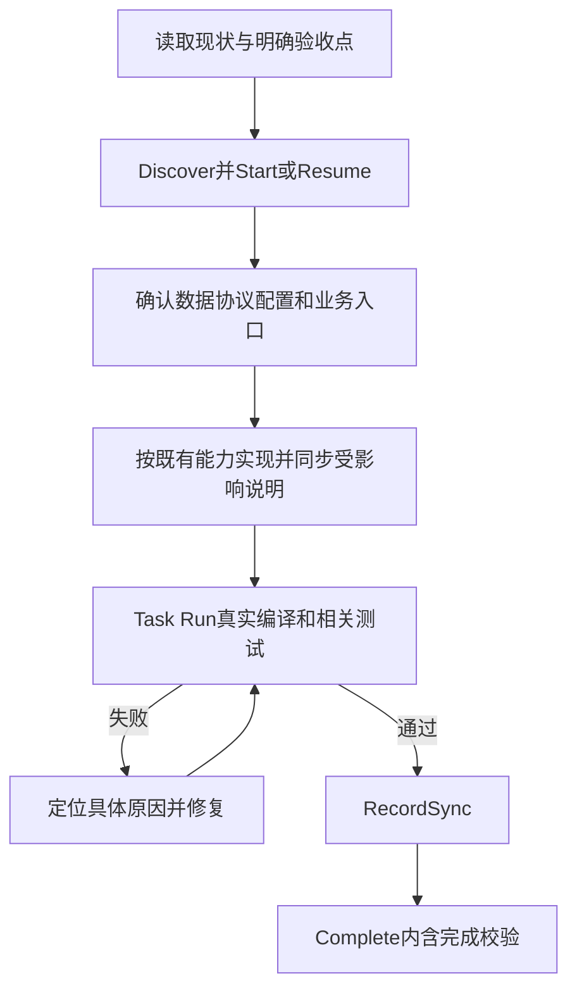

# 开发流程与研发规范手册

> 版本：3.1
>
> 核对日期：2026-10-23
>
> 项目根目录：`D:\work-all\game\server`
>
> 配套文档：[系统架构设计全景文档](01_系统架构设计全景文档.md)

本文面向新功能、既有功能维护、协议/配置变更、缺陷修复和发布验证。执行时先按当前源码确定真实入口，再按最新工程规范约束新增或直接修改的内容。已有代码中的例外不自动成为新代码的规范，也不要求顺手重构未触达的旧代码。

本文是 `doc/` 中开发流程与研发规范主题的唯一主文档。[development_workflow_sop.md](development_workflow_sop.md) 保留为旧入口的迁移说明与章节索引，后续流程和开发示例统一更新在本文。根 AGENTS.md、项目 context 与配置专项规范仍按第 0.1 节承担各自的规则来源职责。

## 0. 依据、适用范围与阅读顺序

### 0.1 事实与规则来源

| 来源 | 用途 |
|---|---|
| 根 [AGENTS.md](../AGENTS.md) 与当前 SOP 引擎 | 任务档位、执行记录、验证、恢复和完成条件 |
| [context/README](../.ai-workspace/context/README.md) | 项目知识入口与按需加载 |
| [project-summary](../.ai-workspace/context/project-summary.md)、[project-tooling](../.ai-workspace/context/project-tooling.md) | 工程、工具和真实仓库边界 |
| [coding-style](../.ai-workspace/context/coding-style.md)、[ai-coding](../.ai-workspace/context/ai-coding.md) | 新增/修改代码规范和常用实现入口 |
| [business-logic-pattern](../.ai-workspace/context/business-logic-pattern.md) 及其专题 | 事件、条件、活动、任务、红点和奖励规则 |
| [proto-rules](../.ai-workspace/context/proto-rules.md)、[client-test](../.ai-workspace/context/client-test.md) | 协议设计与模拟客户端测试 |
| [配置表AI编码规范](../../dic_generate/配置表AI编码规范.md) | 配表详细规则，优先于本手册的重复摘要 |
| 当前 Java、POM、脚本、生成器模板和实际生成物 | 核实 API、执行路径、产物与规范漂移 |

本次宿主核对基线为 `eaaeab57`，protocol 为 `95bd316`。配置规范依据生成器源码 `963495980357b1fa80f3e16ad70b0a4a3a817114`，但部署的 `Gen.jar` 尚未证明与该源码相同。基线用于说明观察范围，不代表所有工作区文件都无未提交变更。

遇到文档与源码不一致，先判断是旧说明、待落实规范，还是实际缺陷；不要按旧说明修改正确代码。本文区分“当前实现”“开发要求”“优化建议”，没有将未运行的生产环境或故障恢复验证写成已通过。

### 0.2 按任务阅读

- 普通业务开发：第 1、2、5、7、9、11 节，并按领域读第 6 节。
- Excel/索引变更：完整阅读第 3 节和外部配置规范，再检查目标表与生成物。
- 协议变更：第 4 节，同时确认客户端发布和测试链路。
- 保存、并发、跨服问题：第 8 节与架构文档第 5、7、8、9 节。
- 环境、上线、回退：第 10 节；优化计划见第 12 节。

## 1. 工程、目录和工具边界

### 1.1 Maven 模块与职责

根 POM 声明六个模块，Java release 为 21，当前 Vert.x 为 5.0.4。Cross 是 game 工程内的另一服务入口，不是根 POM 的第七个独立模块。

| 模块 | 主要职责 | 变更时的核对重点 |
|---|---|---|
| util | 时间、随机、配置及通用工具 | 共享行为不能为单个功能随意改变 |
| protocol | proto、生成器、protobuf 与配置生成代码 | 存在独立 Git，检查真源与产物是否匹配 |
| core | 执行队列、网络/RPC、缓存、基础设施 | 明确兼容面，不能借业务开发无范围地修改框架 |
| game | Game/Cross、Handler/Module、实体与 Mapper | 玩家/公会归属、业务状态、保存、通知 |
| login | HTTP 登录、账号/区服等入口 | 与 Game 登录链路及环境配置一致 |
| simulationclient | 模拟客户端、协议场景与压测工具 | 主源码中的场景不会被 mvn test 自动执行 |

### 1.2 文件放置与仓库归属

| 资产 | 位置/管理方式 |
|---|---|
| 项目级说明 | `doc/` |
| 项目上下文 | `.ai-workspace/context/`，独立工作区仓库 |
| 功能规格与任务 | `.ai-workspace/specs/features/<FeatureName>/`，按 specs 的实际独立归属管理 |
| SOP 引擎与入口 | `.ai-sop/` 子模块、根 `ai-sop.ps1`；锁文件固定引擎版本 |
| 协议真源 | `protocol/src/main/proto/`，protocol 子目录本机另有 Git |
| 游戏 Handler/Module | `game/src/main/java/cn/game/games/net/game/module/` 及对应领域目录 |
| 关系实体/Mapper | `game/.../cache/entity/`、`game/.../net/data/mapper/` 及 Mapper 资源 |
| 模拟客户端场景 | `simulationclient/src/main/java/cn/game/simulation/test/ai/` |
| 配表真源 | `D:\work-all\game\configs`，不在 server 根目录内 |
| 配表生成器源码 | `D:\work-all\game\dic_generate` |

Maven 依赖关系不等于 Git 归属。提交前分别检查实际仓库，不能在宿主执行一次 `git add` 就声称 protocol、workspace、specs 都已同步。保留不相关修改；新增/删除及时按实际 VCS 登记，重命名优先使用 VCS move。

### 1.3 最小环境核查

检查 JDK 21、Maven、PowerShell 7、Git 与依赖可获取性；使用当前终端实际的 `java -version`、`mvn -version`、`pwsh --version`，不要只看 IDE 配置。业务联调另需核对 Apollo、Redis、Zookeeper、数据库和所需服务，不能因编译通过推导运行环境已就绪。

常用编译命令从项目根执行：

```powershell
mvn -B '-DskipTests' compile
mvn -B '-DskipTests' test-compile
```

第二条只编译测试源码。根 POM 默认 `skipTests=true`，不能以 `BUILD SUCCESS` 直接宣称测试执行成功。已登记的修改任务应通过第 9 节的 Task Run 保存真实验证证据。

## 2. 任务生命周期与研发流程

### 2.1 按本次任务选择强度

| 档位 | 适用及完成要求 |
|---|---|
| T1 极速 | 人工明确选择；实现、生效所需产物和配置到位，真实编译/基础检查通过；确有延期才记 FollowUp |
| T2 快速 | 默认；明确验收点，修改实现并同步受影响需求/设计/用例，编译与相关测试通过，RecordSync 后完成 |
| T3 完整 | 人工选择或继承原任务；按完整规格、批准、独立审查、覆盖和验证门禁执行，复用已有有效成果 |

讨论、解释、只读审核无需登记。准备修改源码、测试、配置或项目文档时先确定任务并登记。纯文档仍采用 T1/T2；“简单改一下”不自动降成 T1，协议/存储关键字也不自动升成 T3。

T1/T2 不强制头脑风暴、正式计划、重复批准或独立代码审核，不依赖独立 subagent。T3 执行前必须读 `.ai-sop/workflows/agent-t3.md` 和 `superpowers-adapter.md`；能力不足按引擎规则说明，由人工决定工具或档位，不能假装已完成独立审查。

### 2.2 修改前的登记与验收点

先读取必须的 context 文件，检查已有改动和功能规格。用 Discover 区分新任务、续做或补收尾；同会话明确的任务不反复 Discover/Resume。

以下是命令模板，尖括号必须替换为真实值；客户端注入会话身份时，每个 Task 命令都带相同的 `-Agent` 和 `-NativeSessionId`：

```powershell
pwsh -NoProfile -File ./ai-sop.ps1 Task -Operation Discover -Agent <Agent> -NativeSessionId <真实会话ID>
pwsh -NoProfile -File ./ai-sop.ps1 Task -Operation Start -Feature <FeatureName> -TaskId <taskId> -Objective "本次目标与边界" -Agent <Agent> -NativeSessionId <真实会话ID>
```

FeatureName 使用 PascalCase；taskId 表示一次独立修改。新任务默认 T2；T1/T3 需保存用户真实选择原话。继续原任务用 Resume 并继承其档位，不用新名字逃避原失败或归属。Start/Resume 成功后才能写入；首次修改前简短说明实际档位及义务。

验收点应包含具体入口、可观察结果和关键失败行为。例如领奖需求至少写清：资格、次数/时间、奖励来源、重复调用结果、失败时资源与状态不变、响应/通知、保存后恢复。T2 可直接放入现有条款、设计段落和用例，无需强制创建全套 01/06/05 文档。

### 2.3 实现与同步顺序



用户已给出的清晰需求就是依据；只澄清影响正确性的关键歧义。新增类型必须复用旧通用校验链，不能通过特判旁路资格、限购或支付校验。协议源文件、生成代码与生效配置属于实现，不可按“文档后补”延期。

已批准需求/设计修改语义前，按 SOP 用 `workflow-state.ps1 -Operation ResetApproval -Gate requirement|design` 作废对应批准；requirement 会连带 design。T2 同步本次依据与受影响内容，不补完整 T3 批准；T3 重新确认与批准。仅错字格式可走 UpdateHash，并注明不改语义。实际参数按当前引擎手册使用，不手写状态文件。

### 2.4 验证、证据和完成

Task Run 执行真实命令，按同一 Kind/Batch 保留失败与复测历史；命令、Profile 或用例范围改变时记录 Reason。不能用无关成功、固定 exit 0、旧报告、零执行测试掩盖失败。保存证据失败按提示 RetryEvidence；不要盲目再跑或篡改哈希。

Start 的轻量起点若 UNAVAILABLE，不阻止正常编译/相关测试，但不能用修改后的快照补造基线。纯文档的执行豁免必须满足 SetApplicability 对起点和 Start 前 nonExecutable 路径的要求；`Tests=NOT_APPLICABLE` 仅是同步记录，不自动免除验证。T3 不使用轻量豁免。

完成前记录同步范围，再直接 Complete；无需固定串行 Verify → Status → Complete：

```powershell
pwsh -NoProfile -File ./ai-sop.ps1 Task -Operation RecordSync -Feature <FeatureName> -TaskId <taskId> -Agent <Agent> -NativeSessionId <真实会话ID> -Documentation UPDATED -Tests UPDATED -Summary "已同步的需求/设计/用例及实际范围"
pwsh -NoProfile -File ./ai-sop.ps1 Task -Operation Complete -Feature <FeatureName> -TaskId <taskId> -Agent <Agent> -NativeSessionId <真实会话ID>
```

Documentation 可为 UPDATED/UNCHANGED；Tests 可为 UPDATED/UNCHANGED/NOT_APPLICABLE，必须有真实依据。Complete 成功才是本次任务 DONE，不表示整个历史功能或旧 T3 已验收。

### 2.5 暂停、接管、失败与延期

暂停用 Suspend 并记录 NextAction/Notes，释放占用。异常中断先 InspectRecovery，按诊断 Recover → Resume；正常跨会话接管按提示 ConfirmTakeover。不得删除损坏记录、手工改 owner 或用绕过开关取得权限。

有实际延期才 AddFollowUp，写具体 documentation/test-cases/verification 范围；完成后 CloseFollowUp。旧待办不自动升档或阻止新任务，但 DONE 也不会隐藏它。不同工作副本按独立 taskId 管理；同步任务记录不等于同步了本机写权限，合并后重新验证。

## 3. 配置表设计、生成与运行生效

本节按 2026-10-23 的[配置表AI编码规范](../../dic_generate/配置表AI编码规范.md) 整理。变更前先读目标 Excel、ExcelMeta 条目和实际生成类；示例名称/ID只展示语法，不代表已定义的正式业务数据。

### 3.1 真源、路径与修改边界

设 `GAME=D:\work-all\game`，`CONFIGS=GAME\configs`，`SERVER=GAME\server`，`GEN=GAME\dic_generate`；这些是文档缩写，不是预置环境变量。

| 内容 | 位置 |
|---|---|
| 业务表 | `CONFIGS\Excels\*.xlsx` |
| 表类型、索引、继承 | `CONFIGS\Server\ExcelMeta.xlsx` |
| 跨表引用规则 | `CONFIGS\Server\DataChecker.xlsx` |
| 实际部署工具 | `CONFIGS\Server\dic_generate\Gen.jar`、lib、bin\java.exe |
| Java/XML生成结果 | `CONFIGS\Server\output\java`、`output\xml\data` |
| 客户端输出 | `CONFIGS\Ts\<表名>.ts` |

Excel 是数据真源，ExcelMeta 是生成结构真源。改变字段/类型/索引必须修改源表并重新生成，禁止手改 Java/XML/TS 生成物实现需求。仅使用既有配置写业务代码时不必导表。保留既有 ID、字段名和语义；需要改变时评估存量数据、客户端和回退。

### 3.2 工作簿和 sheet

- 只使用 Excels 目录直接包含的 `.xlsx`；当前不递归扫描，不使用 `.xlsm`/`.xls`。
- 一个工作簿可含多个 sheet，命名 `表名#中文说明`，`#` 前名称在所有工作簿中唯一，新增用合法 PascalCase，不附加工具会生成的 Config 后缀。
- `#` 开头的 sheet 忽略；隐藏 sheet 仍可能解析，不能靠隐藏停用。Excel 临时文件 `~$...` 忽略。
- 编辑需保留无关 sheet、格式、公式和数据，不能以重建整本工作簿代替局部修改。

业务表固定四行表头，第五行开始数据：

| 行 | 含义 | A列 | B列 | C列 |
|---|---|---|---|---|
| 1 | 导出归属 | cs | cs | s |
| 2 | 字段名 | ID | Type | Reward |
| 3 | 字段类型 | int | int | int[][] |
| 4 | 中文含义 | 配置主键 | 业务类型 | 物品ID与数量 |
| 5 | 示例数据 | 1001 | 1 | `2001;3\|2002;5` |

表格中的 `\|` 在 Excel 中写普通 `|`，不要带反斜杠。归属统一用 c/s/cs/n，中间不能留空；n 用于备注等不导出内容。有效字段名称/类型不空、不重复，大小写准确。

第一物理列为大写 `ID`，普通表优先 int；双端表标 cs，服务端表标 s，确保第一服务端字段仍为 ID。即便 group/list 不按 ID 查询，也必须保证行 ID 唯一。第一列以 `#` 开头可注释一行。

数据中不插空行，读取遇空行可能终止；后续检查未必发现遗漏。数值避免百分比/千分位格式，长整数注意 Excel 精度。公式依赖已保存的计算缓存；只写公式字符串不保证导出正确。字符串会 trim，不用首尾空白承载语义。

### 3.3 字段类型和分隔符

| 类型 | 单元格语法 | 必须检查 |
|---|---|---|
| byte/short/int/long | `123` | 范围、单位、溢出和既有 ID 类型 |
| float/double | `1.25` | 比例/万分比由业务定义，不自动缩放 |
| string | 普通文本 | 客户端引号/转义，trim 后语义 |
| boolean | `0` 或 `1` | 普通标量禁止用文本 false，当前会被转 true |
| int[] / string[] | `1;2;3` | 一维使用英文分号 |
| int[][] / string[][] | `1;2\|3;4` | 组内分号、组间竖线，每组长度由业务校验 |
| List<Integer> / List<List<Integer>> | 同对应数组 | 服务端常见组合可用，双端优先数组 |
| Map<Integer,Integer> | `1001;3\|1002;5` | 每组两项，key 不空且不重复 |
| List<Entry<Integer,Float>> | `1001;0.5\|1002;1.5` | 验证实际生成签名和加载值 |
| Date | `2026-10-23 13:02:00` | 格式 yyyy-MM-dd HH:mm:ss；时区由运行约定明确 |
| CronExpression | `0 0 0 * * ?` | 半角符号与实际触发规则 |
| XxxEnum | 整数枚举ID，如 `1` | 名称大小写及 Enum 后缀准确；标量不能空或0 |

普通数值空值为 0，string 为空串，空集合为空数组/List/Map，Date/Cron 为空时为 null。工具默认值不等于业务合法值，加载/初始化中还需校验必填、正数、长度、概率、时间先后等。字符串集合中的 `;`、`|` 没有通用转义方案。

### 3.4 ExcelMeta 的固定结构

ExcelMeta 只读第一张 sheet，第 1 行说明、第 2 行起数据，不能套用业务表四行表头。按固定列位置读取，不调换列或插空行：

```text
A id | B desc | C className | D fileType | E excelFilepath
F index | G compoundIndexes | H uniqueIndex | I nestedIndexes
J weight | K sort | L base
```

C 是 sheet 的 `#` 前名称，不能重复；D 小写。主入口会确定 E 路径，可为空；B 会被 sheet 中文说明覆盖。未登记普通表默认 dict，不必为普通表强制新增元数据行。

| fileType | 适用范围 | 真实访问形态 |
|---|---|---|
| dict | 按 ID 查询 | get/getNullable；list 为 Collection |
| odict | 需要加载顺序的 ID Map | 类似 dict，模板使用 LinkedHashMap |
| group | 按字段取分组，至少一个普通索引 | 索引返回 List，list 为首个普通索引的 Collection<List> |
| list | 顺序遍历行 | list 为 List，无 get(id) |
| ui | 按唯一索引访问，至少一组唯一索引 | getUI...；list 基于首个唯一索引，无 get(id) |
| enum | 生成命名枚举 | 同名 Java enum，无普通 XML/Manager |
| const | 全局常量 | 同名类 static 字段与特殊 XML |

### 3.5 普通、联合与唯一索引

普通索引 F 写 `Type|Level`，表示两套独立索引；字段存在且对服务端可见。常见生成方法为 `getTypeList(value)`、`getTypes()`。

联合索引 G 写 `Chapter;Level|Type;Stage`，每组最多 3 字段，返回列表，例如 `getChapterLevelList(...)`。唯一索引 H 使用相同分组语法，例如 `Code|Chapter;Level`，生成 `getUICode(...)`、`getUIChapterLevel(...)`；无结果返回 null，重复键在加载时检查。

G/H 当前按数字组合键，新增使用非负整数，并遵守下列限制：

| 索引 | 字段上限 |
|---|---|
| 联合索引 | 每项 999999 |
| 唯一索引，1或2字段 | 每项 9999999 |
| 唯一索引，3字段 | 前两项 9999999，第三项 99999 |

上限内仍需检查组合后的 long 溢出，不能只校验单项。枚举索引键依赖 getId 宏，但当前枚举模板未提供该方法，不直接选用。普通/联合索引查不到通常为空 List，唯一索引查不到为 null；调用者按实际生成类处理。

### 3.6 排序、权重、继承及特殊表

权重 J 填 int 兼容字段名，生成 Weightable.weight()；不自动抽奖，也不检查概率总和。排序 K 当前只配单个数值字段，影响普通/联合索引列表和 list 总表，不保证 dict 总 Map 或嵌套索引有序。

父表 L 填父 sheet 名，生成 `ChildConfig extends ParentConfig`；子表仍须包含父字段和行数据，定义保持一致。不是按 ID 自动去父表补值的关系模型。

枚举表仍用四行表头，必要字段 `ID:int`、`name:string`、`desc:string`，至少 ID/name 标 s。name 是合法唯一 Java 枚举常量名。特殊 string ID 会被用作枚举常量名，但不意味着其他字段的枚举引用支持 string ID。

常量表也是四行表头，必要列为 ID/name/type/value，列类型通常均为 string；一行例为 `MaxCount / 最大数量 / int / 100`。ID 是合法 Java 字段名，type 单元格决定实际常量类型。生成 GlobalConst 等同名类，不加 Config 后缀；不能依赖逐常量行 c/s 分流。

### 3.7 业务查询规则

先读生成类签名，再写调用。Config 通常是 public final 字段；不要假定 getter。必要项用 get(id)，允许缺失才用 getNullable 并处理 null。配置缺失不应默认发奖或吞异常后继续。

本项目已有的典型查询为 `QuestManager.instance().get(id)`，具体字段与索引方法仍以当前生成物为准。group/list/ui 不能套用 dict API；当前模板没有通用 `getMap()`。枚举读取 public final ID 或实际 get/getNullable，不假定 `getId()`；常量直接用实际 GlobalConst 字段。

Manager 从 classpath `xml/<表名>.xml` 加载，不在请求内手工读取 Excel/XML 或重新 load。共享 Config 的数组、Map/List 也按只读使用；需要变更先复制。高频请求优先用现有索引，不用逐请求全表扫描替代。

客户端当前是 TS 文件，导出 `DataType<表名>` 接口与 `<表名>` 数据数组，不是 JSON 数据包或自动 TS enum。

### 3.8 DataChecker 引用规则

新增/调整跨表引用同步 `DataChecker.xlsx`；工具不会自动识别所有业务引用。DataChecker 与 AllItemID 两张 sheet 都采用业务表四行表头，备注 n、布尔 0/1。

规则字段为 ID/srcConfig/srcField/refConfigs/fullRef/consistentRef。示例：

```text
srcConfig = Item
srcField = ID
refConfigs = SampleQuest;Reward;0
fullRef = 0
consistentRef = 0
```

含义是 SampleQuest.Reward 每组第 0 项必须属于 Item.ID，不是从 SampleQuest 查 Item 的反向含义。多引用用 `|`，字段间用 `;`，不能写成冒号。

- 标量省略下标；一维指定位置，二维对每组取指定位置。
- Map/Entry 指定 0 检查 key、1 检查 value。
- 常量写 `GlobalConst;常量ID名`。
- 默认引用集合是源集合子集；fullRef=1 要求等于源集合，consistentRef=1 要求本行各引用集合彼此一致。
- 引用侧 0 会忽略，越界可能没有取到值；不校验重复次数或顺序。奖励数组长度、数量和结构仍需业务校验。

AllItemID 使用 ID:int、tables:string[] 定义表 ID 合集，例如 `Asset;Item;Hero`。规则用 srcConfig=AllItemID、srcField=`1;2` 选择分组编号；不是在 srcField 写具体道具 ID，也不提供跨表 ID 唯一性检查。

### 3.9 生成与复制的完整流程

1. 确认源表、元数据、引用规则、工作区已有修改和预期输出范围。
2. 修改源文件；结构/索引变更同时调整调用和测试，保留 ID 兼容。
3. 用实际部署的 x.dic.App 生成 TS/XML/Java 并执行引用检查。ExcelMeta、删表/改名、生成器变化使用 fast=false；增量仅比较业务 Excel 修改时间，不能覆盖这些变化。
4. 检查最终 Java 退出码、完整错误日志与数据检查结果。中间“解析成功”、文件存在、parse.bat 包装退出码都不足以单独证明成功。
5. 审查产物差异，按既有复制链同步。删表/改名另查旧文件残留，复制不等于删除同步。
6. 编译受影响工程，实际加载受影响配置并验证业务约束，再决定运行实例如何生效。

工具调用参数如下，仅是执行说明，不代表普通开发应自动导表：工作目录 `CONFIGS\Server\dic_generate`，`bin\java.exe`，classpath `.;lib/*;Gen.jar`，主类 `x.dic.App`；JVM 参数置于主类之前：

```text
-Dmetafolder=<CONFIGS\Server绝对路径>
-Dfast=false
-DcontinueOnError=true
-DprettyFormat=false
-DgenTempBranch=<工作副本与分支唯一标识>
```

只检查引用时主类可用 `x.dic.check.DataChecker`。continueOnError 不表示错误被业务接受，最终仍须核对全部错误。全量会清空生成目录，优先隔离副本，保持 Excels 与 Server 的相对布局。不要默认执行带还原、pull、切分支、commit/push 的“完整/快速流程”等包装脚本。

主入口不会复制工程。服务端复制脚本 [copy.bat](../game/tool/copy.bat) 要求 metafolder=CONFIGS\Server、workspace=SERVER；`copytotarget=1` 还会覆盖 target/classes 中运行可见的资源，使用前确认目标。

[update_copy.bat](../game/tool/update_copy.bat) 另有仓库操作：当前将代码分支 `pre_release` 映射到配置分支 `Branch_West`，将 `dev` 映射到 `Branch_West_Dev`；必要时 checkout，随后执行 `git pull origin <目标配置分支>`，再调用 copy.bat。恢复原分支位于成功路径末尾，中途失败可能直接退出；即使恢复分支，也不会撤销已拉取的提交。普通生成物同步使用 copy.bat；只有明确需要分支同步时，才按已核实的仓库状态和目标版本使用包装脚本。

| 生成结果 | 工程目标 |
|---|---|
| output/java/entity | protocol/.../generated/config |
| output/java/enum | protocol/.../generated/enume，受 exclude.txt 影响 |
| output/java/init | protocol/.../generated/helper |
| output/java/manager | protocol/.../generated/manager |
| output/xml/data | game/src/main/resources/xml |
| 仅 GlobalConst.xml | login/src/main/resources/xml |

### 3.10 当前工具限制与必要验证

| 能力 | 当前限制与处理 |
|---|---|
| boolean | 普通标量文本 false 会变 true；集合/常量转换另有差异，检查 XML 与加载值 |
| LocalDateTime、json/json<T>、异构数组 | 有类型或生成分支缺口，不凭 Java 类型名认为支持 |
| 双端 Date/Cron/Enum/List/字符串 Map/Entry | TS 值或类型映射不完整，新增组合检查 TS 编译及实际值 |
| nestedIndexes | 只按数量映射固定小写 type/round/stage，最多三层，不是任意字段 |
| 多字段 sort | 模板可能生成连续 return，当前仅用单数值字段 |
| formula/index | 生成、初始化、复制链不完整，不作为默认新增方案 |
| Excel公式 | 依赖缓存；非 float/double 数值公式可能转 int |
| 增量 | 不清理删表产物，未修改文件时也可能异常退出 |
| i18n | 当前按字符串，不自动生成多语言字典 |
| 热更新 | 生成成功不证明运行服务加载，更不证明全节点原子切换 |

配置验收分四层记录：源数据/引用通过、生成物正确、工程编译通过、加载与业务行为通过。至少覆盖目标 ID、缺失引用、唯一索引冲突、Map 重复 key、枚举引用、数组长度和数值范围。新增复杂类型额外验证客户端产物。不得只比较文件时间就宣称发布生效。

## 4. 通讯协议开发与兼容

### 4.1 真源与编号

协议真源在 `protocol/src/main/proto/`，按功能使用 `<模块名>Msg.proto`，包为 `cn.game.protocol.protobuf`。公共结构优先放 BaseMsg/RewardMsg 等既有公共文件，避免功能协议互相循环依赖。

消息命名为 `<模块><行为>Request|Response|Push_<协议ID>`。协议 ID 是十六进制，高 8 位模块号、低 24 位消息号；新模块号与消息号均先全库检索。Request + 1 = Response；Push 不与已占用编号冲突，也避免 PushID 与 PushID-1 落入现有请求响应配对。

`@MessageModule` 注解中的文本会用于生成 `0x...` 模块常量。例如已有好友模块 `30` 对应 `0x30`，不是十进制 30。示例中的已有编号只能用于理解，不能直接当作新功能可用编号。

### 4.2 生成注解与执行入口

| 注解 | 内容与核对点 |
|---|---|
| `//@HandlerPackage` | 服务端包路径，必须是目标功能实际位置 |
| `//@MessageModule` | 与消息高8位一致的模块号文本 |
| `//@ClientHandlerPackage` | 可选客户端 Handler 包路径 |
| `//@Function` | 实际存在的 InitialUI 枚举名；不能编造功能枚举 |

根 [protocol.bat](../protocol.bat) 调用 PbProtocolGenerator，需先检查 protocol 独立仓库的修改和 `proto_gen.properties`。当前脚本的 workspace 默认 server 根，metafolder 默认 workspace，**不是自动指向 configs\Server**；根据实际资源定位显式设置需要的值。

若已存在编译后的 PbProtocolGenerator.class，脚本会跳过生成器编译。改过生成器/依赖时，应先编译相应模块，避免运行旧 class。工具按属性决定是否执行 proto-to-Java，并可生成/更新服务端 Handler 和模拟客户端产物；不能笼统称为“只重写 generated 目录，不碰已有 Handler”。

当前 [proto_gen.properties](../protocol/src/main/resources/proto_gen.properties) 为 `proto.to.java=true`、`client.test.java=false`。按 [PbProtocolGenerator](../protocol/src/main/java/cn/game/protocol/tool/PbProtocolGenerator.java) 的分支，当前启用 Protobuf Java 生成，关闭模拟客户端 Request 测试类和 Handler 的生成。模拟客户端产物与前端协议产物是不同链路；调整开关前确认输出范围，不能因执行了 protocol.bat 就认为客户端测试代码已自动更新。

执行后逐项核对：proto Java 产物、协议 ID 映射、Handler 注册与业务方法、客户端处理器/测试、配置指定的其他输出。保护原业务逻辑，检查编译和差异，不能因为脚本退出 0 就跳过产物审查。

### 4.3 Handler 接入

参考实际 [FriendHandler](../game/src/main/java/cn/game/games/net/game/module/friend/FriendHandler.java) 的类结构和注册方式，不照抄其所有历史业务写法。当前扩展点为 `getModule()`、`inititialize()` 与 `putInvoker(...)`；注意 inititialize 的现有拼写，不能在示例里改成一个不会被调用的新方法。

Handler 负责可信连接身份、协议入参、前置校验、调用 Module、构建 Response 和发送；Module 负责业务语义和状态。避免把完整 Request/Response Builder 长期保存在 Module，优先下传有明确含义的业务参数。

GameBaseHandler 的功能/状态检查受实际注解与分支控制，业务仍需校验实例归属、活动轮次、目标 ID 和具体资格。错误码从当前 ErrorMsgEnum 等真实定义查找；不要假定所有枚举都由 Excel 生成，也不要为了示例编造错误 ID。

### 4.4 全量、增量与奖励同步

- 核心基础数据在对应 Module 的 `buildPlayerAllInfo` 中构造，随登录全量同步；客户端缓存不能成为服务端权威数据。
- 低频周边数据按需拉取，明确响应是全量快照还是增量，空集合表示什么。
- 扣除资源沿用既有公共通知，业务响应不重复承担所有扣除明细。
- 获得奖励通过公共发放入口生成实际 RewardInfo，并按协议契约放进响应；notify 参数不替 Handler 填充 Response。
- 主动推送使用现有 PlayerHelper 等发送入口；不要用推送替代必须返回的请求响应。

### 4.5 字段与发布兼容

新增/修改字段至少记录：来源与权威方、静态/动态、类型/单位、默认/空值含义、接收方/权限、集合顺序、全量/增量、兼容和断言。静态配置通常传 ID，动态实例和服务端生成属性按需传真实数据。

不复用删除字段的编号，不更改原编号类型/语义；删除时用 reserved。新增或直接修改的对外协议不暴露裸 Protobuf map，使用命名明确的 repeated XxxInfo，内部 Map 在边界转换。不要为规范化批量破坏未触达的旧协议。

明确服务端/客户端/配置发布顺序和混跑窗口。展示其他玩家数据也要考虑接收方版本能否识别配置或条目；展示过滤不应反向污染权威存储。测试包括旧客户端读新服务、新客户端读兼容服务、空/默认字段和不支持条目。

## 5. 业务功能从需求到实现

### 5.1 开发前写清的最小契约

| 维度 | 必答问题 |
|---|---|
| 入口 | 哪个协议/事件/定时器/GM/RPC触发，执行在哪个实体队列？ |
| 权威数据 | 玩家、配置、活动轮次和资源从哪里读取，谁能修改？ |
| 资格 | 功能开放、时间、等级、前置、对象归属如何检查？ |
| 状态 | 哪些字段持久化，哪些仅运行期，哪些可由其他状态推导？ |
| 操作 | 成本、奖励、次数、标记、事件、通知的顺序和失败边界？ |
| 重复 | 相同seq、不同seq重复业务、重连重发分别怎样处理？ |
| 时间 | 自然日还是5点，时区/单位、离线跨周期、边界包含关系？ |
| 保存 | 用模块快照还是独立表，何时算成功，崩溃窗口怎样处理？ |
| 兼容 | 旧玩家默认值、旧配置删除、旧客户端与回滚如何处理？ |
| 验证 | 成功、关键失败、重复、边界、冷加载的明确断言？ |

### 5.2 Module 职责与生命周期

模块继承 [BasePlayerModule](../game/src/main/java/cn/game/games/core/BasePlayerModule.java)，经项目现有扫描/初始化与 Player 管理。不要自行建立第二套静态玩家模块仓库，也不要仅 new 一个 Module 就认为完成了 player 注入和事件注册。

| 钩子/方法 | 用途与限制 |
|---|---|
| `initDefault(Player)` | 框架绑定 player/playerId、设置DB约定、注册事件并调用初始化；final方法不覆盖 |
| `init()` / `initAfter()` | 模块初始化，区分新对象和反序列化旧数据，不无条件清空既有进度 |
| `getInitOrder()` / `getPreClasses()` | 当前初始化排序辅助；依赖需保持无环，不假定已有完整拓扑诊断 |
| `defaultDbMapperClass()` / `defaultSelectMethodName()` | 独立表查询约定；默认查询按玩家ID，数组对应关系需正确 |
| `initFromDb(...)` | 消费本模块查询结果，数量与登记的任务匹配 |
| `initFromDbAfter()` | 数据恢复后的初始化/兼容，不混入只应在线登录触发的业务 |
| `onLogin()` | 正常登录相关业务，处于跨天处理之后；不在此重复注册事件 |
| `getEventTypes()` / `handleEvent(...)` | 声明与处理模块关心的事件 |
| `buildPlayerAllInfo(...)` | 需要随登录下发的核心状态 |
| `autoSaveTasks(...)` | 按既有保存模式组织实体；独立表不自动拥有跨表事务 |
| `alwaysStoreDataInStandaloneTable()` | 参与独立表加载/保存策略，仍需明确JSON排除与字段持久化 |
| `isComplete()` | 未完成模块可返回false而不被正常初始化；正式接入必须核对 |

`getModuleSorted()` 的排序不能推导为所有初始化均有依赖顺序；Player.initModule() 当前遍历扫描集合，不能仅设置 getInitOrder() 就假定另一个模块的 init() 已完成。跨模块初始化应沿实际调用点核对。

以下是仅展示当前抽象签名的最小骨架，可独立编译；它没有正式协议、状态或业务行为，并通过 isComplete=false 明确未启用。新增真实模块时补齐需求、保存和断言后再接入：

```java
package cn.game.games.net.game.module.example;

import cn.game.games.core.BasePlayerModule;
import cn.game.games.core.event.EventTypeEnum;
import cn.game.games.core.event.PlayerEvent;
import cn.game.protocol.protobuf.PlayerMsg.PlayerAllInfo;

/** 展示模块扩展签名；正式接入前需补齐业务与持久化契约。 */
public class ExampleModule extends BasePlayerModule {

    /** 当前示例没有需要随登录下发的数据。 */
    @Override
    public void buildPlayerAllInfo(PlayerAllInfo.Builder builder) {
    }

    /** 当前示例不订阅玩家事件。 */
    @Override
    public EventTypeEnum[] getEventTypes() {
        return new EventTypeEnum[0];
    }

    /** 当前示例未订阅事件，因此不产生业务副作用。 */
    @Override
    public void handleEvent(PlayerEvent event) {
    }

    /** 保持示例未启用，避免被当作已实现功能。 */
    @Override
    public boolean isComplete() {
        return false;
    }
}
```

持久字段使用业务数据类型，并保证当前序列化方式能够读写；运行时缓存、player引用、日志对象、计时器和 protobuf Builder 不作为持久状态。重命名包/类/字段要评估旧 modules 中的类名/类型信息，不能只改 Java 引用。

### 5.3 Handler → Module 的写操作顺序

下面是流程约束，不是可以直接复制编译的业务实现。具体 API 重载、错误码、资源类型和状态字段需从目标功能查证。

```text
可信连接确定玩家和所属队列
→ 解析参数，校验范围、去重、目标归属
→ 复用功能/资格/活动窗口校验
→ 校正当前周期，再读取次数和领取状态
→ 从配置计算权威成本与奖励，检查溢出与全部前置条件
→ 使用既有资源接口扣除/发放并推进业务状态
→ 按当前保存契约处理持久化与失败窗口
→ 产生约定事件和资源通知
→ 用实际执行结果构造并发送响应
```

客户端传入的价格、奖励数量、playerId、完成状态不能直接采信。批量操作先明确整体成功还是允许逐项结果，聚合同资源ID的成本，检查整数乘法/加法溢出以及容量约束。不能先扣第一项再发现第二项不合法，却向客户端返回“全部失败、无副作用”。

资源接口抛异常不提供通用回滚。涉及扣费、发奖、领取位、远端调用和持久化时，应明确每个可能失败的位置，以及重试、补偿或人工处理依据。不能先置已领取再发奖却无恢复，也不能先发奖后长期不保存领取位。

### 5.4 查询、重置与旧数据

查询中发生懒重置、补偿或重算持久状态，就必须进入保存闭环；不能以接口名为 GET/INFO 断言只读。购买/领奖等写入口也独立执行幂等周期校正，不能假定客户端先打开界面。

新周期应先清理/结算旧周期状态，再更新周期标识；先覆盖时间戳再判断会丢失重置依据。自然日、NewDay5 和活动轮次使用各自契约。保存后用新对象从存储重建，核对计数、标记、轮次与幂等性。

## 6. 领域能力复用规则

### 6.1 事件

按[事件专题](../.ai-workspace/context/business-patterns/event-system.md) 区分事件生产者和订阅模块。当前 PlayerEvent 是当前处理链中的同步分发，不是跨节点可靠消息；事件处理器异常、重入和耗时会影响原操作。

新增事件先定义触发时机、参数顺序/类型/单位、是否重复、发生次数与测试。成功动作后触发对应事件，不能在失败前提前计数；不要在 onLogin 中重复注册订阅，也不把一个玩家事件直接用于修改另一玩家对象。跨服通知走既有 RPC/消息链并单独定义幂等。

### 6.2 条件

按[条件专题](../.ai-workspace/context/business-patterns/condition-system.md) 使用 ConditionFactory、实际条件类型和配置。countType=0 表示接取后累计，1 表示当前状态，2 表示历史累计；它们不能统一用“事件次数相加”实现。

核对 ClassManager 等缓存的条件实例是否共享，条件实现不能存放某玩家的可变中间结果。`getConditionCount` 适合能从当前/累计数据读取的类型，不是所有行为条件都能凭登录时一次查询补全。条件负责判定，不顺手发奖、扣费或改领取位。

### 6.3 活动

按[活动专题](../.ai-workspace/context/business-patterns/activity-pattern.md) 明确活动ID、实例/轮次、配置版本、开启/结束/销毁时刻与状态。当前有 NONE/VIEW/START/CLOSE 等状态，CLOSE 不自动等于“任何操作都不允许”，是否保留领奖按功能契约。

核对 onLogin、checkAndOpenActivitys、endTimeTask、destroyTimeTask 等恢复与定时入口：离线跨结束、连续两轮、重复触发、配置改期、重启恢复分别怎样处理。旧轮次结算/补偿应在覆盖旧状态前完成并幂等；这是设计要求，不能因为有定时器就假定所有活动已实现。

### 6.4 任务

按[任务专题](../.ai-workspace/context/business-patterns/quest-pattern.md) 分开开放、接取、进度、完成、领取、展示和后继任务。checkOpen 不替代 canReceive 等具体资格；完成不等于已领取，已领取也不必立刻从所有列表移除。

晚开放或晚接取时，状态/历史累计型条件需按规则补判；行为累计型不能不加区分补算。测试跨组推进、一次事件完成多目标、已领显示、下一阶段开启、重复领奖和冷加载。

### 6.5 红点

按[红点专题](../.ai-workspace/context/business-patterns/red-point-pattern.md) 复用现有聚合和请求。当前相关 repeated bool 按请求顺序对应，false 项也保留；不能过滤 false 后导致错位，也不能擅自替换成 bitmap。

InitialUI 类型与活动ID的含义分开。红点是业务状态派生或明确已读状态，不是领奖资格的权威判断。验证出现和消失、窗口结束、资源不足/充足、已领取与跨日恢复；高频红点优先内存过滤，避免扫描/IO放大。

### 6.6 奖励与资源

按[奖励专题](../.ai-workspace/context/business-patterns/reward-pattern.md) 复用 PlayerHelper 等既有资源流程，确认使用的重载和 OpType。randomReward、previewGoods 等计算/展示结果不等于已经发放；响应使用实际发放返回值。

固定奖励、随机奖励、选择奖励、实例化奖励分别确认资源变化与返回细节。校验配置引用、数量、批量聚合、溢出、背包/业务容量、重复执行。不能手改客户端缓存模拟发奖，也不能只构造 RewardInfo 而没有实际资源变更。

## 7. 编码规范与 API 选择

### 7.1 修改边界与分层

只修改需求直接涉及的代码。优先已有模块、Helper、Hook 和兼容入口；未明确授权时不借单个功能重构通用加载、缓存、协议或保存框架。已有实现阻塞正确性时先定位根因并记录受影响范围，而不是通过旁路跳过旧校验。

Handler 处理协议边界，Module 维护玩家业务状态，Helper 复用共享动作，Manager 管理对象与索引；单例 Handler/Manager 不保存请求级玩家字段。相同调用链获取的 Player/Module 下传复用，不反复加载旧副本覆盖新状态。

### 7.2 常用 API 与限制

| 需求 | 既有入口/要求 | 注意 |
|---|---|---|
| 时间 | DateUtil.currentTimeMillis()/currentTimeSeconds() | 不新增 System.currentTimeMillis；字段写明毫秒/秒和时区 |
| 随机 | cn.game.util.Rnd；列表取样用 Rnd.randomElement(list) | 不新增原生 Random/其他随机工具；列表为 null/空时返回 null，数值重载另核对边界 |
| 异步等待 | AsyncUtils.await(Vert.x Future) | 只在允许阻塞的业务上下文，EventLoop禁止；其他Future先正确适配 |
| 增加资源 | PlayerHelper.addResources 的实际重载 | 返回值填入业务响应，notify不代替响应 |
| 扣资源 | PlayerHelper.delResources 的实际重载 | 不足抛业务异常；批量接口不自动等于跨模块事务 |
| 只检查资源 | PlayerHelper.isEnough 的实际重载 | 检查后与真正扣除之间仍需正确队列和一致性 |
| 业务失败 | player.fail(ErrorMsgEnum实际项) | 抛LogicException，不撤回已发生副作用 |
| 请求响应 | client.sendProtocol(...) | 只有协议明确要求失败仍带完整Response时才选对应错误响应方式 |
| 主动推送 | PlayerHelper.sendProtocol 等现有入口 | 目标玩家、离线策略和重复通知要明确 |
| 玩家定时 | Player.setTimerTask/setPeriodicTask | 回到玩家队列，生命周期结束清理 |
| 日志 | 既有log/LoggerType | 不新增System.out.println，携带玩家与操作上下文 |

API 白名单是索引，不替代当前源码签名。新增代码不使用 static import；常量和方法显示所属类。未知异常日志保留 message 与完整堆栈，业务异常不无条件吞掉或伪装成功。

### 7.3 注释与命名

新增/直接修改代码以中文成句注释。类头说明职责和核心约束；方法文档说明参数、返回、副作用和调用前提；属性写含义、单位、范围与特殊值。public 方法按规范提供 JavaDoc，继承契约可复用但实现特有限制要说明。

复杂方法以空行分段，在附近写具体业务目的和必要原因；不使用 `// 1.` 等机械连续编号，不写“处理数据”“避免问题”等无信息说明。代码注释不留下代理工具或模型署名，不编造作者或设计背景。

### 7.4 集合、数值和高频路径

先校验集合范围再 subList；注意其是原列表视图，后续修改/持久化需要独立集合时复制。外部列表按约定限制长度、重复与顺序，不能用异常兜底代替入参校验。跨整数类型、计费乘法、累计数量和索引组合使用可证明安全的范围处理。

事件、红点、登录和定时回调先做开关/窗口/内存过滤，再执行 IO 或扫描。避免每个条目独立数据库/RPC查询造成 N+1；是否批量以既有接口语义为准。优化前记录耗时和规模，不因虚拟线程便忽视数据库连接池或CPU成本。

## 8. 并发、持久化与高风险错误

### 8.1 队列与异步边界

同玩家串行只对纳入同一个邮箱的工作成立。普通任务与优先任务顺序不同；队列满会拒绝，超时不自动取消任务。业务中同步等待自己的邮箱任务，或两个实体互相等待，可能形成死锁。

外部回调要修改玩家数据时先回投所属 Processor；返回 Future 后的回调不会自动保有原调用的串行保证。await 可维持代码流程，但不能提供跨玩家事务；JDK21 部分阻塞仍可能 pinning，具体限制见架构文档。

### 8.2 保存模式与兼容

默认玩家模块快照与独立 DbEntity 表分别核对。DbEntity 是接口，独立表需正确 Mapper、主键、加载和写入；不要写不存在的 `extends DbEntity` 模板。alwaysStoreDataInStandaloneTable 需结合 transient/JsonIgnore，不能靠一个布尔开关避免全部重复序列化。

在线周期保存默认为300秒，但不是数据丢失的最大窗口保证。保存失败、排队、退出链中的异常恢复和进程关停顺序都会影响持久化。批量 DAO 调用不自动成为数据库事务，关键多表更新查明实际事务边界。

需要“成功即持久化”的业务单独定义和验证契约，不能从现有周期快照推导。重命名类/包、字段改型和配置ID删除必须检验旧玩家冷加载；回滚代码不自动回滚已写入的新数据。

### 8.3 缺陷模式与断言

| 风险 | 错误触发 | 修正与验证 |
|---|---|---|
| LIMIT_STATE_POISONING | 只在查询reset，直接写沿用旧计数并覆盖周期 | 写入口幂等重置；未先查直接购买、跨日、重复写 |
| LAZY_RESET_UNPERSISTED | 查询修改内存但未进入真实保存 | 核对保存链，用新对象冷读字段 |
| 重复发奖 | 将连接seq缓存当永久幂等 | 同seq与新seq、重连、保存后重试分别验证 |
| 部分失败 | 先扣费/置标记，后续校验失败 | 写前集中校验；故障注入核对每个窗口和补偿 |
| 客户端伪造 | 接收客户端价格/奖励/玩家归属 | 服务端查配置与可信身份，非法输入不改状态 |
| 旧轮次覆盖 | 先初始化新活动，丢失旧轮次结算依据 | 先结算/补偿再切换，重复执行幂等 |
| 错误发奖回包 | 预览结果当实际奖励或只构造回包 | 对照资源增量、实际RewardInfo和领取位 |
| 共享数据污染 | 修改Config集合、共享条件实例保存玩家数据 | 复制可变数据，跨玩家交替调用验证隔离 |
| 超时重试副作用 | 认为超时表示未执行 | 查询业务终态/幂等结果，不能盲重试 |
| 假落库验证 | 重连复用同一Player或只刷新客户端 | 确认保存完成并从介质构建新对象 |

完整缺陷库见 [logic-audit-game-server](../.ai-workspace/context/logic-audit-game-server.md)。本节是开发自检，不为 T1/T2 增加独立审查门禁。

## 9. 测试设计、执行与证据

### 9.1 选择与变更匹配的验证

| 层次 | 验证范围 | 不能证明 |
|---|---|---|
| 源码/资源编译 | Java类型、引用、测试源码及构建资源 | 业务断言执行、服务已加载新代码 |
| 进程内JUnit | 条件、计算、状态机、隔离模块行为 | 网络、真实数据库、跨服恢复 |
| 模拟客户端 | 正式协议、Handler、通知与响应联动 | 仅刷新缓存无法证明持久化冷加载 |
| 保存闭环 | 保存完成后从存储构建新对象 | 未覆盖故障窗口的所有恢复行为 |
| 配置生成/加载 | 真源→产物→实际加载与业务约束 | 所有节点已同步、全表原子切换 |
| 集成/故障验证 | 真实中间件、并发登录、节点离开、重试等 | 没覆盖到的生产规模和故障组合 |

常规先做相关单元/模拟测试，不默认启动完整业务环境。缺少环境时明确哪些可用 Path A 覆盖、哪些仍需 Path B/冷加载；不能将降级验证改称已完成完整联调。

### 9.2 测试矩阵

每条用例写前置、入口、输入、expected、实际断言和清理。功能涉及的场景至少从以下维度选择，不机械套用无关项：

| 场景 | 关键断言 |
|---|---|
| 正常操作 | 正确状态、次数、资源、事件、返回与通知 |
| 非法输入 | 不存在ID、负数/零/超大值、重复列表、越权；失败无额外副作用 |
| 资格失败 | 未开放、时间外、前置不满足、资源不足；错误原因明确 |
| 批量 | 整体/逐项语义、同资源聚合、部分失败窗口与溢出 |
| 重复 | 同seq重传、新seq重复业务、断线重连重发、冷加载后重发 |
| 时间 | 边界前/点/后，自然日/5点，离线跨周期，未先查询直接写 |
| 旧数据 | 新字段缺省、旧类/字段、已删配置、历史轮次 |
| 保存 | 当前状态保存完成后，新对象冷读一致且仍能防重 |
| 展示 | 登录全量、按需拉取、已领显示、红点亮起与消除 |
| 依赖失败 | RPC/DB失败与超时后终态，恢复/补偿不重复执行 |
| 兼容 | 旧新客户端、服务混跑、配置发布时间差 |

Bug 修复优先在已有用例补断言，尽可能在相同入口保留修复前失败和修复后通过。不能复现时说明缺少条件，不伪造 RED。GM 只负责准备，核心 Act 必须用正式业务入口；断言不仅检查错误码，还检查状态与副作用。

### 9.3 Task Run 和 Profile

真实 Profile 定义见 [verification-commands.json](../.ai-workspace/context/verification-commands.json)。下表按当前配置，不把名称相近的任务混为一谈：

| Profile | 范围 |
|---|---|
| compile | 根Maven生产编译 |
| compile-tests | 生产与测试源码编译，不运行测试 |
| java-unit-smoke | core TagManagerTest，基础框架冒烟，不代表业务覆盖 |
| java-tests | reactor测试；先审查环境依赖，不默认每次全量运行 |
| workspace-syntax / workspace-contract | 工作区脚本、Schema、文档/安装契约，不替代Java验证 |
| workspace-script-tests | 工作区工具脚本回归 |
| sop-tests | SOP引擎测试，普通业务无需默认运行 |

已登记任务这样运行编译：

```powershell
pwsh -NoProfile -File ./ai-sop.ps1 Task -Operation Run -Feature <FeatureName> -TaskId <taskId> -Agent <Agent> -NativeSessionId <真实会话ID> -Profile compile
```

Java 测试脚本使用明确版本的 Surefire 3.5.2、开启测试并检查本轮 XML；零执行、全跳过、旧报告不能当通过。定向测试可在 PowerShell 内传数组，以下占位符先替换：

```powershell
& ./ai-sop.ps1 Task -Operation Run -Feature <FeatureName> -TaskId <taskId> -Agent <Agent> -NativeSessionId <真实会话ID> -Kind test -Batch feature-unit -Executable pwsh -Arguments @('-NoProfile','-File','./.ai-workspace/scripts/run-java-tests.ps1','-Project','<模块>','-Test','<实际测试类>') -TimeoutSeconds 1800
```

不要把 PowerShell 的逗号数组表达式直接交给外层 `pwsh -File`；使用 `& ./ai-sop.ps1` 或脚本内构造参数。失败/修复后复用原 Kind/Batch，改变验证目标或范围写 Reason。若出现多轮失败/过期批次，按 `.ai-sop/docs/VERIFICATION_CONTINUATION.md` 定位续做要求。

### 9.4 模拟客户端

场景继承 [ClientBaseScenarioTest](../simulationclient/src/main/java/cn/game/simulation/test/ai/ClientBaseScenarioTest.java)，放同包 `cn.game.simulation.test.ai`，通过 main/start 入口运行，业务步骤在 executeProcess。常用能力为 `sendAndWait`、`synchronizeDataFromServer`、`sendGmCmd`，使用前读其实际返回类型和失败处理。

`sendAndWait` 适合顺序场景；并发/同序号重放需确认测试工具确实生成目标时序，不能用两个串行调用冒充并发。GM 后核对准备状态，不能凭已发出命令就继续；配置、账号、环境和功能开关实际决定是否足够资源，不依赖“测试号默认全开”的历史假设。

`sendAndWait` 遇业务错误会包装为 RuntimeException。当重复领奖的正确契约是返回“已领取”时，第二次调用抛出异常不直接表示幂等失败；用例应核对预期业务错误码，再查询并断言资源、次数和领取状态没有额外变化。超时、断线及其他错误不能当作预期拒绝。若契约要求重复返回成功结果，则验证结果一致且无重复副作用；仅连续调用两次而没有状态断言不能证明幂等。

从根运行一个真实类：

```powershell
pwsh -NoProfile -File ./run_client.ps1 -TestClass <实际完整类名>
```

登记测试证据时：

```powershell
& ./ai-sop.ps1 Task -Operation Run -Feature <FeatureName> -TaskId <taskId> -Agent <Agent> -NativeSessionId <真实会话ID> -Kind test -Batch feature-simulation -Executable pwsh -Arguments @('-NoProfile','-File','./run_client.ps1','-TestClass','<实际完整类名>') -TimeoutSeconds 600
```

run_client 会编译 simulationclient 的 Maven 依赖闭包，并把相关 target/classes 放在旧依赖JAR前；classpath含 game 不代表本轮自动编译了game，跨模块变更先编译真实受影响闭包。测试连接的服务也必须运行新版本，客户端重新编译不能替代服务升级。

脚本的 TEST PASSED 主要根据 Java 进程退出码，需要确认目标断言执行、没有跳过或提前正常返回。失败时保留服务与客户端日志，检查配置、路由、消息号、错误码和超时，而非修改超时掩盖逻辑错误。

### 9.5 测试隔离与收尾

使用明确测试账号、实例和轮次，避免依赖前一次测试状态。时间偏移与随机替身按既有工具控制并恢复；不修改共享 Config 对象制造 fixture。涉及持久化的测试明确清理或保留证据规则，避免污染后续场景。

每次报告实际测试类、数量/关键断言、通过失败、环境与未覆盖项。编译不等于行为测试，JUnit不等于协议联调，重连不等于冷读。任务记录通过不替代对业务结果的人工/自动断言。

## 10. 本地运行、发布与回退

### 10.1 启动前核查

先检查当前脚本和目标进程，`run_server.ps1` 包含清理/启动操作，不能把它当无副作用的编译命令。不要按进程名批量杀所有 Java；核实 serverId、端口、环境、工作目录和进程归属。

需要完整环境时按部署实际值检查：

1. Java21与构建版本正确，生成代码/XML/依赖完整。
2. Apollo环境与应用配置可读，Spring资源和实际数据库配置匹配。
3. Redis与Zookeeper连接目标属于本次环境，物理serverId不重复。
4. 数据库结构、账号与逻辑服映射、必要初始数据和索引可用。
5. Login/Game/Cross及被测功能所需服务就绪，客户端指向正确入口。
6. 配置初始化、RPC、对象管理器和业务探活通过，不以端口开放代替readiness。

端口、路径和凭据以当前环境为准；历史部署文档只作线索，不复制其中的账号密码，也不假定其旧模块数量和脚本默认值仍有效。

### 10.2 构建与产物清单

发布前记录宿主、protocol、配置真源、生成器/Gen.jar、生成物和数据库迁移的版本。检查跨仓库修改是否成套，尤其是协议源与Java、Excel与XML、Mapper与DDL、客户端与新增字段。

只发布运行需要的产物，开发目录与配置工具路径不自动等于运行classpath。资源复制到源码目录后，仍需构建/发布到实际实例。启用热更新时明确监听目录、各节点结果、关联表一致性和对象缓存策略，不能仅凭源文件mtime认定生效。

### 10.3 发布验收建议

以下是发布核对要求，是否已有自动化由当前环境确认：

- 上线前：相关编译/测试、配置加载、旧数据兼容、备份与回退条件已明确。
- 放量前：实例真实就绪，登录/查询/一个受影响写链路探活正常，版本可核对。
- 放量中：关注登录失败、队列等待、RPC/DB失败、资源与领取异常、路由续约和配置加载错误。
- 下线旧节点：停止新增入口，核对在途请求、队列/定时任务、保存结果与路由释放；保留失败日志。
- 发布后：抽查冷加载、相关红点/活动/任务状态和旧客户端兼容，记录最终版本与异常。

当前保存/退出链的部分失败可能被记录后恢复返回，不能只用一个“退出成功”日志代替落库核对。Cross归属释放和重载顺序同样要观察，而不是默认具备零损迁移。

### 10.4 回退条件

回退前判断代码、协议、配置和数据是否可逆。旧代码是否能读新字段/类信息，旧配置是否仍含已落库ID，新表/字段是否仍被新旧实例引用，都需提前验证。删除字段、重编号和不可逆迁移不能仅回滚JAR。

配置回退要恢复匹配的Java/API与XML，不只替换单表。多节点需核对版本一致；若只能前向修复，写明触发条件和操作步骤。保留原始失败证据，避免用后续正常日志覆盖问题发生时的状态。

## 11. 文档、提交与任务交付

### 11.1 文档同步

| 变更 | 应同步内容 |
|---|---|
| 业务规则 | 既有需求条款、状态/流程说明和对应验收用例 |
| 协议 | 字段来源、单位、全量/增量、兼容、客户端测试 |
| 配置 | 源表、ExcelMeta/DataChecker、生成物、查询/加载约束 |
| 持久化 | 字段兼容、Mapper/DDL、保存/恢复与冷加载测试 |
| 架构或公共能力 | 实际入口、受影响调用者、运行与恢复边界 |
| 工具/脚本 | 命令、真实作用范围、退出语义和Profile |
| 纯说明修订 | 事实依据、链接与示例验证；无业务变更则说明测试代码无需同步 |

T2 更新受影响现有内容，避免为一个小修复复制整套规格造成多份真源。声明规则时区分已实现和待优化；过期 context 核实后同步，不能把新结论只留在聊天中。

### 11.2 提交前检查

检查各仓库 status 与 staged diff，只包含本任务相关内容。不要覆盖或撤销已有修改，不将日志、target、本机会话/权限等当源代码提交。specs 中应保留必要任务与验证 artifacts；本机 Session/Grant/owner 和 .runtime 不同步为接收端权限。

宿主是当前实际Git工程，不机械套用历史SVN提交流程；若某项资产实际另有VCS，按该资产归属处理。提交/推送依用户授权和仓库约定，不自动运行带push的包装脚本。独立工作副本并行修改最终合并后重新验证。

### 11.3 完成报告

完成前 RecordSync 与 Complete，报告包括实际档位、变更文件/行为、同步范围、真实验证、未覆盖项和 Complete 是否成功。T1 真实延期写 FollowUp，T2 不能只改实现就称完成；失败或环境缺口如实说明，不篡改证据。

纯文档任务可报告文档链接/结构、示例编译和必要基础验证；不要把基础冒烟扩大为业务逻辑已验证。交接时写清 Feature/taskId/档位、已完成、失败与下一动作。

## 12. 研发流程的后续优化方向

| 优先级 | 当前问题/风险 | 可落地改进与验收 |
|---|---|---|
| P0 | 源码、context、生成器和部署产物可能漂移 | 建立版本清单与差异检查；能定位每份生成物来源，错误版本不被误标已发布 |
| P0 | 测试编译/退出0容易被当业务验收 | 保留真实执行数、断言和新报告校验；缺失目标场景显式失败或报告缺口 |
| P0 | 重试、冷加载、跨日等回归不足 | 在既有场景补关键失败窗口；覆盖未先查询直接写、保存后重试与旧数据 |
| P1 | 配置全量/增量与复制缺少一体结果 | 隔离生成、差异清单、残留检查、实际加载、业务校验与回退版本可复现 |
| P1 | 协议生成可能运行旧class或改已有Handler | 生成器版本核对、变更清单和目标编译；可检测遗漏注册与业务方法被覆盖 |
| P1 | 测试环境准备依赖个人状态 | 固定fixture约定、独立账号/轮次、环境诊断、失败现场保留与清理 |
| P1 | 发布/关停缺少关键结果汇总 | 区分ready、drain、保存终态、路由移交，失败能定位并恢复 |
| P2 | 高频链路缺少可比较基线 | 记录队列/SQL/RPC/快照指标，优化前后用相同数据规模与环境对比 |

这些是后续任务建议，不是本次文档修改已经实现的自动化。每次优化明确一个问题、受影响链路、成功指标与兼容/回退条件，遵循本次选择的任务档位即可。
