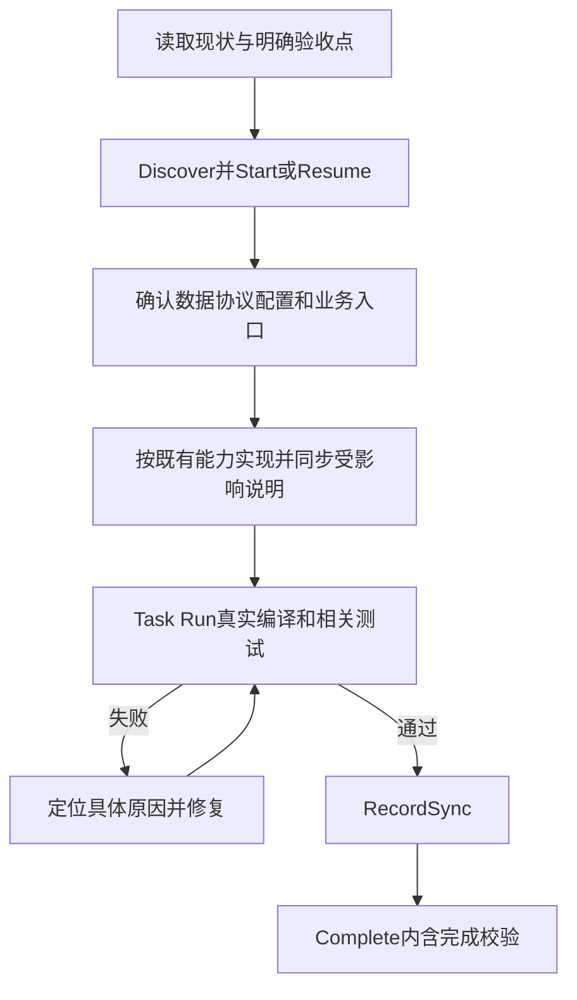
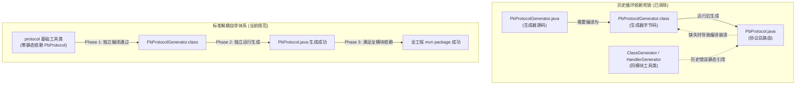

# 开发流程与研发规范手册

> 版本：3.1
>
> 核对日期：2026-10-23
>
> 项目根目录：`D:\work-all\game\server`
>
> 配套文档：[系统架构设计全景文档](01_系统架构设计全景文档.md)

本文面向新功能、既有功能维护、协议/配置变更、缺陷修复和发布验证。执行时先按当前源码确定真实入口，再按最新工程规范约束新增或直接修改的内容。已有代码中的例外不自动成为新代码的规范，也不要求顺手重构未触达的旧代码。

本文是 `doc/` 中开发流程与研发规范主题的唯一主文档。[development_workflow_sop.md](development_workflow_sop.md) 保留为旧入口的迁移说明与章节索引，后续流程和开发示例统一更新在本文。根 AGENTS.md、项目 context 与配置专项规范仍按第 0.1 节承担各自的规则来源职责。

## 0. 依据、适用范围与阅读顺序

### 0.1 事实与规则来源

| 来源 | 用途 |
|---|---|
| 根 [AGENTS.md](../AGENTS.md) 与当前 SOP 引擎 | 任务档位、执行记录、验证、恢复和完成条件 |
| [context/README](../.ai-workspace/context/README.md) | 项目知识入口与按需加载 |
| [project-summary](../.ai-workspace/context/project-summary.md)、[project-tooling](../.ai-workspace/context/project-tooling.md) | 工程、工具和真实仓库边界 |
| [coding-style](../.ai-workspace/context/coding-style.md)、[ai-coding](../.ai-workspace/context/ai-coding.md) | 新增/修改代码规范和常用实现入口 |
| [business-logic-pattern](../.ai-workspace/context/business-logic-pattern.md) 及其专题 | 事件、条件、活动、任务、红点和奖励规则 |
| [proto-rules](../.ai-workspace/context/proto-rules.md)、[client-test](../.ai-workspace/context/client-test.md) | 协议设计与模拟客户端测试 |
| [配置表AI编码规范](../../dic_generate/配置表AI编码规范.md) | 配表详细规则，优先于本手册的重复摘要 |
| 当前 Java、POM、脚本、生成器模板和实际生成物 | 核实 API、执行路径、产物与规范漂移 |

本次宿主核对基线为 `eaaeab57`，protocol 为 `95bd316`。配置规范依据生成器源码 `963495980357b1fa80f3e16ad70b0a4a3a817114`，但部署的 `Gen.jar` 尚未证明与该源码相同。基线用于说明观察范围，不代表所有工作区文件都无未提交变更。

遇到文档与源码不一致，先判断是旧说明、待落实规范，还是实际缺陷；不要按旧说明修改正确代码。本文区分“当前实现”“开发要求”“优化建议”，没有将未运行的生产环境或故障恢复验证写成已通过。

### 0.2 按任务阅读

- 普通业务开发：第 1、2、5、7、9、11 节，并按领域读第 6 节。
- Excel/索引变更：完整阅读第 3 节和外部配置规范，再检查目标表与生成物。
- 协议变更：第 4 节，同时确认客户端发布和测试链路。
- 保存、并发、跨服问题：第 8 节与架构文档第 5、7、8、9 节。
- 环境、上线、回退：第 10 节；优化计划见第 12 节。

## 1. 工程、目录和工具边界

### 1.1 Maven 模块与职责

根 POM 声明六个模块，Java release 为 21，当前 Vert.x 为 5.0.4。Cross 是 game 工程内的另一服务入口，不是根 POM 的第七个独立模块。

| 模块 | 主要职责 | 变更时的核对重点 |
|---|---|---|
| util | 时间、随机、配置及通用工具 | 共享行为不能为单个功能随意改变 |
| protocol | proto、生成器、protobuf 与配置生成代码 | 存在独立 Git，检查真源与产物是否匹配 |
| core | 执行队列、网络/RPC、缓存、基础设施 | 明确兼容面，不能借业务开发无范围地修改框架 |
| game | Game/Cross、Handler/Module、实体与 Mapper | 玩家/公会归属、业务状态、保存、通知 |
| login | HTTP 登录、账号/区服等入口 | 与 Game 登录链路及环境配置一致 |
| simulationclient | 模拟客户端、协议场景与压测工具 | 主源码中的场景不会被 mvn test 自动执行 |

### 1.2 文件放置与仓库归属

| 资产 | 位置/管理方式 |
|---|---|
| 项目级说明 | `doc/` |
| 项目上下文 | `.ai-workspace/context/`，独立工作区仓库 |
| 功能规格与任务 | `.ai-workspace/specs/features/<FeatureName>/`，按 specs 的实际独立归属管理 |
| SOP 引擎与入口 | `.ai-sop/` 子模块、根 `ai-sop.ps1`；锁文件固定引擎版本 |
| 协议真源 | `protocol/src/main/proto/`，protocol 子目录本机另有 Git |
| 游戏 Handler/Module | `game/src/main/java/cn/game/games/net/game/module/` 及对应领域目录 |
| 关系实体/Mapper | `game/.../cache/entity/`、`game/.../net/data/mapper/` 及 Mapper 资源 |
| 模拟客户端场景 | `simulationclient/src/main/java/cn/game/simulation/test/ai/` |
| 配表真源 | `D:\work-all\game\configs`，不在 server 根目录内 |
| 配表生成器源码 | `D:\work-all\game\dic_generate` |

Maven 依赖关系不等于 Git 归属。提交前分别检查实际仓库，不能在宿主执行一次 `git add` 就声称 protocol、workspace、specs 都已同步。保留不相关修改；新增/删除及时按实际 VCS 登记，重命名优先使用 VCS move。

### 1.3 最小环境核查

检查 JDK 21、Maven、PowerShell 7、Git 与依赖可获取性；使用当前终端实际的 `java -version`、`mvn -version`、`pwsh --version`，不要只看 IDE 配置。业务联调另需核对 Apollo、Redis、Zookeeper、数据库和所需服务，不能因编译通过推导运行环境已就绪。

常用编译命令从项目根执行：

```powershell
mvn -B '-DskipTests' compile
mvn -B '-DskipTests' test-compile
```

第二条只编译测试源码。根 POM 默认 `skipTests=true`，不能以 `BUILD SUCCESS` 直接宣称测试执行成功。已登记的修改任务应通过第 9 节的 Task Run 保存真实验证证据。

## 2. 任务生命周期与研发流程

### 2.1 按本次任务选择强度

| 档位 | 适用及完成要求 |
|---|---|
| T1 极速 | 人工明确选择；实现、生效所需产物和配置到位，真实编译/基础检查通过；确有延期才记 FollowUp |
| T2 快速 | 默认；明确验收点，修改实现并同步受影响需求/设计/用例，编译与相关测试通过，RecordSync 后完成 |
| T3 完整 | 人工选择或继承原任务；按完整规格、批准、独立审查、覆盖和验证门禁执行，复用已有有效成果 |

讨论、解释、只读审核无需登记。准备修改源码、测试、配置或项目文档时先确定任务并登记。纯文档仍采用 T1/T2；“简单改一下”不自动降成 T1，协议/存储关键字也不自动升成 T3。

T1/T2 不强制头脑风暴、正式计划、重复批准或独立代码审核，不依赖独立 subagent。T3 执行前必须读 `.ai-sop/workflows/agent-t3.md` 和 `superpowers-adapter.md`；能力不足按引擎规则说明，由人工决定工具或档位，不能假装已完成独立审查。

### 2.2 修改前的登记与验收点

先读取必须的 context 文件，检查已有改动和功能规格。用 Discover 区分新任务、续做或补收尾；同会话明确的任务不反复 Discover/Resume。

以下是命令模板，尖括号必须替换为真实值；客户端注入会话身份时，每个 Task 命令都带相同的 `-Agent` 和 `-NativeSessionId`：

```powershell
pwsh -NoProfile -File ./ai-sop.ps1 Task -Operation Discover -Agent <Agent> -NativeSessionId <真实会话ID>
pwsh -NoProfile -File ./ai-sop.ps1 Task -Operation Start -Feature <FeatureName> -TaskId <taskId> -Objective "本次目标与边界" -Agent <Agent> -NativeSessionId <真实会话ID>
```

FeatureName 使用 PascalCase；taskId 表示一次独立修改。新任务默认 T2；T1/T3 需保存用户真实选择原话。继续原任务用 Resume 并继承其档位，不用新名字逃避原失败或归属。Start/Resume 成功后才能写入；首次修改前简短说明实际档位及义务。

验收点应包含具体入口、可观察结果和关键失败行为。例如领奖需求至少写清：资格、次数/时间、奖励来源、重复调用结果、失败时资源与状态不变、响应/通知、保存后恢复。T2 可直接放入现有条款、设计段落和用例，无需强制创建全套 01/06/05 文档。

### 2.3 实现与同步顺序



用户已给出的清晰需求就是依据；只澄清影响正确性的关键歧义。新增类型必须复用旧通用校验链，不能通过特判旁路资格、限购或支付校验。协议源文件、生成代码与生效配置属于实现，不可按“文档后补”延期。

已批准需求/设计修改语义前，按 SOP 用 `workflow-state.ps1 -Operation ResetApproval -Gate requirement|design` 作废对应批准；requirement 会连带 design。T2 同步本次依据与受影响内容，不补完整 T3 批准；T3 重新确认与批准。仅错字格式可走 UpdateHash，并注明不改语义。实际参数按当前引擎手册使用，不手写状态文件。

### 2.4 验证、证据和完成

Task Run 执行真实命令，按同一 Kind/Batch 保留失败与复测历史；命令、Profile 或用例范围改变时记录 Reason。不能用无关成功、固定 exit 0、旧报告、零执行测试掩盖失败。保存证据失败按提示 RetryEvidence；不要盲目再跑或篡改哈希。

Start 的轻量起点若 UNAVAILABLE，不阻止正常编译/相关测试，但不能用修改后的快照补造基线。纯文档的执行豁免必须满足 SetApplicability 对起点和 Start 前 nonExecutable 路径的要求；`Tests=NOT_APPLICABLE` 仅是同步记录，不自动免除验证。T3 不使用轻量豁免。

完成前记录同步范围，再直接 Complete；无需固定串行 Verify → Status → Complete：

```powershell
pwsh -NoProfile -File ./ai-sop.ps1 Task -Operation RecordSync -Feature <FeatureName> -TaskId <taskId> -Agent <Agent> -NativeSessionId <真实会话ID> -Documentation UPDATED -Tests UPDATED -Summary "已同步的需求/设计/用例及实际范围"
pwsh -NoProfile -File ./ai-sop.ps1 Task -Operation Complete -Feature <FeatureName> -TaskId <taskId> -Agent <Agent> -NativeSessionId <真实会话ID>
```

Documentation 可为 UPDATED/UNCHANGED；Tests 可为 UPDATED/UNCHANGED/NOT_APPLICABLE，必须有真实依据。Complete 成功才是本次任务 DONE，不表示整个历史功能或旧 T3 已验收。

### 2.5 暂停、接管、失败与延期

暂停用 Suspend 并记录 NextAction/Notes，释放占用。异常中断先 InspectRecovery，按诊断 Recover → Resume；正常跨会话接管按提示 ConfirmTakeover。不得删除损坏记录、手工改 owner 或用绕过开关取得权限。

有实际延期才 AddFollowUp，写具体 documentation/test-cases/verification 范围；完成后 CloseFollowUp。旧待办不自动升档或阻止新任务，但 DONE 也不会隐藏它。不同工作副本按独立 taskId 管理；同步任务记录不等于同步了本机写权限，合并后重新验证。

## 3. 配置表设计、生成与运行生效

本节按 2026-10-23 的[配置表AI编码规范](../../dic_generate/配置表AI编码规范.md) 整理。变更前先读目标 Excel、ExcelMeta 条目和实际生成类；示例名称/ID只展示语法，不代表已定义的正式业务数据。

### 3.1 真源、路径与修改边界

设 `GAME=D:\work-all\game`，`CONFIGS=GAME\configs`，`SERVER=GAME\server`，`GEN=GAME\dic_generate`；这些是文档缩写，不是预置环境变量。

| 内容 | 位置 |
|---|---|
| 业务表 | `CONFIGS\Excels\*.xlsx` |
| 表类型、索引、继承 | `CONFIGS\Server\ExcelMeta.xlsx` |
| 跨表引用规则 | `CONFIGS\Server\DataChecker.xlsx` |
| 实际部署工具 | `CONFIGS\Server\dic_generate\Gen.jar`、lib、bin\java.exe |
| Java/XML生成结果 | `CONFIGS\Server\output\java`、`output\xml\data` |
| 客户端输出 | `CONFIGS\Ts\<表名>.ts` |

Excel 是数据真源，ExcelMeta 是生成结构真源。改变字段/类型/索引必须修改源表并重新生成，禁止手改 Java/XML/TS 生成物实现需求。仅使用既有配置写业务代码时不必导表。保留既有 ID、字段名和语义；需要改变时评估存量数据、客户端和回退。

### 3.2 工作簿和 sheet

- 只使用 Excels 目录直接包含的 `.xlsx`；当前不递归扫描，不使用 `.xlsm`/`.xls`。
- 一个工作簿可含多个 sheet，命名 `表名#中文说明`，`#` 前名称在所有工作簿中唯一，新增用合法 PascalCase，不附加工具会生成的 Config 后缀。
- `#` 开头的 sheet 忽略；隐藏 sheet 仍可能解析，不能靠隐藏停用。Excel 临时文件 `~$...` 忽略。
- 编辑需保留无关 sheet、格式、公式和数据，不能以重建整本工作簿代替局部修改。

业务表固定四行表头，第五行开始数据：

| 行 | 含义 | A列 | B列 | C列 |
|---|---|---|---|---|
| 1 | 导出归属 | cs | cs | s |
| 2 | 字段名 | ID | Type | Reward |
| 3 | 字段类型 | int | int | int[][] |
| 4 | 中文含义 | 配置主键 | 业务类型 | 物品ID与数量 |
| 5 | 示例数据 | 1001 | 1 | `2001;3\|2002;5` |

表格中的 `\|` 在 Excel 中写普通 `|`，不要带反斜杠。归属统一用 c/s/cs/n，中间不能留空；n 用于备注等不导出内容。有效字段名称/类型不空、不重复，大小写准确。

第一物理列为大写 `ID`，普通表优先 int；双端表标 cs，服务端表标 s，确保第一服务端字段仍为 ID。即便 group/list 不按 ID 查询，也必须保证行 ID 唯一。第一列以 `#` 开头可注释一行。

数据中不插空行，读取遇空行可能终止；后续检查未必发现遗漏。数值避免百分比/千分位格式，长整数注意 Excel 精度。公式依赖已保存的计算缓存；只写公式字符串不保证导出正确。字符串会 trim，不用首尾空白承载语义。

### 3.3 字段类型和分隔符

| 类型 | 单元格语法 | 必须检查 |
|---|---|---|
| byte/short/int/long | `123` | 范围、单位、溢出和既有 ID 类型 |
| float/double | `1.25` | 比例/万分比由业务定义，不自动缩放 |
| string | 普通文本 | 客户端引号/转义，trim 后语义 |
| boolean | `0` 或 `1` | 普通标量禁止用文本 false，当前会被转 true |
| int[] / string[] | `1;2;3` | 一维使用英文分号 |
| int[][] / string[][] | `1;2\|3;4` | 组内分号、组间竖线，每组长度由业务校验 |
| List<Integer> / List<List<Integer>> | 同对应数组 | 服务端常见组合可用，双端优先数组 |
| Map<Integer,Integer> | `1001;3\|1002;5` | 每组两项，key 不空且不重复 |
| List<Entry<Integer,Float>> | `1001;0.5\|1002;1.5` | 验证实际生成签名和加载值 |
| Date | `2026-10-23 13:02:00` | 格式 yyyy-MM-dd HH:mm:ss；时区由运行约定明确 |
| CronExpression | `0 0 0 * * ?` | 半角符号与实际触发规则 |
| XxxEnum | 整数枚举ID，如 `1` | 名称大小写及 Enum 后缀准确；标量不能空或0 |

普通数值空值为 0，string 为空串，空集合为空数组/List/Map，Date/Cron 为空时为 null。工具默认值不等于业务合法值，加载/初始化中还需校验必填、正数、长度、概率、时间先后等。字符串集合中的 `;`、`|` 没有通用转义方案。

### 3.4 ExcelMeta 的固定结构

ExcelMeta 只读第一张 sheet，第 1 行说明、第 2 行起数据，不能套用业务表四行表头。按固定列位置读取，不调换列或插空行：

```text
A id | B desc | C className | D fileType | E excelFilepath
F index | G compoundIndexes | H uniqueIndex | I nestedIndexes
J weight | K sort | L base
```

C 是 sheet 的 `#` 前名称，不能重复；D 小写。主入口会确定 E 路径，可为空；B 会被 sheet 中文说明覆盖。未登记普通表默认 dict，不必为普通表强制新增元数据行。

| fileType | 适用范围 | 真实访问形态 |
|---|---|---|
| dict | 按 ID 查询 | get/getNullable；list 为 Collection |
| odict | 需要加载顺序的 ID Map | 类似 dict，模板使用 LinkedHashMap |
| group | 按字段取分组，至少一个普通索引 | 索引返回 List，list 为首个普通索引的 Collection<List> |
| list | 顺序遍历行 | list 为 List，无 get(id) |
| ui | 按唯一索引访问，至少一组唯一索引 | getUI...；list 基于首个唯一索引，无 get(id) |
| enum | 生成命名枚举 | 同名 Java enum，无普通 XML/Manager |
| const | 全局常量 | 同名类 static 字段与特殊 XML |

### 3.5 普通、联合与唯一索引

普通索引 F 写 `Type|Level`，表示两套独立索引；字段存在且对服务端可见。常见生成方法为 `getTypeList(value)`、`getTypes()`。

联合索引 G 写 `Chapter;Level|Type;Stage`，每组最多 3 字段，返回列表，例如 `getChapterLevelList(...)`。唯一索引 H 使用相同分组语法，例如 `Code|Chapter;Level`，生成 `getUICode(...)`、`getUIChapterLevel(...)`；无结果返回 null，重复键在加载时检查。

G/H 当前按数字组合键，新增使用非负整数，并遵守下列限制：

| 索引 | 字段上限 |
|---|---|
| 联合索引 | 每项 999999 |
| 唯一索引，1或2字段 | 每项 9999999 |
| 唯一索引，3字段 | 前两项 9999999，第三项 99999 |

上限内仍需检查组合后的 long 溢出，不能只校验单项。枚举索引键依赖 getId 宏，但当前枚举模板未提供该方法，不直接选用。普通/联合索引查不到通常为空 List，唯一索引查不到为 null；调用者按实际生成类处理。

### 3.6 排序、权重、继承及特殊表

权重 J 填 int 兼容字段名，生成 Weightable.weight()；不自动抽奖，也不检查概率总和。排序 K 当前只配单个数值字段，影响普通/联合索引列表和 list 总表，不保证 dict 总 Map 或嵌套索引有序。

父表 L 填父 sheet 名，生成 `ChildConfig extends ParentConfig`；子表仍须包含父字段和行数据，定义保持一致。不是按 ID 自动去父表补值的关系模型。

枚举表仍用四行表头，必要字段 `ID:int`、`name:string`、`desc:string`，至少 ID/name 标 s。name 是合法唯一 Java 枚举常量名。特殊 string ID 会被用作枚举常量名，但不意味着其他字段的枚举引用支持 string ID。

常量表也是四行表头，必要列为 ID/name/type/value，列类型通常均为 string；一行例为 `MaxCount / 最大数量 / int / 100`。ID 是合法 Java 字段名，type 单元格决定实际常量类型。生成 GlobalConst 等同名类，不加 Config 后缀；不能依赖逐常量行 c/s 分流。

### 3.7 业务查询规则

先读生成类签名，再写调用。Config 通常是 public final 字段；不要假定 getter。必要项用 get(id)，允许缺失才用 getNullable 并处理 null。配置缺失不应默认发奖或吞异常后继续。

本项目已有的典型查询为 `QuestManager.instance().get(id)`，具体字段与索引方法仍以当前生成物为准。group/list/ui 不能套用 dict API；当前模板没有通用 `getMap()`。枚举读取 public final ID 或实际 get/getNullable，不假定 `getId()`；常量直接用实际 GlobalConst 字段。

Manager 从 classpath `xml/<表名>.xml` 加载，不在请求内手工读取 Excel/XML 或重新 load。共享 Config 的数组、Map/List 也按只读使用；需要变更先复制。高频请求优先用现有索引，不用逐请求全表扫描替代。

客户端当前是 TS 文件，导出 `DataType<表名>` 接口与 `<表名>` 数据数组，不是 JSON 数据包或自动 TS enum。

### 3.8 DataChecker 引用规则

新增/调整跨表引用同步 `DataChecker.xlsx`；工具不会自动识别所有业务引用。DataChecker 与 AllItemID 两张 sheet 都采用业务表四行表头，备注 n、布尔 0/1。

规则字段为 ID/srcConfig/srcField/refConfigs/fullRef/consistentRef。示例：

```text
srcConfig = Item
srcField = ID
refConfigs = SampleQuest;Reward;0
fullRef = 0
consistentRef = 0
```

含义是 SampleQuest.Reward 每组第 0 项必须属于 Item.ID，不是从 SampleQuest 查 Item 的反向含义。多引用用 `|`，字段间用 `;`，不能写成冒号。

- 标量省略下标；一维指定位置，二维对每组取指定位置。
- Map/Entry 指定 0 检查 key、1 检查 value。
- 常量写 `GlobalConst;常量ID名`。
- 默认引用集合是源集合子集；fullRef=1 要求等于源集合，consistentRef=1 要求本行各引用集合彼此一致。
- 引用侧 0 会忽略，越界可能没有取到值；不校验重复次数或顺序。奖励数组长度、数量和结构仍需业务校验。

AllItemID 使用 ID:int、tables:string[] 定义表 ID 合集，例如 `Asset;Item;Hero`。规则用 srcConfig=AllItemID、srcField=`1;2` 选择分组编号；不是在 srcField 写具体道具 ID，也不提供跨表 ID 唯一性检查。

### 3.9 生成与复制的完整流程

1. 确认源表、元数据、引用规则、工作区已有修改和预期输出范围。
2. 修改源文件；结构/索引变更同时调整调用和测试，保留 ID 兼容。
3. 用实际部署的 x.dic.App 生成 TS/XML/Java 并执行引用检查。ExcelMeta、删表/改名、生成器变化使用 fast=false；增量仅比较业务 Excel 修改时间，不能覆盖这些变化。
4. 检查最终 Java 退出码、完整错误日志与数据检查结果。中间“解析成功”、文件存在、parse.bat 包装退出码都不足以单独证明成功。
5. 审查产物差异，按既有复制链同步。删表/改名另查旧文件残留，复制不等于删除同步。
6. 编译受影响工程，实际加载受影响配置并验证业务约束，再决定运行实例如何生效。

工具调用参数如下，仅是执行说明，不代表普通开发应自动导表：工作目录 `CONFIGS\Server\dic_generate`，`bin\java.exe`，classpath `.;lib/*;Gen.jar`，主类 `x.dic.App`；JVM 参数置于主类之前：

```text
-Dmetafolder=<CONFIGS\Server绝对路径>
-Dfast=false
-DcontinueOnError=true
-DprettyFormat=false
-DgenTempBranch=<工作副本与分支唯一标识>
```

只检查引用时主类可用 `x.dic.check.DataChecker`。continueOnError 不表示错误被业务接受，最终仍须核对全部错误。全量会清空生成目录，优先隔离副本，保持 Excels 与 Server 的相对布局。不要默认执行带还原、pull、切分支、commit/push 的“完整/快速流程”等包装脚本。

独立 DataChecker 是一次性命令，修复版在成功、规则失败和读取异常路径都会关闭解析线程池；成功返回 0，错误保留异常并返回非零值。旧部署包可能打印通过后仍驻留，不能把超时终止算作通过；部署包与回归依据见规格仓 `features/ServerArchitectureAndAgentReadiness/tasks/datachecker-process-exit/acceptance.md`。`check.bat` 末尾还有交互式 pause，自动化直接调用 Java。进程内需要继续解析时使用 `DataChecker.check()`，由调用方管理线程池，避免复用一次性 main。

主入口不会复制工程。服务端复制脚本 [copy.bat](../game/tool/copy.bat) 要求 metafolder=CONFIGS\Server、workspace=SERVER；`copytotarget=1` 还会覆盖 target/classes 中运行可见的资源，使用前确认目标。

[update_copy.bat](../game/tool/update_copy.bat) 另有仓库操作：当前将代码分支 `pre_release` 映射到配置分支 `Branch_West`，将 `dev` 映射到 `Branch_West_Dev`；必要时 checkout，随后执行 `git pull origin <目标配置分支>`，再调用 copy.bat。恢复原分支位于成功路径末尾，中途失败可能直接退出；即使恢复分支，也不会撤销已拉取的提交。普通生成物同步使用 copy.bat；只有明确需要分支同步时，才按已核实的仓库状态和目标版本使用包装脚本。

| 生成结果 | 工程目标 |
|---|---|
| output/java/entity | protocol/.../generated/config |
| output/java/enum | protocol/.../generated/enume，受 exclude.txt 影响 |
| output/java/init | protocol/.../generated/helper |
| output/java/manager | protocol/.../generated/manager |
| output/xml/data | game/src/main/resources/xml |
| 仅 GlobalConst.xml | login/src/main/resources/xml |

### 3.10 当前工具限制与必要验证

| 能力 | 当前限制与处理 |
|---|---|
| boolean | 普通标量文本 false 会变 true；集合/常量转换另有差异，检查 XML 与加载值 |
| LocalDateTime、json/json<T>、异构数组 | 有类型或生成分支缺口，不凭 Java 类型名认为支持 |
| 双端 Date/Cron/Enum/List/字符串 Map/Entry | TS 值或类型映射不完整，新增组合检查 TS 编译及实际值 |
| nestedIndexes | 只按数量映射固定小写 type/round/stage，最多三层，不是任意字段 |
| 多字段 sort | 模板可能生成连续 return，当前仅用单数值字段 |
| formula/index | 生成、初始化、复制链不完整，不作为默认新增方案 |
| Excel公式 | 依赖缓存；非 float/double 数值公式可能转 int |
| 增量 | 不清理删表产物，未修改文件时也可能异常退出 |
| i18n | 当前按字符串，不自动生成多语言字典 |
| 热更新 | 生成成功不证明运行服务加载，更不证明全节点原子切换 |

配置验收分四层记录：源数据/引用通过、生成物正确、工程编译通过、加载与业务行为通过。至少覆盖目标 ID、缺失引用、唯一索引冲突、Map 重复 key、枚举引用、数组长度和数值范围。新增复杂类型额外验证客户端产物。不得只比较文件时间就宣称发布生效。

## 4. 通讯协议开发与兼容

### 4.1 真源与编号

协议真源在 `protocol/src/main/proto/`，按功能使用 `<模块名>Msg.proto`，包为 `cn.game.protocol.protobuf`。公共结构优先放 BaseMsg/RewardMsg 等既有公共文件，避免功能协议互相循环依赖。

消息命名为 `<模块><行为>Request|Response|Push_<协议ID>`。协议 ID 是十六进制，高 8 位模块号、低 24 位消息号；新模块号与消息号均先全库检索。Request + 1 = Response；Push 不与已占用编号冲突，也避免 PushID 与 PushID-1 落入现有请求响应配对。

`@MessageModule` 注解中的文本会用于生成 `0x...` 模块常量。例如已有好友模块 `30` 对应 `0x30`，不是十进制 30。示例中的已有编号只能用于理解，不能直接当作新功能可用编号。

### 4.2 生成注解与执行入口

| 注解 | 内容与核对点 |
|---|---|
| `//@HandlerPackage` | 服务端包路径，必须是目标功能实际位置 |
| `//@MessageModule` | 与消息高8位一致的模块号文本 |
| `//@ClientHandlerPackage` | 可选客户端 Handler 包路径 |
| `//@Function` | 实际存在的 InitialUI 枚举名；不能编造功能枚举 |

根 [protocol.bat](../protocol.bat) 调用 PbProtocolGenerator，需先检查 protocol 独立仓库的修改和 `proto_gen.properties`。当前脚本的 workspace 默认 server 根，metafolder 默认 workspace，**不是自动指向 configs\Server**；根据实际资源定位显式设置需要的值。

若已存在编译后的 PbProtocolGenerator.class，脚本会跳过生成器编译。改过生成器/依赖时，应先编译相应模块，避免运行旧 class。工具按属性决定是否执行 proto-to-Java，并可生成/更新服务端 Handler 和模拟客户端产物；不能笼统称为“只重写 generated 目录，不碰已有 Handler”。

当前 [proto_gen.properties](../protocol/src/main/resources/proto_gen.properties) 为 `proto.to.java=true`、`client.test.java=false`。按 [PbProtocolGenerator](../protocol/src/main/java/cn/game/protocol/tool/PbProtocolGenerator.java) 的分支，当前启用 Protobuf Java 生成，关闭模拟客户端 Request 测试类和 Handler 的生成。模拟客户端产物与前端协议产物是不同链路；调整开关前确认输出范围，不能因执行了 protocol.bat 就认为客户端测试代码已自动更新。

执行后逐项核对：proto Java 产物、协议 ID 映射、Handler 注册与业务方法、客户端处理器/测试、配置指定的其他输出。保护原业务逻辑，检查编译和差异，不能因为脚本退出 0 就跳过产物审查。

### 4.3 首次构建自举（Bootstrapping）原理与循环依赖解决方案

在全新机器克隆仓库、执行 `mvn clean` 或生成物尚未产生时，工程构建面临经典的“先有鸡还是先有蛋（Bootstrapping）”死锁问题：



#### 4.3.1 循环依赖根因剖析
1. **死锁本质**：`PbProtocolGenerator` 负责生成全工程协议路由总表 `PbProtocol.java`；但它自身是用 Java 编写的源码，必须先编译为 `.class` 才能运行。
2. **触发诱因**：执行 `protocol.bat` 时，若检测到尚未生成 `PbProtocolGenerator.class`，脚本会自动调用 `mvn -pl protocol -am -DskipTests package` 进行生成器编译。
3. **历史隐患定位**：历史上 `protocol` 模块内的 `ClassGenerator.java` 包含了未使用的 `import cn.game.protocol.protobuf.PbProtocol;`，已废弃类 `HandlerGenerator.java` 内部静态硬编码了 `PbProtocol.getInstance().getMsgId(...)`。这导致在全新环境下，Maven 编译 `protocol` 模块因“找不到符号 PbProtocol”提前崩溃，生成器 class 永远无法产出。

#### 4.3.2 规范治理与解耦方案
1. **代码层绝对解耦（铁律）**：
   - **代码生成器（Tool）绝对禁止静态依赖其自身的生成产物**。
   - `ClassGenerator.java` 已彻底移除对 `PbProtocol` 的未引用 import。
   - `HandlerGenerator.java`（历史 `@Deprecated` 工具）已解除对 `PbProtocol.getInstance()` 的静态绑定，改用消息命名模式自动推导。
   - 解耦后，`protocol` 模块在没有 `PbProtocol.java` 的情况下，亦可独立进行 100% 干净编译。
2. **首次构建标准操作步骤（SOP）**：
   - **步骤 1（自举生成）**：在干净工程根目录下，优先执行：
     ```powershell
     .\protocol.bat
     ```
     *原理*：脚本自动触发 `mvn -pl protocol -am package` 编译生成器，随后执行 `java ... PbProtocolGenerator`，一键生成 `PbProtocol.java` 与各模块 Handler 桩代码，终端输出 `[完成] PbProtocolGenerator 执行成功`。
   - **步骤 2（全量打包）**：此时所有依赖条件均已就绪，直接执行全工程编译：
     ```powershell
     mvn clean package -DskipTests
     ```
3. **容灾兜底（Stub 机制）**：
   若因特定环境变动再次遇到生成器无法编译的死锁，可在 `protocol/src/main/java/cn/game/protocol/protobuf/` 下临时建立一个极简空桩类 `PbProtocol.java`：
   ```java
   package cn.game.protocol.protobuf;
   import cn.game.protocol.parser.ProtocolParser;
   public class PbProtocol implements ProtocolParser {
       private static PbProtocol instance = new PbProtocol();
       public static PbProtocol getInstance() { return instance; }
   }
   ```
   随后运行 `protocol.bat`，正式生成的 `PbProtocol.java` 会自动覆盖此空桩。

#### 4.3.3 长效工程化优化方案（建议推进）
为彻底从架构层面根除自举复杂性，建议后续推进以下两项工业级优化：
1. **独立生成器子模块（`protocol-generator` 拆分）**：
   - 将 `PbProtocolGenerator`、`ClassGenerator`、`velocity` 模板及依赖拆分为独立的 Maven 子模块 `server/protocol-generator`；
   - 该模块只依赖 `util`、`javaparser`、`velocity`，物理隔离于 `protocol` 契约包；
   - 依赖拓扑彻底线性化：`util` -> `protocol-generator` (生成代码) -> `protocol` -> `core` -> `game`，物理上消除循环依赖可能。
2. **Maven 插件化集成（`generate-sources` 绑定）**：
   - 将协议生成与配表更新打包为标准 Maven Plugin 或配置在 `exec-maven-plugin` 的 `generate-sources` 阶段，执行标准 `mvn compile` 时自动按需触发增量生成，免除人工维护 bat 脚本。

### 4.4 Handler 接入

参考实际 [FriendHandler](../game/src/main/java/cn/game/games/net/game/module/friend/FriendHandler.java) 的类结构和注册方式，不照抄其所有历史业务写法。当前扩展点为 `getModule()`、`inititialize()` 与 `putInvoker(...)`；注意 inititialize 的现有拼写，不能在示例里改成一个不会被调用的新方法。

Handler 负责可信连接身份、协议入参、前置校验、调用 Module、构建 Response 和发送；Module 负责业务语义和状态。避免把完整 Request/Response Builder 长期保存在 Module，优先下传有明确含义的业务参数。

GameBaseHandler 的功能/状态检查受实际注解与分支控制，业务仍需校验实例归属、活动轮次、目标 ID 和具体资格。错误码从当前 ErrorMsgEnum 等真实定义查找；不要假定所有枚举都由 Excel 生成，也不要为了示例编造错误 ID。

### 4.5 全量、增量与奖励同步

- 核心基础数据在对应 Module 的 `buildPlayerAllInfo` 中构造，随登录全量同步；客户端缓存不能成为服务端权威数据。
- 低频周边数据按需拉取，明确响应是全量快照还是增量，空集合表示什么。
- 扣除资源沿用既有公共通知，业务响应不重复承担所有扣除明细。
- 获得奖励通过公共发放入口生成实际 RewardInfo，并按协议契约放进响应；notify 参数不替 Handler 填充 Response。
- 主动推送使用现有 PlayerHelper 等发送入口；不要用推送替代必须返回的请求响应。

### 4.5 字段与发布兼容

新增/修改字段至少记录：来源与权威方、静态/动态、类型/单位、默认/空值含义、接收方/权限、集合顺序、全量/增量、兼容和断言。静态配置通常传 ID，动态实例和服务端生成属性按需传真实数据。

不复用删除字段的编号，不更改原编号类型/语义；删除时用 reserved。新增或直接修改的对外协议不暴露裸 Protobuf map，使用命名明确的 repeated XxxInfo，内部 Map 在边界转换。不要为规范化批量破坏未触达的旧协议。

明确服务端/客户端/配置发布顺序和混跑窗口。展示其他玩家数据也要考虑接收方版本能否识别配置或条目；展示过滤不应反向污染权威存储。测试包括旧客户端读新服务、新客户端读兼容服务、空/默认字段和不支持条目。

## 5. 业务功能从需求到实现

### 5.1 开发前写清的最小契约

| 维度 | 必答问题 |
|---|---|
| 入口 | 哪个协议/事件/定时器/GM/RPC触发，执行在哪个实体队列？ |
| 权威数据 | 玩家、配置、活动轮次和资源从哪里读取，谁能修改？ |
| 资格 | 功能开放、时间、等级、前置、对象归属如何检查？ |
| 状态 | 哪些字段持久化，哪些仅运行期，哪些可由其他状态推导？ |
| 操作 | 成本、奖励、次数、标记、事件、通知的顺序和失败边界？ |
| 重复 | 相同seq、不同seq重复业务、重连重发分别怎样处理？ |
| 时间 | 自然日还是5点，时区/单位、离线跨周期、边界包含关系？ |
| 保存 | 用模块快照还是独立表，何时算成功，崩溃窗口怎样处理？ |
| 兼容 | 旧玩家默认值、旧配置删除、旧客户端与回滚如何处理？ |
| 验证 | 成功、关键失败、重复、边界、冷加载的明确断言？ |

### 5.2 Module 职责与生命周期

模块继承 [BasePlayerModule](../game/src/main/java/cn/game/games/core/BasePlayerModule.java)，经项目现有扫描/初始化与 Player 管理。不要自行建立第二套静态玩家模块仓库，也不要仅 new 一个 Module 就认为完成了 player 注入和事件注册。

| 钩子/方法 | 用途与限制 |
|---|---|
| `initDefault(Player)` | 框架绑定 player/playerId、设置DB约定、注册事件并调用初始化；final方法不覆盖 |
| `init()` / `initAfter()` | 模块初始化，区分新对象和反序列化旧数据，不无条件清空既有进度 |
| `getInitOrder()` / `getPreClasses()` | 当前初始化排序辅助；依赖需保持无环，不假定已有完整拓扑诊断 |
| `defaultDbMapperClass()` / `defaultSelectMethodName()` | 独立表查询约定；默认查询按玩家ID，数组对应关系需正确 |
| `initFromDb(...)` | 消费本模块查询结果，数量与登记的任务匹配 |
| `initFromDbAfter()` | 数据恢复后的初始化/兼容，不混入只应在线登录触发的业务 |
| `onLogin()` | 正常登录相关业务，处于跨天处理之后；不在此重复注册事件 |
| `getEventTypes()` / `handleEvent(...)` | 声明与处理模块关心的事件 |
| `buildPlayerAllInfo(...)` | 需要随登录下发的核心状态 |
| `autoSaveTasks(...)` | 按既有保存模式组织实体；独立表不自动拥有跨表事务 |
| `alwaysStoreDataInStandaloneTable()` | 参与独立表加载/保存策略，仍需明确JSON排除与字段持久化 |
| `isComplete()` | 未完成模块可返回false而不被正常初始化；正式接入必须核对 |

`getModuleSorted()` 的排序不能推导为所有初始化均有依赖顺序；Player.initModule() 当前遍历扫描集合，不能仅设置 getInitOrder() 就假定另一个模块的 init() 已完成。跨模块初始化应沿实际调用点核对。

以下是仅展示当前抽象签名的最小骨架，可独立编译；它没有正式协议、状态或业务行为，并通过 isComplete=false 明确未启用。新增真实模块时补齐需求、保存和断言后再接入：

```java
package cn.game.games.net.game.module.example;

import cn.game.games.core.BasePlayerModule;
import cn.game.games.core.event.EventTypeEnum;
import cn.game.games.core.event.PlayerEvent;
import cn.game.protocol.protobuf.PlayerMsg.PlayerAllInfo;

/** 展示模块扩展签名；正式接入前需补齐业务与持久化契约。 */
public class ExampleModule extends BasePlayerModule {

    /** 当前示例没有需要随登录下发的数据。 */
    @Override
    public void buildPlayerAllInfo(PlayerAllInfo.Builder builder) {
    }

    /** 当前示例不订阅玩家事件。 */
    @Override
    public EventTypeEnum[] getEventTypes() {
        return new EventTypeEnum[0];
    }

    /** 当前示例未订阅事件，因此不产生业务副作用。 */
    @Override
    public void handleEvent(PlayerEvent event) {
    }

    /** 保持示例未启用，避免被当作已实现功能。 */
    @Override
    public boolean isComplete() {
        return false;
    }
}
```

持久字段使用业务数据类型，并保证当前序列化方式能够读写；运行时缓存、player引用、日志对象、计时器和 protobuf Builder 不作为持久状态。重命名包/类/字段要评估旧 modules 中的类名/类型信息，不能只改 Java 引用。

### 5.3 Handler → Module 的写操作顺序

下面是流程约束，不是可以直接复制编译的业务实现。具体 API 重载、错误码、资源类型和状态字段需从目标功能查证。

```text
可信连接确定玩家和所属队列
→ 解析参数，校验范围、去重、目标归属
→ 复用功能/资格/活动窗口校验
→ 校正当前周期，再读取次数和领取状态
→ 从配置计算权威成本与奖励，检查溢出与全部前置条件
→ 使用既有资源接口扣除/发放并推进业务状态
→ 按当前保存契约处理持久化与失败窗口
→ 产生约定事件和资源通知
→ 用实际执行结果构造并发送响应
```

客户端传入的价格、奖励数量、playerId、完成状态不能直接采信。批量操作先明确整体成功还是允许逐项结果，聚合同资源ID的成本，检查整数乘法/加法溢出以及容量约束。不能先扣第一项再发现第二项不合法，却向客户端返回“全部失败、无副作用”。

资源接口抛异常不提供通用回滚。涉及扣费、发奖、领取位、远端调用和持久化时，应明确每个可能失败的位置，以及重试、补偿或人工处理依据。不能先置已领取再发奖却无恢复，也不能先发奖后长期不保存领取位。

### 5.4 查询、重置与旧数据

查询中发生懒重置、补偿或重算持久状态，就必须进入保存闭环；不能以接口名为 GET/INFO 断言只读。购买/领奖等写入口也独立执行幂等周期校正，不能假定客户端先打开界面。

新周期应先清理/结算旧周期状态，再更新周期标识；先覆盖时间戳再判断会丢失重置依据。自然日、NewDay5 和活动轮次使用各自契约。保存后用新对象从存储重建，核对计数、标记、轮次与幂等性。

## 6. 领域能力复用规则

### 6.1 事件

按[事件专题](../.ai-workspace/context/business-patterns/event-system.md) 区分事件生产者和订阅模块。当前 PlayerEvent 是当前处理链中的同步分发，不是跨节点可靠消息；事件处理器异常、重入和耗时会影响原操作。

新增事件先定义触发时机、参数顺序/类型/单位、是否重复、发生次数与测试。成功动作后触发对应事件，不能在失败前提前计数；不要在 onLogin 中重复注册订阅，也不把一个玩家事件直接用于修改另一玩家对象。跨服通知走既有 RPC/消息链并单独定义幂等。

### 6.2 条件

按[条件专题](../.ai-workspace/context/business-patterns/condition-system.md) 使用 ConditionFactory、实际条件类型和配置。countType=0 表示接取后累计，1 表示当前状态，2 表示历史累计；它们不能统一用“事件次数相加”实现。

核对 ClassManager 等缓存的条件实例是否共享，条件实现不能存放某玩家的可变中间结果。`getConditionCount` 适合能从当前/累计数据读取的类型，不是所有行为条件都能凭登录时一次查询补全。条件负责判定，不顺手发奖、扣费或改领取位。

### 6.3 活动

按[活动专题](../.ai-workspace/context/business-patterns/activity-pattern.md) 明确活动ID、实例/轮次、配置版本、开启/结束/销毁时刻与状态。当前有 NONE/VIEW/START/CLOSE 等状态，CLOSE 不自动等于“任何操作都不允许”，是否保留领奖按功能契约。

核对 onLogin、checkAndOpenActivitys、endTimeTask、destroyTimeTask 等恢复与定时入口：离线跨结束、连续两轮、重复触发、配置改期、重启恢复分别怎样处理。旧轮次结算/补偿应在覆盖旧状态前完成并幂等；这是设计要求，不能因为有定时器就假定所有活动已实现。

### 6.4 任务

按[任务专题](../.ai-workspace/context/business-patterns/quest-pattern.md) 分开开放、接取、进度、完成、领取、展示和后继任务。checkOpen 不替代 canReceive 等具体资格；完成不等于已领取，已领取也不必立刻从所有列表移除。

晚开放或晚接取时，状态/历史累计型条件需按规则补判；行为累计型不能不加区分补算。测试跨组推进、一次事件完成多目标、已领显示、下一阶段开启、重复领奖和冷加载。

### 6.5 红点

按[红点专题](../.ai-workspace/context/business-patterns/red-point-pattern.md) 复用现有聚合和请求。当前相关 repeated bool 按请求顺序对应，false 项也保留；不能过滤 false 后导致错位，也不能擅自替换成 bitmap。

InitialUI 类型与活动ID的含义分开。红点是业务状态派生或明确已读状态，不是领奖资格的权威判断。验证出现和消失、窗口结束、资源不足/充足、已领取与跨日恢复；高频红点优先内存过滤，避免扫描/IO放大。

### 6.6 奖励与资源

按[奖励专题](../.ai-workspace/context/business-patterns/reward-pattern.md) 复用 PlayerHelper 等既有资源流程，确认使用的重载和 OpType。randomReward、previewGoods 等计算/展示结果不等于已经发放；响应使用实际发放返回值。

固定奖励、随机奖励、选择奖励、实例化奖励分别确认资源变化与返回细节。校验配置引用、数量、批量聚合、溢出、背包/业务容量、重复执行。不能手改客户端缓存模拟发奖，也不能只构造 RewardInfo 而没有实际资源变更。

## 7. 编码规范与 API 选择

### 7.1 修改边界与分层

只修改需求直接涉及的代码。优先已有模块、Helper、Hook 和兼容入口；未明确授权时不借单个功能重构通用加载、缓存、协议或保存框架。已有实现阻塞正确性时先定位根因并记录受影响范围，而不是通过旁路跳过旧校验。

Handler 处理协议边界，Module 维护玩家业务状态，Helper 复用共享动作，Manager 管理对象与索引；单例 Handler/Manager 不保存请求级玩家字段。相同调用链获取的 Player/Module 下传复用，不反复加载旧副本覆盖新状态。

### 7.2 常用 API 与限制

| 需求 | 既有入口/要求 | 注意 |
|---|---|---|
| 时间 | DateUtil.currentTimeMillis()/currentTimeSeconds() | 不新增 System.currentTimeMillis；字段写明毫秒/秒和时区 |
| 随机 | cn.game.util.Rnd；列表取样用 Rnd.randomElement(list) | 不新增原生 Random/其他随机工具；列表为 null/空时返回 null，数值重载另核对边界 |
| 异步等待 | AsyncUtils.await(Vert.x Future) | 只在允许阻塞的业务上下文，EventLoop禁止；其他Future先正确适配 |
| 增加资源 | PlayerHelper.addResources 的实际重载 | 返回值填入业务响应，notify不代替响应 |
| 扣资源 | PlayerHelper.delResources 的实际重载 | 不足抛业务异常；批量接口不自动等于跨模块事务 |
| 只检查资源 | PlayerHelper.isEnough 的实际重载 | 检查后与真正扣除之间仍需正确队列和一致性 |
| 业务失败 | player.fail(ErrorMsgEnum实际项) | 抛LogicException，不撤回已发生副作用 |
| 请求响应 | client.sendProtocol(...) | 只有协议明确要求失败仍带完整Response时才选对应错误响应方式 |
| 主动推送 | PlayerHelper.sendProtocol 等现有入口 | 目标玩家、离线策略和重复通知要明确 |
| 玩家定时 | Player.setTimerTask/setPeriodicTask | 回到玩家队列，生命周期结束清理 |
| 日志 | 既有log/LoggerType | 不新增System.out.println，携带玩家与操作上下文 |

API 白名单是索引，不替代当前源码签名。新增代码不使用 static import；常量和方法显示所属类。未知异常日志保留 message 与完整堆栈，业务异常不无条件吞掉或伪装成功。

### 7.3 注释与命名

新增/直接修改代码以中文成句注释。类头说明职责和核心约束；方法文档说明参数、返回、副作用和调用前提；属性写含义、单位、范围与特殊值。public 方法按规范提供 JavaDoc，继承契约可复用但实现特有限制要说明。

复杂方法以空行分段，在附近写具体业务目的和必要原因；不使用 `// 1.` 等机械连续编号，不写“处理数据”“避免问题”等无信息说明。代码注释不留下代理工具或模型署名，不编造作者或设计背景。

### 7.4 集合、数值和高频路径

先校验集合范围再 subList；注意其是原列表视图，后续修改/持久化需要独立集合时复制。外部列表按约定限制长度、重复与顺序，不能用异常兜底代替入参校验。跨整数类型、计费乘法、累计数量和索引组合使用可证明安全的范围处理。

事件、红点、登录和定时回调先做开关/窗口/内存过滤，再执行 IO 或扫描。避免每个条目独立数据库/RPC查询造成 N+1；是否批量以既有接口语义为准。优化前记录耗时和规模，不因虚拟线程便忽视数据库连接池或CPU成本。

## 8. 并发、持久化与高风险错误

### 8.1 队列与异步边界

同玩家串行只对纳入同一个邮箱的工作成立。普通任务与优先任务顺序不同；队列满会拒绝，超时不自动取消任务。业务中同步等待自己的邮箱任务，或两个实体互相等待，可能形成死锁。

外部回调要修改玩家数据时先回投所属 Processor；返回 Future 后的回调不会自动保有原调用的串行保证。await 可维持代码流程，但不能提供跨玩家事务；JDK21 部分阻塞仍可能 pinning，具体限制见架构文档。

### 8.2 保存模式与兼容

默认玩家模块快照与独立 DbEntity 表分别核对。DbEntity 是接口，独立表需正确 Mapper、主键、加载和写入；不要写不存在的 `extends DbEntity` 模板。alwaysStoreDataInStandaloneTable 需结合 transient/JsonIgnore，不能靠一个布尔开关避免全部重复序列化。

单表玩家保存必须在玩家所属串行执行上下文先封存参数，再提交异步 DAO。`PlayerDataSnapshot` 覆盖生产 `insert` / `updateByPrimaryKey` 实际读取的字段，提交对象之后不得改写；完成回调不能清理其 JSON。新增 Mapper 字段时同步复制逻辑和 `PlayerSaveSnapshotTest`：测试从真实 BoundSql 独立生成非默认值并实际绑定，漏复制或新增未支持的可变类型必须失败。完整带类型 JSON 是当前模块图的隔离方式；独立表路径保持原规则。

S2A 验收使用可控提交器保留原参数引用，安排 A 提交→B 提交→A 完成→B 读参，并覆盖等待超时后晚读和失败回调。该层测试证明参数稳定，不能替代真实数据库保存后新对象冷读，也不保证跨次写入顺序。

S2B 中，创建及单表快照必须复用 `PlayerHelper` 的统一通道，禁止直接使用带等待超时的通用 DAO Future 决定下一次写入。调用者等待超时不等于未执行；不要自动重试关键保存。缺失、不活跃、空任务、零影响行不能返回持久化成功。新增异步清理必须携带原 Player 身份并尊重保存风险保留结果，不能继续删除路由或以新对象覆盖驻留玩家。

UNKNOWN 恢复限受信运维核对：确认本地执行已退出后，还必须排除数据库/代理后端旧事务晚提交；按当前 coordinatorId/playerId/generation 调用 `reconcile` 并保存核对记录。单次读库不能替代终止证明；无可靠证据就继续隔离。诊断中的未知业务变更时间必须保留 null，不用快照时间补零或冒充健康。完整变更埋点、五分钟保护、充值持久化幂等及节点关停仍是后续阶段。

定向验收运行 `PlayerSaveOrderingTest`、`PlayerSnapshotWriterTest` 及已有 `PlayerSaveSnapshotTest`；真实邮箱内 await 必须由独立写入/通知完成，不回投同一邮箱。会话替身验证显式 commit 调用顺序，不能宣称真实数据库提交或故障恢复已验收。

在线周期保存默认为300秒，但不是数据丢失的最大窗口保证。保存失败、排队、退出链中的异常恢复和进程关停顺序都会影响持久化。批量 DAO 调用不自动成为数据库事务，关键多表更新查明实际事务边界。

需要“成功即持久化”的业务单独定义和验证契约，不能从现有周期快照推导。重命名类/包、字段改型和配置ID删除必须检验旧玩家冷加载；回滚代码不自动回滚已写入的新数据。

### 8.3 缺陷模式与断言

| 风险 | 错误触发 | 修正与验证 |
|---|---|---|
| LIMIT_STATE_POISONING | 只在查询reset，直接写沿用旧计数并覆盖周期 | 写入口幂等重置；未先查直接购买、跨日、重复写 |
| LAZY_RESET_UNPERSISTED | 查询修改内存但未进入真实保存 | 核对保存链，用新对象冷读字段 |
| 重复发奖 | 将连接seq缓存当永久幂等 | 同seq与新seq、重连、保存后重试分别验证 |
| 部分失败 | 先扣费/置标记，后续校验失败 | 写前集中校验；故障注入核对每个窗口和补偿 |
| 客户端伪造 | 接收客户端价格/奖励/玩家归属 | 服务端查配置与可信身份，非法输入不改状态 |
| 旧轮次覆盖 | 先初始化新活动，丢失旧轮次结算依据 | 先结算/补偿再切换，重复执行幂等 |
| 错误发奖回包 | 预览结果当实际奖励或只构造回包 | 对照资源增量、实际RewardInfo和领取位 |
| 共享数据污染 | 修改Config集合、共享条件实例保存玩家数据 | 复制可变数据，跨玩家交替调用验证隔离 |
| 超时重试副作用 | 认为超时表示未执行 | 查询业务终态/幂等结果，不能盲重试 |
| 假落库验证 | 重连复用同一Player或只刷新客户端 | 确认保存完成并从介质构建新对象 |

完整缺陷库见 [logic-audit-game-server](../.ai-workspace/context/logic-audit-game-server.md)。本节是开发自检，不为 T1/T2 增加独立审查门禁。

## 9. 测试设计、执行与证据

### 9.1 选择与变更匹配的验证

| 层次 | 验证范围 | 不能证明 |
|---|---|---|
| 源码/资源编译 | Java类型、引用、测试源码及构建资源 | 业务断言执行、服务已加载新代码 |
| 进程内JUnit | 条件、计算、状态机、隔离模块行为 | 网络、真实数据库、跨服恢复 |
| 模拟客户端 | 正式协议、Handler、通知与响应联动 | 仅刷新缓存无法证明持久化冷加载 |
| 保存闭环 | 保存完成后从存储构建新对象 | 未覆盖故障窗口的所有恢复行为 |
| 配置生成/加载 | 真源→产物→实际加载与业务约束 | 所有节点已同步、全表原子切换 |
| 集成/故障验证 | 真实中间件、并发登录、节点离开、重试等 | 没覆盖到的生产规模和故障组合 |

常规先做相关单元/模拟测试，不默认启动完整业务环境。缺少环境时明确哪些可用 Path A 覆盖、哪些仍需 Path B/冷加载；不能将降级验证改称已完成完整联调。

### 9.2 测试矩阵

每条用例写前置、入口、输入、expected、实际断言和清理。功能涉及的场景至少从以下维度选择，不机械套用无关项：

| 场景 | 关键断言 |
|---|---|
| 正常操作 | 正确状态、次数、资源、事件、返回与通知 |
| 非法输入 | 不存在ID、负数/零/超大值、重复列表、越权；失败无额外副作用 |
| 资格失败 | 未开放、时间外、前置不满足、资源不足；错误原因明确 |
| 批量 | 整体/逐项语义、同资源聚合、部分失败窗口与溢出 |
| 重复 | 同seq重传、新seq重复业务、断线重连重发、冷加载后重发 |
| 时间 | 边界前/点/后，自然日/5点，离线跨周期，未先查询直接写 |
| 旧数据 | 新字段缺省、旧类/字段、已删配置、历史轮次 |
| 保存 | 当前状态保存完成后，新对象冷读一致且仍能防重 |
| 展示 | 登录全量、按需拉取、已领显示、红点亮起与消除 |
| 依赖失败 | RPC/DB失败与超时后终态，恢复/补偿不重复执行 |
| 兼容 | 旧新客户端、服务混跑、配置发布时间差 |

Bug 修复优先在已有用例补断言，尽可能在相同入口保留修复前失败和修复后通过。不能复现时说明缺少条件，不伪造 RED。GM 只负责准备，核心 Act 必须用正式业务入口；断言不仅检查错误码，还检查状态与副作用。

### 9.3 Task Run 和 Profile

真实 Profile 定义见 [verification-commands.json](../.ai-workspace/context/verification-commands.json)。下表按当前配置，不把名称相近的任务混为一谈：

| Profile | 范围 |
|---|---|
| compile | 根Maven生产编译 |
| compile-tests | 生产与测试源码编译，不运行测试 |
| java-unit-smoke | core TagManagerTest，基础框架冒烟，不代表业务覆盖 |
| java-tests | reactor测试；先审查环境依赖，不默认每次全量运行 |
| workspace-syntax / workspace-contract | 工作区脚本、Schema、文档/安装契约，不替代Java验证 |
| workspace-script-tests | 工作区工具脚本回归 |
| sop-tests | SOP引擎测试，普通业务无需默认运行 |

已登记任务这样运行编译：

```powershell
pwsh -NoProfile -File ./ai-sop.ps1 Task -Operation Run -Feature <FeatureName> -TaskId <taskId> -Agent <Agent> -NativeSessionId <真实会话ID> -Profile compile
```

Java 测试脚本使用明确版本的 Surefire 3.5.2、开启测试并检查本轮 XML；零执行、全跳过、旧报告不能当通过。定向测试可在 PowerShell 内传数组，以下占位符先替换：

```powershell
& ./ai-sop.ps1 Task -Operation Run -Feature <FeatureName> -TaskId <taskId> -Agent <Agent> -NativeSessionId <真实会话ID> -Kind test -Batch feature-unit -Executable pwsh -Arguments @('-NoProfile','-File','./.ai-workspace/scripts/run-java-tests.ps1','-Project','<模块>','-Test','<实际测试类>') -TimeoutSeconds 1800
```

不要把 PowerShell 的逗号数组表达式直接交给外层 `pwsh -File`；使用 `& ./ai-sop.ps1` 或脚本内构造参数。失败/修复后复用原 Kind/Batch，改变验证目标或范围写 Reason。若出现多轮失败/过期批次，按 `.ai-sop/docs/VERIFICATION_CONTINUATION.md` 定位续做要求。

### 9.4 模拟客户端

场景继承 [ClientBaseScenarioTest](../simulationclient/src/main/java/cn/game/simulation/test/ai/ClientBaseScenarioTest.java)，放同包 `cn.game.simulation.test.ai`，通过 main/start 入口运行，业务步骤在 executeProcess。常用能力为 `sendAndWait`、`synchronizeDataFromServer`、`sendGmCmd`，使用前读其实际返回类型和失败处理。

`sendAndWait` 适合顺序场景；并发/同序号重放需确认测试工具确实生成目标时序，不能用两个串行调用冒充并发。GM 后核对准备状态，不能凭已发出命令就继续；配置、账号、环境和功能开关实际决定是否足够资源，不依赖“测试号默认全开”的历史假设。

`sendAndWait` 遇业务错误会包装为 RuntimeException。当重复领奖的正确契约是返回“已领取”时，第二次调用抛出异常不直接表示幂等失败；用例应核对预期业务错误码，再查询并断言资源、次数和领取状态没有额外变化。超时、断线及其他错误不能当作预期拒绝。若契约要求重复返回成功结果，则验证结果一致且无重复副作用；仅连续调用两次而没有状态断言不能证明幂等。

从根运行一个真实类：

```powershell
pwsh -NoProfile -File ./run_client.ps1 -TestClass <实际完整类名>
```

登记测试证据时：

```powershell
& ./ai-sop.ps1 Task -Operation Run -Feature <FeatureName> -TaskId <taskId> -Agent <Agent> -NativeSessionId <真实会话ID> -Kind test -Batch feature-simulation -Executable pwsh -Arguments @('-NoProfile','-File','./run_client.ps1','-TestClass','<实际完整类名>') -TimeoutSeconds 600
```

run_client 会编译 simulationclient 的 Maven 依赖闭包，并把相关 target/classes 放在旧依赖JAR前；classpath含 game 不代表本轮自动编译了game，跨模块变更先编译真实受影响闭包。测试连接的服务也必须运行新版本，客户端重新编译不能替代服务升级。

脚本的 TEST PASSED 主要根据 Java 进程退出码，需要确认目标断言执行、没有跳过或提前正常返回。失败时保留服务与客户端日志，检查配置、路由、消息号、错误码和超时，而非修改超时掩盖逻辑错误。

### 9.5 测试隔离与收尾

使用明确测试账号、实例和轮次，避免依赖前一次测试状态。时间偏移与随机替身按既有工具控制并恢复；不修改共享 Config 对象制造 fixture。涉及持久化的测试明确清理或保留证据规则，避免污染后续场景。

每次报告实际测试类、数量/关键断言、通过失败、环境与未覆盖项。编译不等于行为测试，JUnit不等于协议联调，重连不等于冷读。任务记录通过不替代对业务结果的人工/自动断言。

## 10. 本地运行、发布与回退

### 10.1 启动前核查

先检查当前脚本和目标进程，`run_server.ps1` 包含清理/启动操作，不能把它当无副作用的编译命令。不要按进程名批量杀所有 Java；核实 serverId、端口、环境、工作目录和进程归属。

需要完整环境时按部署实际值检查：

1. Java21与构建版本正确，生成代码/XML/依赖完整。
2. Apollo环境与应用配置可读，Spring资源和实际数据库配置匹配。
3. Redis与Zookeeper连接目标属于本次环境，物理serverId不重复。
4. 数据库结构、账号与逻辑服映射、必要初始数据和索引可用。
5. Login/Game/Cross及被测功能所需服务就绪，客户端指向正确入口。
6. 配置初始化、RPC、对象管理器和业务探活通过，不以端口开放代替readiness。

端口、路径和凭据以当前环境为准；历史部署文档只作线索，不复制其中的账号密码，也不假定其旧模块数量和脚本默认值仍有效。

### 10.2 构建与产物清单

发布前记录宿主、protocol、配置真源、生成器/Gen.jar、生成物和数据库迁移的版本。检查跨仓库修改是否成套，尤其是协议源与Java、Excel与XML、Mapper与DDL、客户端与新增字段。

只发布运行需要的产物，开发目录与配置工具路径不自动等于运行classpath。资源复制到源码目录后，仍需构建/发布到实际实例。启用热更新时明确监听目录、各节点结果、关联表一致性和对象缓存策略，不能仅凭源文件mtime认定生效。

### 10.3 发布验收建议

以下是发布核对要求，是否已有自动化由当前环境确认：

- 上线前：相关编译/测试、配置加载、旧数据兼容、备份与回退条件已明确。
- 放量前：实例真实就绪，登录/查询/一个受影响写链路探活正常，版本可核对。
- 放量中：关注登录失败、队列等待、RPC/DB失败、资源与领取异常、路由续约和配置加载错误。
- 下线旧节点：停止新增入口，核对在途请求、队列/定时任务、保存结果与路由释放；保留失败日志。
- 发布后：抽查冷加载、相关红点/活动/任务状态和旧客户端兼容，记录最终版本与异常。

当前保存/退出链的部分失败可能被记录后恢复返回，不能只用一个“退出成功”日志代替落库核对。Cross归属释放和重载顺序同样要观察，而不是默认具备零损迁移。

### 10.4 回退条件

回退前判断代码、协议、配置和数据是否可逆。旧代码是否能读新字段/类信息，旧配置是否仍含已落库ID，新表/字段是否仍被新旧实例引用，都需提前验证。删除字段、重编号和不可逆迁移不能仅回滚JAR。

配置回退要恢复匹配的Java/API与XML，不只替换单表。多节点需核对版本一致；若只能前向修复，写明触发条件和操作步骤。保留原始失败证据，避免用后续正常日志覆盖问题发生时的状态。

## 11. 文档、提交与任务交付

### 11.1 文档同步

| 变更 | 应同步内容 |
|---|---|
| 业务规则 | 既有需求条款、状态/流程说明和对应验收用例 |
| 协议 | 字段来源、单位、全量/增量、兼容、客户端测试 |
| 配置 | 源表、ExcelMeta/DataChecker、生成物、查询/加载约束 |
| 持久化 | 字段兼容、Mapper/DDL、保存/恢复与冷加载测试 |
| 架构或公共能力 | 实际入口、受影响调用者、运行与恢复边界 |
| 工具/脚本 | 命令、真实作用范围、退出语义和Profile |
| 纯说明修订 | 事实依据、链接与示例验证；无业务变更则说明测试代码无需同步 |

T2 更新受影响现有内容，避免为一个小修复复制整套规格造成多份真源。声明规则时区分已实现和待优化；过期 context 核实后同步，不能把新结论只留在聊天中。

### 11.2 提交前检查

检查各仓库 status 与 staged diff，只包含本任务相关内容。不要覆盖或撤销已有修改，不将日志、target、本机会话/权限等当源代码提交。specs 中应保留必要任务与验证 artifacts；本机 Session/Grant/owner 和 .runtime 不同步为接收端权限。

宿主是当前实际Git工程，不机械套用历史SVN提交流程；若某项资产实际另有VCS，按该资产归属处理。提交/推送依用户授权和仓库约定，不自动运行带push的包装脚本。独立工作副本并行修改最终合并后重新验证。

### 11.3 完成报告

完成前 RecordSync 与 Complete，报告包括实际档位、变更文件/行为、同步范围、真实验证、未覆盖项和 Complete 是否成功。T1 真实延期写 FollowUp，T2 不能只改实现就称完成；失败或环境缺口如实说明，不篡改证据。

纯文档任务可报告文档链接/结构、示例编译和必要基础验证；不要把基础冒烟扩大为业务逻辑已验证。交接时写清 Feature/taskId/档位、已完成、失败与下一动作。

## 12. 研发流程的后续优化方向

| 优先级 | 当前问题/风险 | 可落地改进与验收 |
|---|---|---|
| P0 | 源码、context、生成器和部署产物可能漂移 | 建立版本清单与差异检查；能定位每份生成物来源，错误版本不被误标已发布 |
| P0 | 测试编译/退出0容易被当业务验收 | 保留真实执行数、断言和新报告校验；缺失目标场景显式失败或报告缺口 |
| P0 | 重试、冷加载、跨日等回归不足 | 在既有场景补关键失败窗口；覆盖未先查询直接写、保存后重试与旧数据 |
| P1 | 配置全量/增量与复制缺少一体结果 | 隔离生成、差异清单、残留检查、实际加载、业务校验与回退版本可复现 |
| P1 | 协议生成可能运行旧class或改已有Handler | 生成器版本核对、变更清单和目标编译；可检测遗漏注册与业务方法被覆盖 |
| P1 | 测试环境准备依赖个人状态 | 固定fixture约定、独立账号/轮次、环境诊断、失败现场保留与清理 |
| P1 | 发布/关停缺少关键结果汇总 | 区分ready、drain、保存终态、路由移交，失败能定位并恢复 |
| P2 | 高频链路缺少可比较基线 | 记录队列/SQL/RPC/快照指标，优化前后用相同数据规模与环境对比 |

这些是后续任务建议，不是本次文档修改已经实现的自动化。每次优化明确一个问题、受影响链路、成功指标与兼容/回退条件，遵循本次选择的任务档位即可。


### S2C 玩家变更与保存风险约束

新增聚合玩家业务应在既有 `GameBaseHandler`、Player 业务 timer、`PlayerHelper.addTask/modifyPlayer` 入口执行；自行创建的异步回调应使用 `PlayerWriteGuard.submit/submitValue`，携带原 Player，在实际执行时重新核对身份及写保护。同步模块操作可在已有作用域内执行。不要把整个外部 Future 视为同步作用域，也不要在远程回调线程直接写玩家字段；需要同步等待时须核对不等待同一邮箱内的后继任务。

保护错误不是业务成功；请求应传播失败，协议拒绝使用原请求序号，不返回虚假的充值或保存成功。心跳与恢复保存豁免，但业务性定时任务仍必须经过保护。手工保存必须通过 PlayerHelper 统一捕获/提交；等待超时不重投，UNKNOWN 不用一次查询自动解锁。自动重试耗尽或永久失败先排查原因，再显式保存；仅最新风险完整确认且无未决写入才能解除保护。

验收应覆盖真实业务分派的“排队时健康、执行时已超预算”以及迟到回调、异常关闭作用域、旧快照成功不能清除新变化。使用 `save-risk-regression-expected.json` 的明确用例清单。模拟事务通过只证明本地边界，不代替现有数据库上隔离账号的冷读和故障注入；新功能若加入旁路写入，须补相应入口测试。

### S2 存储层真实数据库验收

`PlayerSaveDatabaseIT` 显式选择执行，不随普通 `*Test` 单测连接数据库。先设置环境变量 `S2_DB_CONFIG` 指向本机 JDBC Properties 文件（键为 `dburl/dbuser/dbpass/driverClassName`，不要把凭据提交仓库或写入日志），再运行：

```powershell
pwsh -NoProfile -File ./.ai-workspace/scripts/run-java-tests.ps1 -Project game -Test 'PlayerSaveDatabaseIT,PlayerTimerCancellationTest' -ExpectedTestsFile ./game/src/test/resources/save-database-expected.json
```

在已登记的任务中，仍用 `Task Run` 包装上述命令。配置缺失应失败，不把跳过当通过。测试只插入带唯一 `runId/playerId/uid` 的 `t_player_data` 夹具，不创建表、不使用业务账号、不启动 Game/Login。成功后按主键、UID、accountId 和 deviceId 同时匹配删除；失败保留行及登记日志，确认测试进程、底层写入结束后再按这些精确标识处理，禁止按名称前缀批量清理。

五项数据库用例分别在 JDBC 与 SpringManaged 事务下验证：生产 Mapper/Writer 保存后新会话冷读并重建 Player；真实 commit 前阻塞时等待超时不让后继快照提前进入写入器；真实 commit 已返回后注入回执异常，保持 UNKNOWN 并在实际结束和冷读核对后显式恢复；可支付订单经生产发布流程确认保存后，在新 Player 中恢复完整关联且不恢复临时 callback；实际离线发货提交确认后才回复和清理，再冷读订单及测试奖励标记。回执异常是受控提交故障，不等于真实网络断线、数据库宕机或进程崩溃演练。定时器用例覆盖排队后取消、取消全部，以及已因保护延期后的单次取消与未取消对照。

这些夹具不等于正式注册账号。注册/登录/重连全链路、真实节点故障与接管、共享负载下五分钟预算和 10ms 性能目标，仍须使用专用注册账号另行验收。

### S3A 前置：支付结果消费与异步回复

每日礼包（含打包购买）、限时礼包、基金签到购买只在 `Boolean.TRUE` 支付结果下调用原购买/奖励逻辑。`false`、`null` 和失败 Future 都不能发奖或回复成功；支付仍未决时不提前发送成功。每日礼包和基金的无具体原因失败沿用 `unknown`，限时礼包沿用 `xian_shi_li_bao_buy_fail`。异常保留明确业务错误码，并通过派生 Future 捕获后续购买回调异常，记录原始异常；这不代表部分发奖已回滚。

这三个入口在调用支付前创建业务局部的 `PaymentReply`，捕获原连接和当次请求序号。异步成功、失败及响应缓存统一归属原请求，不能取回复时已经被心跳或新请求更新的序号，也不改发到重连后的新连接。本批已推广到下文列出的现金购买消费点，仍不等于全项目异步协议已完成审计。

`PaymentFailureResponseTest` 直接调用实际 Handler，使用受控支付结果和奖励模块；针对性运行指定 `payment-responses-expected.json`。测试覆盖普通/打包礼包、未决/失败/成功/null、支付及发奖异常、业务错误码、响应类型与奖励字段、连接替换、请求序号推进以及真实 GameClient 缓存重放。不启动真实充值平台，不宣称已验证奖励持久化。

本批分离发奖执行与保存后的最终成功；后续 S3A 仍需完成跨服务孤儿订单恢复、重复回调幂等成功确认、Login 订单单调状态及平台回执契约核对。当前修复不能替代这些持久化与恢复验收。

### S3A 可支付订单发布验收

现金订单必须复用 `PaymentOrderPublisher`：先保存 `PayItem` 关联，再尝试推单，且推单成功不能提前完成支付为 true。只支持聚合表；独立表必须在 Login 创单前拒绝。超时、UNKNOWN、捕获异常均保留已有关联但不推单，迟到成功不自动重推。同步发送失败必须精确清除本次 callback，不能删除 PayItem 或其他订单的 callback。

针对性验收使用 `PaymentOrderPublisherTest` 和 `payment-order-publication-expected.json`，覆盖 RPC 无效/null/失败、保存未决/失败/UNKNOWN/超时晚提交、真实邮箱发货排队、重复订单、原对象/连接/session/退出状态、序号缓存、复制参数、独立表拒绝与同步发送失败。实际 `Player.pay` 的普通/一元充值接线以外部事件总线替身核对 RPC，发布组件测试核对推送与持久字段；不把该替身称为 Login 服务验收。一元充值 SKU 统一为 `1007`，回退本提交将恢复旧的不一致行为。

执行上方真实库命令同时验收第四项发布后关联冷读，现有数据库只使用精确隔离的夹具行。完整 SDK 发货、重启后的订单恢复、最终奖励只发一次及所有消费者请求归属尚未在本批完成。保存等待期间同玩家请求排队，需另行做性能基线；不能将 10ms 目标写成已达成。

### S3A 发货归属与离线收尾验收

发货必须在实际邮箱任务内校验原对象身份；不能在保存的外部完成回调按旧 online 值清理玩家。离线加载内部也需要邮箱，只能异步加载完成后再投递业务；保存可以在邮箱等待，但不能等待同一邮箱中的后继任务。离线历史默认 login 标志不代表实际在线登录，须结合临时连接与加载结果判断；重连后真实连接即使尚未更新 online 标志，也不能作为可清理的离线临时对象。

已观察到加载失败的驻留实例保持本 Handler 发货隔离，依据必须来自 `OfflinePlayerInitializationFailure` 携带的原对象；登记前失败不标记当前同 ID 玩家。核对初始化失败原因、保存风险和当前归属后，才能通过既有安全生命周期释放并重新加载；不得直接删除隔离记录、清空玩家或用新对象覆盖旧对象绕过风险。该标记不是跨进程恢复证明，也不能说明其他加载入口已经统一治理。

使用 `PaymentDeliveryLifecycleTest` 与 `payment-delivery-lifecycle-expected.json` 验证实际入口、正常离线默认标志、初始化在途/失败残留、排队/保存期间归属变化、同对象换连接、提交前零回复、UNKNOWN/超时保留、提交后发送/清理异常不双回复，以及 Charge 异常后的保守拒绝。真实库清单包含第五项提交门槛与冷读，使用专用行及测试奖励标记；不代替正式账号和真实平台的完整履约验收。本批建立下述奖励完成契约；本批仅对新版本完成凭证开放幂等成功，不能只凭 finish 放行。


### S3A 奖励完成与最终成功验收

验收顺序固定为：完整奖励 Future 明确完成 → 同步 Charge 正常返回 → finish/REWARDS_COMPLETED → 关闭业务作用域 → 同一保存协调器确认 → 原请求购买成功及 Login 成功。`PaymentCompletion` 的奖励 Supplier 不包含最终成功响应。异步步骤必须返回真实业务结果，不能把 Future 创建、任务受理或网络发送受理作为发奖完成。现行注册消费清单、旧订单兼容和保守恢复边界见 01 文档 9.2.5；不改变各入口奖励数量和协议消息格式。

`PaymentCompletionTest` 覆盖异步延迟、同步/异步失败与部分副作用、Charge 异常、未迁移 Boolean 回调拒绝、离线异常、保存失败/UNKNOWN/超时与迟到提交、奖励等待期间权威替换、阻断 JSON 及旧 finish、月卡实际离线购买等待邮件插入。`PaymentFailureResponseTest.actualHandlersWaitForShipmentRewardsAndCommit` 把每日礼包、限时礼包、基金签到的真实 Handler 注册连接到真实 ServerHandler 发货分支，提交前同时核对购买与 Login 零成功。其他注册点已迁移并编译，未宣称逐商品配置/所有实际奖励模块全覆盖。

精确方法清单为 `game/src/test/resources/payment-completion-expected.json`，包含本次新增方法及原支付/生命周期/保存风险回归目标。普通执行命令如下，仍用同一任务的 Task Run 包装，批次为 compile-tests 与 payment-completion：

```powershell
mvn -B '-DskipTests' test-compile
pwsh -NoProfile -File ./.ai-workspace/scripts/run-java-tests.ps1 -Project game -Test 'PaymentCompletionTest,PaymentFailureResponseTest,PaymentDeliveryLifecycleTest,PaymentOrderPublisherTest,PlayerSaveRiskTest' -ExpectedTestsFile ./game/src/test/resources/payment-completion-expected.json
```

本机沙箱中 protocol 的 Git 信任未包含在四个已授权路径内，读取提交号失败；本次验证仅以 `-Dexec.skip=true` 跳过 POM 的 Git 元数据 exec 插件，仍执行真实 reactor 编译及 Surefire，用例与新 XML 检查不跳过，不改变 Git 信任、沙箱或项目配置。测试脚本运行时可在该验证子进程的 MAVEN_OPTS 附加此 JVM 属性。原失败及修正命令保留在 SOP。`.git/index.lock` 的写权限拒绝使新增文件暂存无法完成，须由有权限的控制器按精确清单登记；不得改用宽权限、删除锁或 git add -A。

部分执行失败只隔离待核对，不假设奖励可回滚。核对前禁止清空 completionState、reset finish、删除驻留 Player 或重新发送礼包；后续恢复需单独限定订单、实际副作用及保存/邮件终态。未确认保存的最终购买响应不发送成功；资源/邮件推送仍可能在失败之前已产生。本轮不启动业务服务、不连接真实数据库，不复用上一批数据库/审核通过作为本批证据；真实平台、跨重启/跨节点、十天清理、全平台对账与完整业务环境另验。本批独立审核由工作台 AGY 只读完成，开发 CLI 不另派子 Agent。


### S3A 重复通知验收与平台边界

任务 `s3a-payment-idempotency` 的 Game 清单为 `game/src/test/resources/payment-idempotency-expected.json`，逐项保留上一批支付、生命周期及保存风险回归并新增凭证测试。Login 必须另跑 `login/src/test/resources/payment-idempotency-expected.json`，Game reactor 不覆盖 Login 用例。真实库必须显式运行 `PlayerSaveDatabaseIT#completedPaymentColdReloadDeduplicatesWithoutReplaying` 与离线发货回归，精确清单为 `payment-idempotency-database-expected.json`；从当前 Apollo game/default/jdbc 获取配置后设置测试进程 S2_DB_CONFIG，使用唯一行 INSERT 和身份限定 DELETE，不触及业务账号。未配置或连接失败必须记未完成，不能复用旧库证据。

```powershell
# 下列命令均由同一任务 Task Run 包装；仅跳过既有 Git 元数据 exec 插件。
$env:MAVEN_OPTS += ' -Dexec.skip=true'
& ./.ai-workspace/scripts/run-java-tests.ps1 -Project game -Test 'PaymentIdempotencyTest,PaymentCompletionTest,PaymentFailureResponseTest,PaymentDeliveryLifecycleTest,PaymentOrderPublisherTest,PlayerSaveRiskTest' -ExpectedTestsFile ./game/src/test/resources/payment-idempotency-expected.json
& ./.ai-workspace/scripts/run-java-tests.ps1 -Project login -Test PaymentNotificationTest -ExpectedTestsFile ./login/src/test/resources/payment-idempotency-expected.json
& ./.ai-workspace/scripts/run-java-tests.ps1 -Project game -Test 'PlayerSaveDatabaseIT#completedPaymentColdReloadDeduplicatesWithoutReplaying+offlineDeliveryCommitsBeforeReplyAndCleanup' -ExpectedTestsFile ./game/src/test/resources/payment-idempotency-database-expected.json
# Login 使用当前 login/default/jdbc 的私有临时配置；不沿用 Game 数据库。
& ./.ai-workspace/scripts/run-java-tests.ps1 -Project login -Test PaymentOrderDatabaseIT -ExpectedTestsFile ./login/src/test/resources/payment-idempotency-database-expected.json
```

验收包含提交前零成功、并发及成功后重投只执行一次业务、身份/商品/金额不匹配、历史 finish、异常及保存 FAILED/UNKNOWN/timeout 的保守处理、新协调器和新玩家从真实数据库恢复后无副作用去重。冷读 IT 只证明本批隔离玩家聚合快照及受控奖励计数，不代表真实邮件平台、全部 SKU、跨节点或任意故障下恰好一次。

畅游字符串 SKU 与内部 itemId 的对应、固定数量及历史 debug_text 不是可证明的约束，已移除上轮猜测限制，回归验证历史 Login 行仍走原验单及 Game 链。身份、精确金额和已绑定单号检查继续保留。正式商品/金额单位、验单与本地订单绑定、平台更新正文及重试语义仍缺契约；MD5 不含秘密，不是可信绑定证据，不能声称真实平台全链已验收。微信/iOS 的其他外部字段和完整支付环境仍需独立平台验收；本批不启动业务服务或进行真实支付。AGY 由工作台独立只读审核，开发不关闭 bug，不自报审核通过。

Login 真实库独立清单逐方法要求并发/迟到失败、冲突及未知支付状态；回执使用真实 JSON 列合法夹具，双影响行数配置均需执行，条件删除后冷查为空。若无对应订单表则失败，不创建表或改用模拟数据库掩盖。本批凭证新增字段经基线模式验证旧 Jackson 不可读，按不兼容格式更新停机排空旧 Game 写入器，写入后只允许前向修复，不支持旧 JAR 直接回滚或新旧混跑。该边界不声称已执行集群停机演练。


S3A 审查修复验证：关联任务 s3a-payment-review-fixes 保留原 DONE 任务与全部失败历史。GM/微信实际 handle 和 iOS 共用生产处理链的回归纳入 Login 逐方法 payment-idempotency-expected.json；覆盖同步异常结束 HTTP、非数字单号、空 SDK 身份、状态/金额/流水冲突、并发乱序及异步失败。PayItem 未知字段与未知版本同时验证；Login 真实库冲突断言增加 mch_order_no。所有本轮证据须重新 Task Run，不能复用原任务通过记录。工作台 AGY 独立复审前不宣称批准，不关闭外部历史标签或未注册 bug。

### S3B 证据保留与只读核对验收

本批新增 `payment-evidence.ps1 -PlayerId <正整数> -OrderId <正整数>`，从当前 game/core/protocol/util 编译目录及 game/target/lib 读取依赖；需要先完成编译和部署依赖，不会自动启动生产服务。S2_DB_CONFIG 指向本地受限 Java Properties 文件：Game 使用 dburl/dbuser/dbpass，Login 使用 login.dburl/login.dbuser/login.dbpass；配置由受控运维提供，禁止进入仓库、日志或结果。测试从 Apollo 的 game/default/jdbc 与 login/default/jdbc 仅读 configurations，正确 Properties 转义、限制文件 ACL，仅测试进程设置环境变量，finally 删除临时文件。CLI 不查询 Apollo，不新增 HTTP/协议或数据库 DDL，运维应使用已有 OS/数据库权限控制并优先只读账号。

清单 `game/src/test/resources/payment-evidence-expected.json` 逐方法覆盖本批实际初始化清理和 CLI 树读、十天边界、旧/新/未知凭证、冲突、异常字段、损坏 JSON、无记录、输入及大小限制、查询失败/超时、重复执行只读性，并保留既有支付/保存回归。`payment-evidence-database-expected.json` 要求唯一 fixture 的真实持久化→新会话冷读→实际初始化清理→CLI 两库核对重复两次→完整 modules 不变→精确清理后冷查为空，并保留实际发货/重启去重回归。Login 本批没有修改，不以 Game reactor 声称覆盖 Login 行为；CLI 对 Login 的查询只读且不读取 receipt。

所有命令由当前任务 Task Run 记录，使用 compile-tests、payment-evidence、payment-database 批次。仅以验证子进程 MAVEN_OPTS 的 -Dexec.skip=true 跳过受沙箱 Git 信任限制的元数据 exec 插件；真实编译与测试不能跳过。定向测试通过 .ai-workspace/scripts/run-java-tests.ps1 显式 Surefire 3.5.2 执行，要求本轮 XML 与精确方法清单；真实库仅唯一 fixture，禁止业务账号/平台请求/启动服务。结果以本任务新证据为准，不复用旧批准。AGY 独立只读审核由工作台执行，开发 CLI 不自报批准或关闭 bug。

### S3C 订单容量观测验收与独立复跑

任务 `s3c-payment-capacity-monitoring`（T2）只完成每玩家保留订单数、完整 modules UTF-8 字节、可配置预算和有界限频告警，以及只读诊断容量信息；配置键、默认值、等值触发、无效回退、指标口径和人工处置见架构文档 S3C。归档、安全删除、持久去重索引和平台终态证明仍待另行任务，不能把原 `payment-evidence-capacity-and-archive` 全部关闭。开发完成不代替工作台 AGY 独立审查，不自报审核通过，不关闭 bug。

独立入口：`pwsh -NoProfile -File ./.ai-workspace/specs/features/ServerArchitectureAndAgentReadiness/tasks/s3c-payment-capacity-monitoring/evidence/run-review-tests.ps1`。默认 All 运行六模块真实 test-compile，再运行 Game/Login 定向测试；`-Mode Compile` 与 `-Mode Test` 可由 Task Run 分别登记 compile-tests/payment-capacity。Test 同样执行 test-compile，不使用旧 class 代替编译。只跳过 Git 元数据 exec 插件，显式开启测试并固定 Surefire 3.5.2。

每次由当前执行者在 `.ai-workspace/.runtime/payment-capacity-review/<随机ID>` 创建自己的目录，Windows ACL 仅授予该执行者，不依赖其他用户/旧执行者的私有目录，也不修改既有 ACL。完整日志、fresh XML 副本及 gate.json 保留于该目录；控制台输出短脱敏摘要，任何失败保持非零退出。运行前删除明确选中类的旧 XML，逐个要求新报告；按完整类名#方法名核对 expected，全部方法恰好执行一次，suite/testcase 计数一致且无 failed/error/skipped，额外/漏跑/计数不符均失败。源码和清单指纹随本轮 gate 保存，用于审核对齐同一快照。

新 `payment-capacity-expected.json` 复用原 payment-evidence 方法和保存快照回归，并加入本任务监控及诊断用例；旧 expected 不改。必须实际运行 PaymentEvidenceTest、PaymentIdempotencyTest、PaymentCompletionTest、PaymentFailureResponseTest、PaymentDeliveryLifecycleTest、PaymentOrderPublisherTest、PlayerSaveRiskTest、PlayerSaveSnapshotTest，并复用 Login payment-idempotency-expected.json 的 13 个 PaymentNotificationTest 方法。覆盖多字节/代理对 UTF-8、阈值相等与超过、独立维度、重复/回拨/并发预留、锁外告警、玩家轮换与全局输出有界、真实 Micrometer 固定基数、只读重复诊断和大小边界、大订单集原样封存、NOT_WRITTEN/UNKNOWN 不误报提交，以及探针/指标/告警异常不改变保存回执。

本任务未改数据库写入器、Mapper、支付履约逻辑或持久 JSON 格式；SQL 仍为按玩家主键的单行只读 SELECT，在原尺寸投影中显式 CONVERT(modules USING utf8mb4) 后再 OCTET_LENGTH，不假设列编码，不生成超限占位正文。容量测试使用真实序列化、状态机、MyBatis 参数绑定回归、受控事务结果与 JDBC 只读查询替身，无需数据库配置、DDL、业务数据或平台请求。没有重跑旧 DB IT，不宣称本批新增真实库冷读、数据库编码/磁盘大小、集群行为、平台验单或负载 SLA 验收；原真实库证据保留在来源任务。本任务的容量 critical 不是保存硬限额，绝不以诊断 INPUT_LIMIT 或容量预警拒绝已支付履约。

### S3C 审查修复验收（s3c-payment-capacity-review-fixes，T2）

本任务关联已 DONE 的容量监控任务，仅修复慢 observer 对保存回执的影响、墙钟跳变导致的限频静默，以及故障日志隔离边界。来源任务的报告、runner、expected 和验证历史保留；当前源码 expected 扩展新增六个方法。回执先完成，生产指标/告警与注入 observer 使用同一有界后台出口（单线程、一个排队样本，繁忙丢弃）；故障日志另有相同上界，日志自身失败不递归。确认容量仍按代次保留在 status，不改变 UNKNOWN、保存推进、幂等或已支付履约。

复跑使用新任务 `evidence/run-review-tests.ps1`，基于原 runner，每次在 `.ai-workspace/.runtime/payment-capacity-review-fixes/<随机ID>` 创建当前身份独占目录，Maven 堆上限 1024 MiB、测试 JVM 512 MiB。六模块真实 test-compile 后，按当前逐方法清单运行完整容量/支付/保存回归及 Login 13 方法，核对 fresh XML；失败、跳过、额外或遗漏均非零。新增闩锁覆盖 observer/metrics/真实生产告警日志阻塞时回执已完成、多代次及跨玩家仍推进、被丢弃任务与线程/队列上界、释放及异常后资源恢复；真实探针失败时故障日志阻塞/抛错也不能影响封存或保存。告警与故障限频按生产相同的单调经过毫秒契约注入，覆盖墙钟快进/回归、精确 elapsed 边界、满表回收及并发预留。本批不连接数据库/平台，不改数据库，不复跑旧 DB IT，不声称业务环境或负载 SLA 已验收；开发验证不代表 AGY 复审批准，不关闭 bug。

等待辅助方法以 `nanoTime - start` 计算超时，不比较绝对截止读数；首次观察到就绪后直接返回，避免共享执行器状态在重复读取间变化导致即时误报。`s3c-payment-capacity-await-fix` 在既有回归方法中补充单次就绪、纳秒计数回绕和超时边界断言，保留原 140 方法清单与独立复跑入口。

### S3C 可信封存命令、恢复与独立验收

任务 `s3c-payment-trusted-archive`（T2）依据本次明确授权，只交付本地单玩家单订单封存与验证，原诊断兼容。先编译当前六模块并准备依赖，再显式调用（以下路径/ID由操作者替换）：

```powershell
./payment-archive.ps1 -Operation archive -PlayerId <正玩家ID> -OrderId <正订单ID> -OutputRoot <绝对私有归档根> -KeyFile <根外私有32字节key文件>
./payment-archive.ps1 -Operation verify -PlayerId <正玩家ID> -OrderId <正订单ID> -OutputRoot <同一归档根> -KeyFile <原始key文件>
```

archive 的连接配置仍仅从受限 S2_DB_CONFIG 读取，生产操作应使用只读账号；verify 不连接数据库、不需要 S2_DB_CONFIG。明确提供所有参数，无默认 key、扫描、分页或自动批量归档。根/文件名、V1 HMAC、key备份/轮换和信任边界见架构文档本批小节。归档根可由工具新建，父级必须已存在；已有根/key必须私有，不能通过修改他人ACL取得可读权限。独立 key 丢失后没有可信降级验证；相同权限管理员或 key 泄漏不在防护范围。

SEALED_AND_VERIFIED 表示新文件经 force 和冷读验证，VERIFIED 表示显式 verify 当前文件，VERIFIED_EXISTING 仅表示精确相同完整观察已存在；失败返回 FAILED_RETAIN_SOURCE / NOT_VERIFIED 和非零退出。摘要不包含原单号、正文、账号、凭据或key。新采集时间不同属于新内容；已有文件不覆盖，需 verify 历史观察。竞争可在原持有者退出后重试，但不得删除锁文件来绕过有效文件锁。半写、截断、冲突、force/冷读失败均应保留产物和原失败证据，由人工保全并调查；禁止盲目覆盖、自动重签或把旧内容当新成功。

部署只增加离线工具，不改 Apollo/schema/业务保存格式，也不启动线上清理；可停用新增 CLI，保留 key 和文件继续原证据保留。已有 PayItem 完成凭证的旧 JAR 回滚禁令仍有效，不能用本地归档代替源持久去重记录。平台真实性、事务终态、删除和补发权限仍未证明，所有回执 canDelete/canResend 固定 false。

独立执行入口为当前任务 `evidence/run-review-tests.ps1`，默认 All：真实六模块 test-compile、完整既有140方法（Game127/Login13）加15个归档单测，再运行Game旧三方法/新增两库端到端及Login四方法真实DB。Compile/Test/Database可分别由 Task Run 登记；只跳过 Git 元数据插件，不跳过编译或测试。fresh XML逐方法 expected 必须完整一致、无失败/错误/skip，额外或遗漏均失败。日志和XML保留本轮当前身份私有随机runtime，stdout摘要小于12000字符，旧证据不覆盖。子进程 JAVA_TOOL_OPTIONS 使用正确 file:/// URI；敏感日志不输出到摘要。

数据库阶段仅从 `http://test:9888/configs/game/default/jdbc` 和 `http://test:9888/configs/login/default/jdbc` 获取本轮配置，每字符按Java Properties Unicode转义，仅子进程S2_DB_CONFIG使用，finally删除凭据。每轮当前身份创建唯一私有runtime，测试key/归档仅临时夹具。新增端到端仅INSERT本轮唯一Game/Login fixture，真实只读采集→归档force/冷读→verify→新连接核对两库源行不变→带归属条件精确删除→fresh session冷查为空；不DDL、不改业务账号、不调用支付。清理证明来自本轮成功断言及日志实际计数，不复用旧五次清理。DB不可用真实失败，不用mock替代。

两库配置中无前缀键属于 Game，`login.*` 属于 Login；Login 独立回归优先读取 `login.*`，仅旧单库配置兼容无前缀键，不能将 Game 库上的执行计为 Login 验收。

归档单测独立核对磁盘字节和JCA MAC，覆盖签名/内容/身份/结论篡改、缺key/错key/未知version、错期望单号、重复键/超深/超大、同内容幂等与冲突不覆写、线程及进程锁竞争、半写/截断、write/force/read故障、源数据保留、风险无删除/补发权限、真实junction路径边界与新JVM stdout脱敏。开发报告保留精确文件/行/证据；AGY由工作台独立只读复审，开发不关闭bug、不自报复审通过。截至S3C仅容量观测及可验证封存完成；后续S3D交付同库持久去重及隔离DB验收，原 payment-evidence-capacity-and-archive 的平台独立终态和安全清理仍未完成，整体待办保持PENDING。

### S3D 持久去重部署、回滚与验收

启动开关为 JVM `-Dgame.paymentDurableDedup=true`，默认false，`Config.paymentDurableDedupEnabled` 启动时读取一次，不是Apollo在线切换项。关闭时不解析新数据库表，保持现有V1热订单支付行为；缺表且未启用不会让默认部署的全部支付失败。启用后任一新表缺失、引擎/唯一约束不符或查询不可用均拒绝，不降级到旧V1或归档；热记录清理始终禁止。

生产发布必须按以下顺序执行：

1. 停止支付受理及所有Game旧写入器，等待或人工排除数据库在途旧事务，保全玩家快照与支付证据。确认每玩家只有一个节点持写权，业务池配置有界连接/读写超时；不能只凭进程退出推断数据库事务已结束。
2. 运维在目标Game库审查并执行 `game/src/main/resources/db/migration/payment-durable-dedup-v1.sql`；应用不自动DDL，本任务也不应用生产DDL。核对两个新表及`t_player_data`均为InnoDB，两张新表分别有order主键与SDK唯一键。生产支付账号对新表仅SELECT/INSERT，不授予覆盖/清理权限。表已存在时先审查真实结构，不盲目重复执行或DROP重建。
3. 停服更新六模块对应JAR，以显式JVM开关启动，定向验证新订单占位→奖励→同事务凭证/快照commit→回包，以及重复通知零副作用；既有V1无独立凭证的重试将保守拒绝，不应通过补发“修复”。本次不调用真实支付平台，平台验收仍待正式合同资料。
4. 保持全部PayItem和平台证据、归档key/文件与两张表；不得开启清理。对长期仅占位、UNKNOWN或PAYMENT_FROZEN订单告警并人工保全，不按超时接管/自动补偿/自动解冻。

迁移尚未启用、没有任何新占位时可保持开关关闭使用当前V1功能；只要已有新占位，就不能直接关开关或回滚到忽略该凭证的JAR，因为部分奖励/迟到提交可能存在。回滚前须停服排除旧事务，逐单核对并制定兼容恢复方案；未来如果移出热PayItem，忽略新表的旧JAR更不能安全运行。PayItem持久字段沿用当前HEAD的V1格式，但早于V1的JAR仍可能因新字段拒绝反序列化；格式能读不等于新去重语义可回滚。两张表永不作为自动回滚清理目标。

新任务的独立入口为 `tasks/s3d-payment-durable-dedup/evidence/run-review-tests.ps1`（相对本功能规格目录），默认All，保留Compile/Test/Database分组。真实编译六模块；Game既有142方法+新增4方法、Login既有13方法；DB保留Game4/Login4方法并新增14个Game方法。逐方法expected清单仅扩展新文件，不删旧目标；freshXML核对完整集合、每项恰好一次，失败/错误/skip/遗漏或额外项均非零。摘要不超过12000字符，分组列出实际Game/Login/DB计数和清理证据；不以BUILD SUCCESS代替方法验证。

DB配置每轮只从Apollo的Game/Login实时只读端点获取，不读取旧缓存；当前执行身份创建随机私有runtime，配置逐字符JavaProperties转义，finally删除；子JVM日志使用file:/// URI。只为本轮在Game库创建`s3d_claim_<32位随机十六进制>`和`s3d_receipt_<同后缀>`，结构直接来源迁移SQL，标识符严格校验，生产固定表名不受业务输入控制。每张测试表有本轮comment身份，只有实际创建并冷查确认该身份后才DROP。先等待本轮写线程退出，再按精确id/uid/account/device条件清理自己的Game行，旧回归按原精确条件清理Login行；新连接查玩家为空、information_schema查两测试表为空，保存清理计数。绝不对现有业务表应用生产DDL或清理其他账号/表。

新增真实库覆盖JDBC/Spring原子提交与回滚、凭证INSERT失败/唯一键冲突导致聚合不提交、同单/SDK不同参数竞争、重复通知、真实移走测试热记录后的冷加载、错身份/各购买字段/版本/摘要、缺表/缺唯一约束/查询故障、保存超时后迟到commit、真实commit后确认丢失、部分奖励隔离和离线原清理顺序。仅测试fixture模拟未来无热记录，不增加生产清理能力。保留旧DONE任务runner和证据，不关闭任何BUG；开发完成后由工作台独立运行本任务All及AGY只读审核。

### S3D 逐单只读预检操作与验收

在六模块当前类完成编译后，显式提供`S2_DB_CONFIG`受限本地JavaProperties文件（Game键dburl/dbuser/dbpass/driverClassName，Login加login.前缀），运行：

```powershell
./payment-cleanup-preflight.ps1 -PlayerId <正long> -OrderId <正long> -ArchiveRoot <绝对私有归档根> -KeyFile <根外私有32字节key>
```

没有默认玩家、订单、key或扫描范围，不支持force、assume-terminal、自动恢复或backfill。CLI只输出固定安全状态/原因码/所需下一步证据，不输出玩家或订单ID、SDK单号、购买正文、连接/路径/key/凭据。退出码1为INVALID_INPUT；2为局部一致但缺外部证明（BLOCKED_EXTERNAL_PROOFS）；3为局部证据阻断，包括认证/配置/读取故障（BLOCKED_LOCAL_EVIDENCE）。没有退出0或“已清理”结果，localEvidenceReady不能用作删除/补发条件。ARCHIVE_AUTHENTICATION_OR_FORMAT_FAILED先核对归档/key/私有权限并保全原产物；CURRENT_*或DURABLE_*按具体冲突调查当前冷记录及事务，不自动改写；外部阻断需要未来接入可信平台终态与写入者隔离/UNKNOWN排除证据，不能由布尔开关代替。

新任务独立入口为`tasks/s3d-payment-safe-cleanup-gate/evidence/run-review-tests.ps1`，默认All，也可按Compile/Test/Database分组定位失败。完整保留当前181方法（Game146、Login13、DB Game18/Login4），新增10个定向单测和3个真实库方法。Fresh JUnit逐方法完整集合恰好一次，失败/错误/skip/缺失/额外项均失败；摘要小于12000字符，完整日志和报告留本轮私有runtime，失败尝试保留。输入快照覆盖六模块源码/资源/POM、相关文档和runner，结束核对未变化。独立工作台运行同一All入口，不以开发自报替代AGY审核。

每次DB阶段从`http://test:9888/configs/game/default/jdbc`及`/configs/login/default/jdbc`只读获取新配置，私有随机目录、逐字符JavaProperties Unicode转义，finally删除并核对配置不存在。新测试每个Case精确创建一Game/一Login行、随机带本轮comment的两表；真实JDBC/Spring聚合和receipt事务commit后，以认证归档加实际CLI/reader预检，冷查Game/Login/claim/receipt全部字段和归档字节前后相等。故障仅修改本轮fixture，缺表仅DROP实际创建且comment再次冷查匹配的精确测试表。清理等待写线程退出，精确身份删除fixture并新连接查行/表不存在，销毁测试key/归档目录。测试产物销毁不代表生产归档/凭证可以删除。

`fixture-plan.json`按每个实际DB方法的构造位置和循环结构记录Case数量及对应冷空标记，runner按方法清单求和，不猜测固定合计：旧Game归档4方法中两方法各遍历JDBC/Spring，两方法各1组；旧durable14方法中三方法各2组，其余各1组；旧Login4方法中affectedRows循环一方法2组，其余各1组；本批CLI完成方法遍历JDBC/Spring为2组，损坏方法和缺失/风险方法各1组。新夹具还核对OPENED/COLD_EMPTY随机后缀逐一对应且唯一，验证精确清理和配置删除。

本批只部署离线只读工具，生产durable开关仍默认OFF，迁移SQL保持opt-in且不执行生产DDL，不启动线上服务。可停用新CLI作为回退；不回滚已有durable去重语义，不删除热项/归档/claim/receipt。缺失可信平台终态及旧写入者隔离证明仍是后续独立任务，容量治理/归档整体不能宣称完成。

### S3E 启用结构预检与隔离验收

六模块当前版本编译后，还须准备Game运行依赖：使用正常发布包的对应game/target/lib，或在根目录显式执行 `mvn -B -pl game '-DskipTests' dependency:copy-dependencies`。test-compile本身不会生成该目录；本轮编译的game/core/protocol/util类目录在classpath先于依赖JAR。运维提供私有临时Java Properties（Game dburl/dbuser/dbpass/driverClassName）并设置S2_DB_CONFIG，执行 `./payment-enable-preflight.ps1`。缺少当前类或依赖目录时脚本返回BLOCKED_RUNTIME/退出3并提示准备依赖；存在目录不证明JAR版本或配置正确。工具不自动编译/下载依赖、不自动从Apollo取配置、不接受force/表名/开关参数，只读固定Game三表元数据；没有生产DDL或激活入口。日志配置通过file:/// URI加载。stdout只含版本、元数据观察签名、固定局部原因和外部阻断，不输出连接/正文/原始默认值。

退出1表示非法参数，退出3表示结构/配置/读取/总超时阻断，退出2表示局部结构就绪但外部前提仍未证明；无退出0，不可把localSchemaReady或signature作为自动启用条件。按角色/字段/REQUIRE规则与权威V1 DDL核对，不自动ALTER/DROP修复。字段精确契约、允许的显示宽度/字段顺序/非唯一索引容差、并发DDL窗口和元数据权限可见性边界见架构S3E。部署时须独立确认平台SDK全局命名空间、每玩家单写与旧事务隔离、历史凭证覆盖，并冻结DDL；不自动迁移历史凭证、不重放历史奖励、不解冻UNKNOWN。默认仍OFF。

本任务验证入口为 `tasks/s3e-payment-enable-preflight/evidence/run-review-tests.ps1`（相对本功能规格目录），All/Compile/Test/Database模式。沿用S3D逐方法fresh JUnit及精确夹具冷查门禁，保留原194方法并加入schema/CLI故障单测及真实DDL变体。Compile执行六模块clean test-compile；Test/Database显式执行Surefire3.5.2并要求完整expected集合各一次、无skip/失败/额外/缺失。All在同轮完成全部步骤；私有runtime保存原始日志、XML、输入前后哈希、gate.json，stdout为小于12000字符的摘要。失败轮次保留，不以其他成功覆盖。

Database每轮从Apollo Game/Login只读HTTP端点-NoProxy获取新配置；只在当前身份专有ACL目录写逐字符Unicode转义Properties，finally删除。保留旧真实双库验收，新schema测试只操作唯一玩家以及随机32hex后缀、实际创建集合+持久comment双重确认的测试表。新连接冷查两表无claim/receipt、玩家聚合无变更来断言错误schema在占位/奖励/Charge/保存前拒绝；finally先等写线程结束，再精确删除本轮行并确认所有本轮表不存在。玩家非事务引擎用自有影子表测试，不ALTER生产t_player_data；生产新表不执行DDL。独立Studio控制器需运行新All入口，指定AGY模型只读审查同一源/输入快照后才能由控制器分别提交源码与specs；开发不提交、不关闭BUG、不自报审查通过。


### Task4 数据库超时验收与操作限制

专用支付/保存入口的预算、数据源支持范围、Spring绑定、状态恢复和UNKNOWN分类见架构文档Task4；禁止对一次请求修改共享Hikari/MyBatis配置。生产Game的Hikari60000ms获取、默认5000ms验证合计纳入默认65000ms acquire预算；网络/查询5000ms、总75000ms，均为本地`payment.db.*Millis`参数。物理建连、DNS/认证及平台停顿的限制必须如实报告；当前Apollo没有显式物理connect/socket上限，此任务未写远程配置。若要求进程/OS级硬截止，需要独立部署隔离方案，不能用取消线程伪造完成。

本轮期望清单`payment-database-timeout-expected.json`和`payment-database-timeout-database-expected.json`在完整既有213方法上新增连接能力、预算/URL优先级、恢复异常、隐式提交防护、schema共用预算，以及实际Hikari饱和、实际MySQL行锁socket超时、慢SQL查询超时；JDBC和Spring分别验证确认丢失、迟到真实commit与恢复/废弃。提交确认丢失、迟到屏障和驱动不支持/恢复失败是实际自有fixture连接外的故障注入，不冒称真实断网。真实socket/查询计时分类与实测毫秒单独保留在私有日志。

新任务evidence/run-review-tests.ps1支持Compile/Test/Database/All，fresh六模块clean test-compile、逐方法无缺失/额外/重复/跳过、双库实际回归；所有源码/资源/POM及期望清单和runner前后hash必须一致。每轮新取Apollo jdbc，当前身份ACL私有目录、Java Properties每字符转义、Log4j file:/// URI、finally删除S2_DB_CONFIG；不打印配置。新表仅随机32hex后缀及所有权注释；按精确主键/owner清理后新连接冷查为空并确认表不存在，保留失败证据，不删热订单/归档/claim/receipt。原194及Task3的19方法不删减，旧runner不弱化。

独立Studio控制器运行本任务runner All并核对当前source/spec/input哈希后，仅由指定AGY gemini-3.8-flash-high只读审核。开发者不关闭BUG、不提交或推送；审核后的修复登记新的相关任务，不能Resume已经DONE的任务。运行报告仅为开发验证，不能替代独立审核。源文件与精确任务规格由控制器分别提交，排除runtime和原暂存.ai-sop。

### Task5：历史订单只读盘点操作与验收

仅在已有单独明确业务清单授权时执行。先把Game/Login的dburl/dbuser/dbpass/driverClassName写入当前原生执行身份私有、无链接的绝对路径Properties文件；Login键加login.。配置仅通过S2_DB_CONFIG指定，不写入仓库，不输出值，字符按Java Properties规则转义，使用后finally删除。工具不会自行获取远程配置。示例参数仅说明格式：`./payment-legacy-inventory.ps1 -Pairs '41:91,42:92' -PageSize 1 -Cursor '-'`；示例不授予这些账号的查询权限。保留聚合报告nextCursor，再以同一清单继续；清单重排允许，增减或更换输入须从`-`开始。无默认清单、无全库选项、无自定义表名/SQL/归档输入或明细导出。

报告PAGE_COMPLETE/退出0只说明本页全部输入已分类，PARTIAL_READ/退出2须保留此前分类并从报告nextCursor重试，INVALID_INPUT/退出1未连接数据库。scopeExhausted是输入位置覆盖，不等于完整历史覆盖；observed不包括未读到的失败项，unreadableAttempts/dependencyOpenFailed分别说明行尝试和打开依赖失败；缺行/缺依赖分类可完成观察，查询错误不等于缺行。每页最多10项（清单最多100项），整轮12秒合作式预算；2秒连接/网络/查询，正文4MiB/字段、Login单号764字节；慢库可能只能完成部分页，JDBC退出及清理后才返回，操作系统/驱动/DNS不具备硬实时保证。多库/多连接/多页不是原子快照，禁止据此自动生成操作资格。

分类、严格解析和无授权语义见架构Task5段。先核对Game/Login身份、完整V1或历史风险及依赖，再由人工收集独立平台终态、旧写入者/UNKNOWN隔离、实际可信证据；需要归档时使用原payment-archive的HMAC流程。即使完整当前receipt/claim，canDelete/canResend/canBackfill仍恒false；禁止自动回填/重放/删除/退款/解冻。本任务没有执行真实业务清单，只对本轮新建Game/Login随机归属表验收。

Task5独立控制器入口：`pwsh -NoProfile -File ./.ai-workspace/specs/features/ServerArchitectureAndAgentReadiness/tasks/s3e-payment-legacy-inventory/evidence/run-review-tests.ps1 -Mode All`。Compile为六模块fresh clean test-compile；Test保留既有181 Game+13 Login并加入13个新单元方法；Database保留既有37 Game+4 Login并加入7个真实两库方法（总255）。逐方法expected严格核对一一执行、无额外/缺失/重复/skip；新fixture只创建本轮32hex表，核对comment后清理并新连接查不存在，源全字段字节前后相等，实际子JVM验证退出码和Player/PlayerModule不初始化。每轮fresh Apollo只读配置仅供隔离验收，私有日志/配置finally删除/输入哈希稳定检查沿用Task4安全方法；原失败证据保留，不能以旧成功替代。开发不提交或推送，独立Studio及指定Flash审核由控制器执行，runtime不入源提交。

### S4：请求计时诊断与可复现基线

默认不开启，受控实例使用本地JVM参数 `-Dgame.timing.enabled=true`；无需Apollo变更、共享池变更或监控服务。通过现有 `TaskExecutorService.getMonitor().collectStatistics().timings` 或 `TimingMetrics.current().snapshot()` 在监控线程拉取，保留stage/route/outcome/count/dropped/over10ms/maxNanos与p50/p95/p99UpperMicros及窗口enabled/dropped/failures。精确计数、桶上界近似分位数、争用丢样偏差、重置、相邻协议响应和异步边界限制见架构S4。诊断读取者可慢，但生产记录者只tryLock丢样；不把快照拉取加到每个业务请求。`TimingMetrics.reset(boolean)` 是本地新窗口操作，不清除在途业务；采集全量可比阶段时先自然排空自有负载，不暂停共享业务玩家。

独立控制器门禁入口：

```powershell
pwsh -NoProfile -File ./.ai-workspace/specs/features/ServerArchitectureAndAgentReadiness/tasks/s4-request-timing-baseline/evidence/run-review-tests.ps1 -Mode All
```

All执行六模块fresh clean test-compile、完整原255逐方法服务端回归（Game194/Login13/DatabaseGame44/DatabaseLogin4）、六个core历史清单去重并将类目标展开成精确方法、新计时用例、新真实保存计时冷读及新JVM基准。Compile/Test/Database/Benchmark和开发定向Metrics可分别定位；每次使用新私有ACL目录，不复用成功XML或配置。JUnit实际方法必须各一次，无重复/缺失/额外/skip；不默认跑无关Redis/网络集成测试。测试条件仅判定真实结果、次数、分位数计算、资源回收与输入稳定，不以宿主延迟达标率作随机门禁。stdout小于12000字符，原始日志/XML/完整benchmark.json/gate.json留私有runtime；失败证据保留。同批次范围扩展须以Reason登记。

Database仍每轮从Game/Login Apollo readonly端点-NoProxy新取jdbc；每字符Java Properties Unicode转义，S2_DB_CONFIG只指本轮当前身份专有目录中的文件，finally删除并报告configRemoved。保留旧支付两库所有回归与冷空计划；新增计时库验收复用独有玩家主键、生产模块序列化/Writer/Mapper，真实提交后新会话核对正文，精确归属条件清理并冷查为空。新增方法不建表；旧测试只创建本轮随机32hex后缀和所有权注释表，按原守卫验证后回收。生产命名新表缺失为默认关闭状态，绝不创建/启用，不删历史热单、归档、claim/receipt、不补偿/回填/解冻或调用平台。

Benchmark模式执行 `RequestTimingBenchmarkTest.freshJvmProducesCompleteRecomputableMatrix`，它启动 `java -Xmx512m -cp <本轮测试classpath> cn.game.core.execute.RequestTimingBenchmark <本轮私有绝对路径>/benchmark.json`。报告包含JDK/VM/OS/CPU、执行类哈希、seed、路由/载荷/实体分布/池大小、预热与测量各窗口、完整原始纳秒、exact nearest-rank p50/p95/p99、>10ms比例、错误数和清理状态；gate同时记录全部源码/资源/POM/脚本输入前后哈希、sourceHash和当前六模块构建输出buildHash。两种哈希范围不同，不能互换。原始样本包含Protobuf解析、独占客户端夹具建立、邮箱及响应验证和调用线程唤醒；生产REQUEST钩子从已解码入口起算到写入Future完成，数值不要求相同或可相加。

measurementScope固定为IN_PROCESS_REAL_MAILBOX_PROTOBUF_GAMECLIENT_SYNTHETIC_TRANSPORT。传输替身不测真实WebSocket/内核往返，未运行authenticated deployed Game/Login，不加载业务用户；DB/RPC/快照工作不在空心跳基准内，报告这些样本为0。完整部署基线需要实际加载新代码的隔离实例、归属明确的测试账号及网络/依赖环境；本次不启动共享实例或对实际用户压测。OFF/ON仅保存观测，没有校准因果开销或速度提升；热点队列和分散并发遥测争用是本次可观察限制，保存/支付路径仍可能占邮箱数十秒，不能宣称普遍10ms。

本任务由开发完成T2验证、RecordSync与Complete；Studio控制器另运行同一All gate及AGY Gemini4ArgonHigh只读审核，只有控制器遇到显式quota耗尽才可按用户授权切Flash。开发不自行调用替代审核者、不提交/推送、不关闭BUG；新审核修复须另建相关任务，不能Resume DONE。控制器以审核源码/spec/input快照相等后按实际仓库分别提交，排除runtime与基线暂存.ai-sop及其他无关资产。
